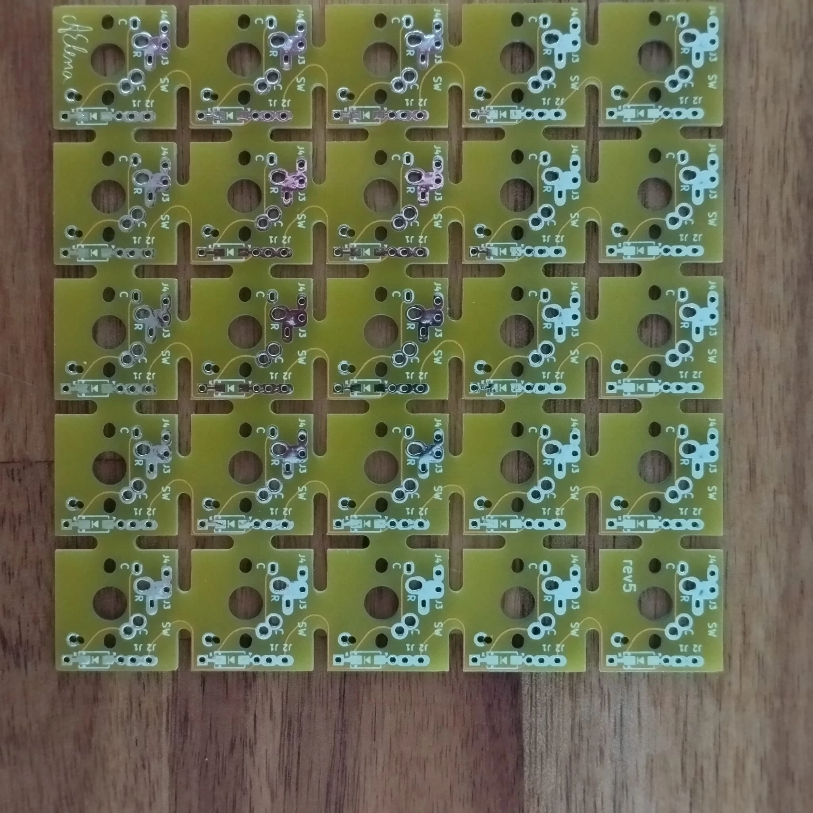
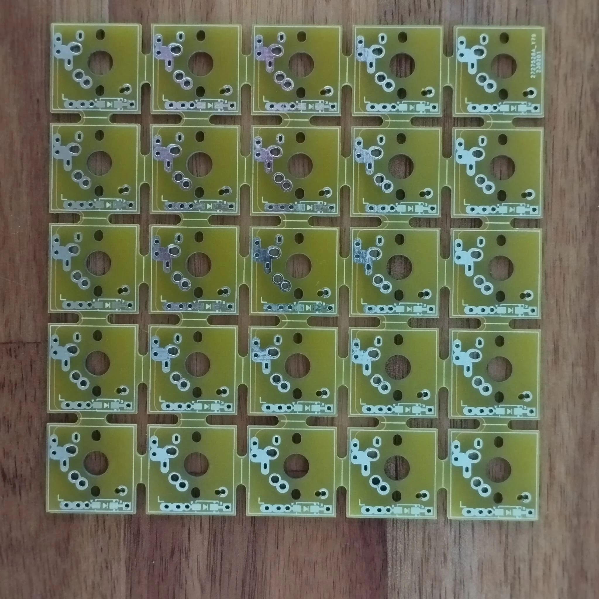
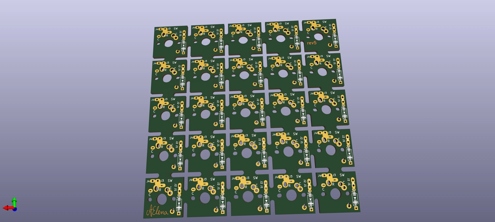
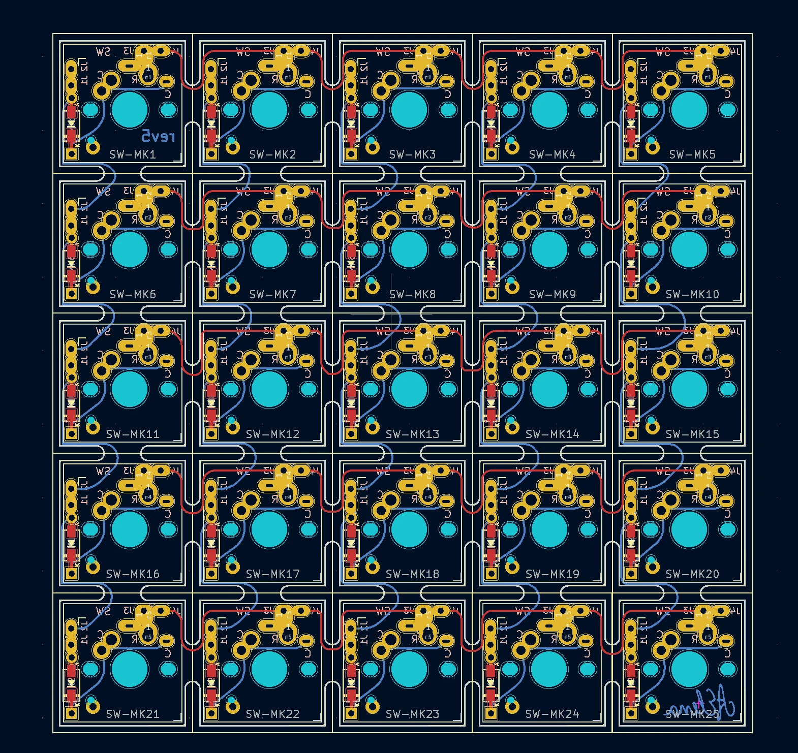

# Handwire Helpers — Modular 5×5 Matrix PCB

  5×5 Modular Switch Grid
  Cherry MX &amp; Kailh Choc v2
  Cut-to-Size Matrix Panel

Handwiring a custom keyboard is rewarding, but point-to-point soldering can be tedious. This project provides a **modular 5×5 switch matrix PCB** supporting both **Cherry MX** and **Kailh Choc v2** footprints that can be scored and cut to your exact row/column dimensions and chained together.

{ loading=lazy }
{ loading=lazy }

## 3D Render & PCB Layout { #render }

{ loading=lazy }
{ loading=lazy }

## Gerbers & KiCad Source { #gerbers }

* [:material-folder-zip: **Ready-Made JLCPCB Gerbers (`gerbers-rev5.zip`)**](https://gitlab.com/m-lego/hand5x5/-/blob/main/gerbers-rev5.zip)
* **Full KiCad Project**: [`m-lego/hand5x5` on GitLab](https://gitlab.com/m-lego/hand5x5) (shared footprints in [`m-lego/m65`](https://gitlab.com/m-lego/m65))
