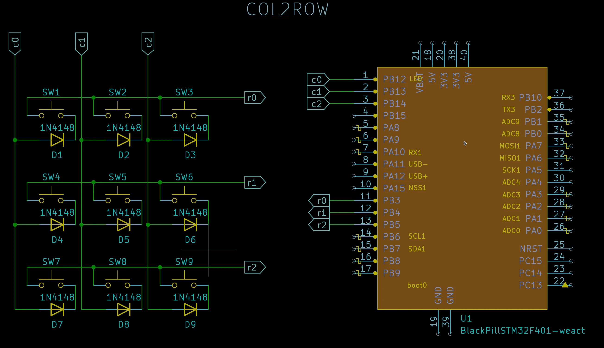
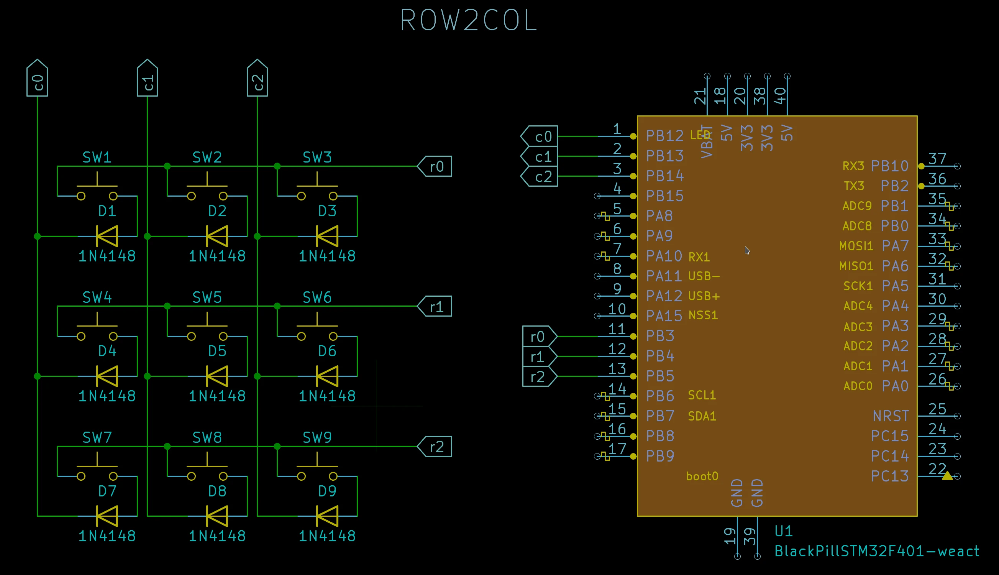
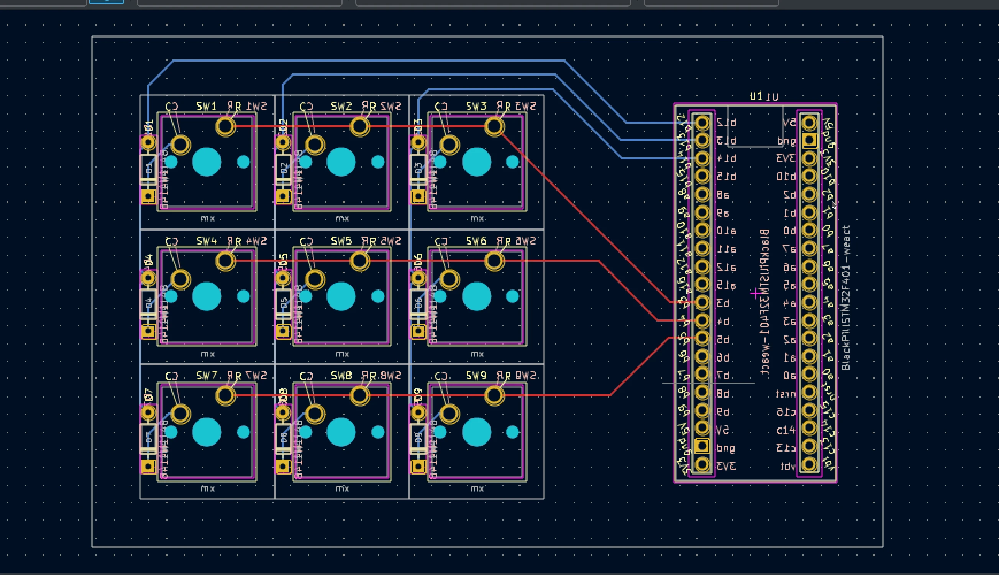
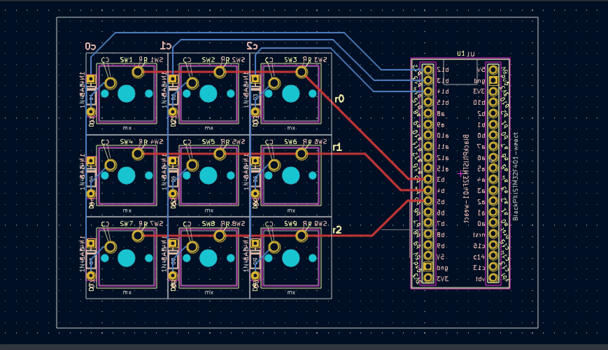
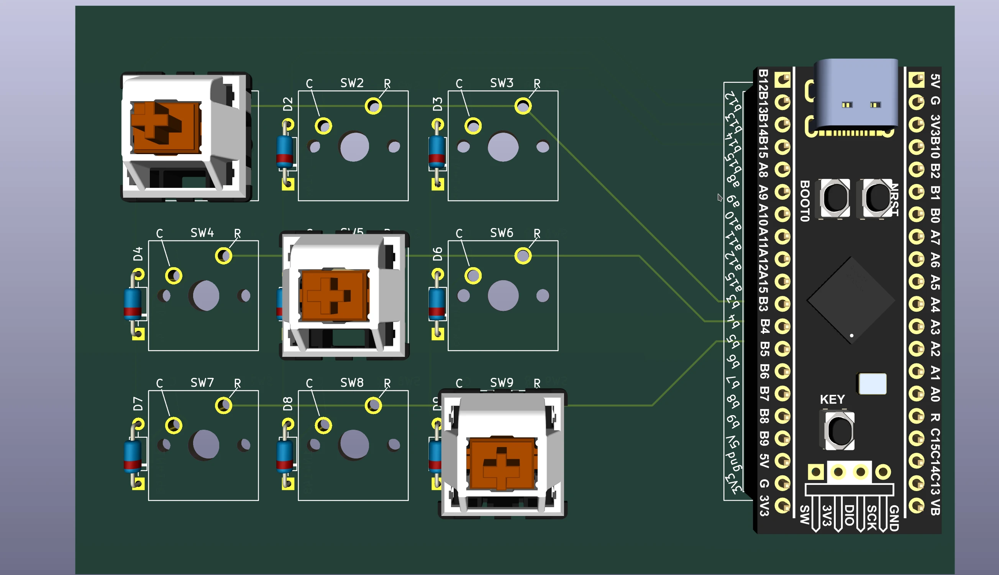
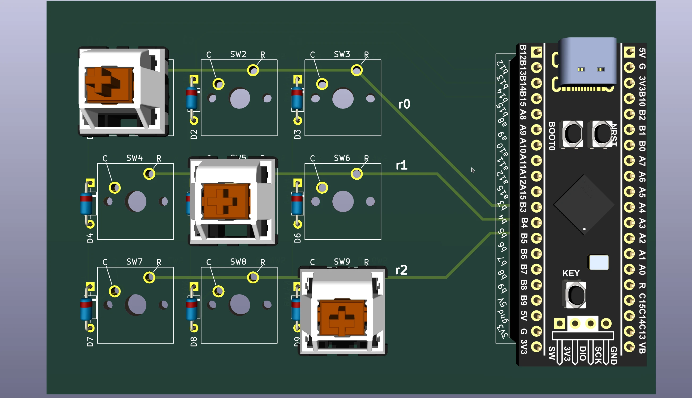
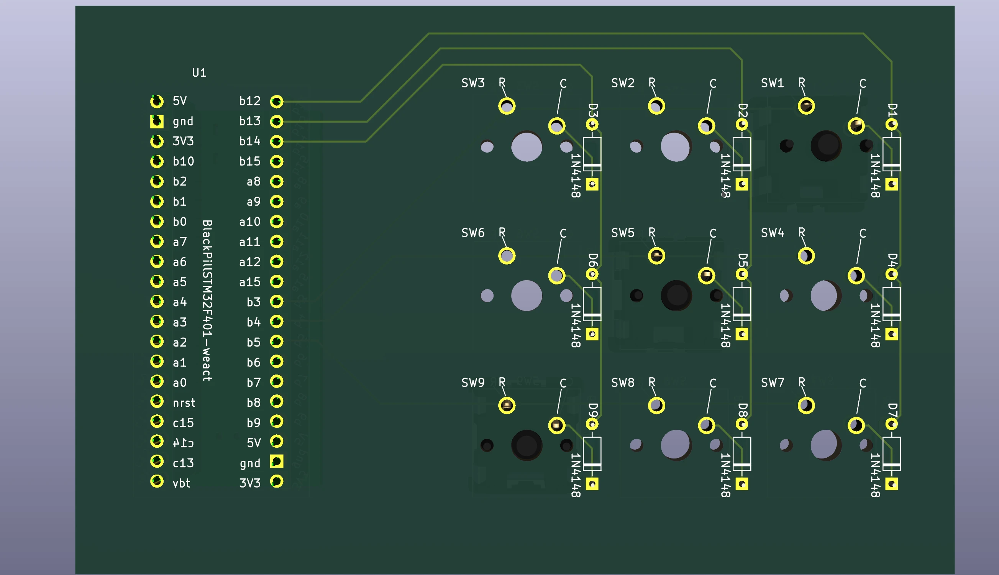
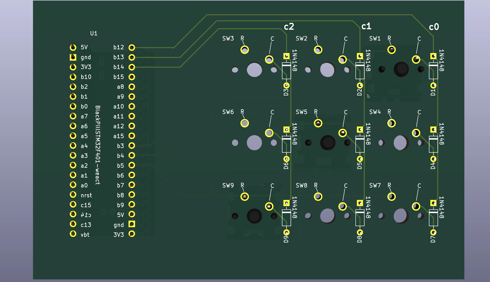

# How a Keyboard Matrix Works — Practical 3×3 Guide

<div class="spec-badges">
  <span class="spec-badge">COL2ROW vs. ROW2COL</span>
  <span class="spec-badge">QMK Data-Driven Config</span>
  <span class="spec-badge">STM32F401 &amp; RP2040</span>
  <span class="spec-badge">KiCad PCB Design</span>
</div>

## Setting Up the Scene { #set-up-the-scene }

If you have read the official QMK guides — [How a Keyboard Matrix Works](https://docs.qmk.fm/#/how_a_matrix_works), [How Keyboards Work](https://docs.qmk.fm/#/how_keyboards_work), and [Understanding QMK's Code](https://docs.qmk.fm/#/understanding_qmk) — and want a concrete, end-to-end example connecting the schematic, diode orientation, QMK firmware, and PCB layout, this guide walks through a complete **3×3 mechanical keypad (`m3x3`)** using a WeAct **`STM32F401` BlackPill** (and **Raspberry Pi Pico `RP2040`**).

!!! note "MCU Pin Quirks"
    Every microcontroller family has its own pin constraints and boot strapping requirements. Always check which pins are reserved or require pull-ups before finalizing a PCB:

    * [WeAct BlackPill `STM32F401CCU6` Pinout](https://stm32-base.org/boards/STM32F401CCU6-WeAct-Black-Pill-V1.2.html) & [`STM32F411CEU6` Pinout](https://stm32-base.org/boards/STM32F411CEU6-WeAct-Black-Pill-V2.0.html)
    * [QMK WeAct BlackPill `STM32F4x1` Platform Notes](https://docs.qmk.fm/#/platformdev_blackpill_f4x1?id=weact-blackpill-stm32f4x1)

### Diode Orientation: `COL2ROW` vs. `ROW2COL`

Adding a `1N4148` signal diode in series with each key switch prevents **ghosting** when multiple keys are pressed simultaneously. Because a diode conducts current in only one direction, there are two valid ways to orient the diodes across your matrix intersections:

| `COL2ROW` (Column → Row) | `ROW2COL` (Row → Column) |
| :---: | :---: |
| { loading=lazy } | { loading=lazy } |
| Diode cathode (black band) points toward the **Row** line | Diode cathode (black band) points toward the **Column** line |

In both circuits above, **Rows (`R0–R2`)** connect to `B3`, `B4`, `B5` and **Columns (`C0–C2`)** connect to `B12`, `B13`, `B14`. The only hardware difference is the direction of the diode!

In QMK's `config.h` (or `info.json`), this is configured via `DIODE_DIRECTION`:

=== "Left Circuit (`COL2ROW`)"

    ```c
    // config.h
    #define DIODE_DIRECTION COL2ROW
    ```

    ```json
    // info.json
    "diode_direction": "COL2ROW"
    ```

=== "Right Circuit (`ROW2COL`)"

    ```c
    // config.h
    #define DIODE_DIRECTION ROW2COL
    ```

    ```json
    // info.json
    "diode_direction": "ROW2COL"
    ```

At this stage, you already have everything needed to write and test the firmware on a breadboard using only the MCU and a few DuPont jumper wires!

---

## Creating a Simple QMK Firmware { #creating-a-simple-firmware }

Once you have [set up your QMK environment](https://docs.qmk.fm/#/newbs_getting_started), QMK's CLI can scaffold the entire keyboard definition automatically.

!!! info "Design Parameters for `m3x3`"
    * **MCU Type**: `blackpill_f401` (or `blackpill_f411`)
    * **Column Pins (`C0–C2`)**: `B12`, `B13`, `B14` *(order matters!)*
    * **Row Pins (`R0–R2`)**: `B3`, `B4`, `B5` *(order matters!)*
    * **Diode Direction**: `COL2ROW`
    * **Keyboard Name**: `m3x3`
    * **GitHub Username / Author**: `alinelena` / `"dr faustroll"`

### Scaffold the Keyboard

```bash
qmk new-keyboard -n "dr faustroll" -u alinelena -t blackpill_f401 -kb m3x3 -l ortho_3x3
```

QMK generates the following directory structure inside `keyboards/m3x3/`:

```text
Ψ Generating a new QMK keyboard directory
Ψ Created a new keyboard called m3x3.
Ψ To start working on things, `cd` into keyboards/m3x3,
Ψ or open the directory in your preferred text editor.
Ψ And build with qmk compile -kb m3x3 -km default.

keyboards/m3x3/
├── config.h
├── info.json
├── keymaps/
│   └── default/
│       └── keymap.c
├── readme.md
└── rules.mk
```

### Configure `info.json` and `keymap.c`

1. **Set Diode Direction (`keyboards/m3x3/info.json`)**:

    ```json
    "diode_direction": "COL2ROW",
    ```

2. **Set Matrix Pins (`keyboards/m3x3/info.json`)**:
    Replace the placeholder pins with our actual row and column pins:

    ```json
    "matrix_pins": {
        "cols": ["B12", "B13", "B14"],
        "rows": ["B3", "B4", "B5"]
    },
    ```

3. **Customize the Keymap (`keyboards/m3x3/keymaps/default/keymap.c`)**:
    See QMK's [Basic Keycodes reference](https://docs.qmk.fm/#/keycodes_basic). Replace the default `KC_A`–`KC_I` block with a 1–9 numpad layout:

    ```c
    [0] = LAYOUT_ortho_3x3(
        KC_7,   KC_8,   KC_9,
        KC_4,   KC_5,   KC_6,
        KC_1,   KC_2,   KC_3
    )
    ```

4. **Compile & Flash**:

    ```bash
    qmk compile -kb m3x3 -km default
    qmk flash -kb m3x3 -km default
    ```

    ```text
    Linking: .build/m3x3_default.elf                                            [OK]
    Creating binary load file for flashing: .build/m3x3_default.bin             [OK]
    Size after:
       text    data     bss     dec     hex filename
          0   23032       0   23032    59f8 m3x3_default.bin
    ```

---

## What If My Layout Is Not Listed in `qmk new-keyboard`? { #my-layout-is-not-listed }

If your exact matrix dimensions aren't listed as a community layout preset, simply bootstrap with the closest larger preset (for example, `ortho_4x4`) and trim `keyboards/m3x3/info.json` and `keymaps/default/keymap.c`:

1. Update `"diode_direction"` and `"matrix_pins"` in `keyboards/m3x3/info.json` to 3 columns and 3 rows as shown above.
2. In `keyboards/m3x3/info.json`, rename `"LAYOUT_ortho_4x4"` to `"LAYOUT_ortho_3x3"` and remove any entries referencing row `3` or column `3`:

    ```json
    "LAYOUT_ortho_3x3": {
        "layout": [
            { "matrix": [0, 0], "x": 0, "y": 0 },
            { "matrix": [0, 1], "x": 1, "y": 0 },
            { "matrix": [0, 2], "x": 2, "y": 0 },
            { "matrix": [1, 0], "x": 0, "y": 1 },
            { "matrix": [1, 1], "x": 1, "y": 1 },
            { "matrix": [1, 2], "x": 2, "y": 1 },
            { "matrix": [2, 0], "x": 0, "y": 2 },
            { "matrix": [2, 1], "x": 1, "y": 2 },
            { "matrix": [2, 2], "x": 2, "y": 2 }
        ]
    }
    ```

3. Update `keyboards/m3x3/keymaps/default/keymap.c` to use `LAYOUT_ortho_3x3` with 9 keys, then compile and flash!

---

## Using Raspberry Pi Pico (`RP2040`) { #i-want-to-use-raspberry-pico-rp2040 }

Switching to an `RP2040` board is just a matter of choosing `-t RP2040` and specifying valid `GPx` pin names:

* [Official Raspberry Pi Pico Pinout PDF](https://datasheets.raspberrypi.com/pico/Pico-R3-A4-Pinout.pdf) *(always verify the pinout diagram for your specific RP2040 clone)*
* [QMK `RP2040` Platform Documentation](https://docs.qmk.fm/#/platformdev_rp2040)

```bash
qmk new-keyboard -n "dr faustroll" -u alinelena -t RP2040 -kb m3x3 -l ortho_3x3
```

Then set your chosen GPIO pins (for example, `GP0`–`GP2` for columns and `GP10`–`GP12` for rows) in `keyboards/m3x3/info.json`:

```json
"diode_direction": "COL2ROW",
"matrix_pins": {
    "cols": ["GP0", "GP1", "GP2"],
    "rows": ["GP10", "GP11", "GP12"]
},
```

---

## Designing the PCB in KiCad { #pcbs }

Once your firmware is tested, you can either [handwire the switches](hand5x5.md) or design a custom PCB in **KiCad**:

* **PCB Design Tutorial**: [ai03's Keyboard PCB Design Guide](https://wiki.ai03.com/books/pcb-design)
* **KiCad Footprints & Symbols**: [ebastler's `marbastlib`](https://github.com/ebastler/marbastlib) and [mechkey.org resources](https://mechkey.org/)

### Side-by-Side PCB Comparison (`COL2ROW` vs. `ROW2COL`)

| View | `COL2ROW` (Column → Row) | `ROW2COL` (Row → Column) |
| :--- | :---: | :---: |
| **KiCad Routed Tracks** | { loading=lazy } | { loading=lazy } |
| **3D Render (Front)** | { loading=lazy } | { loading=lazy } |
| **3D Render (Bottom)** | { loading=lazy } | { loading=lazy } |
