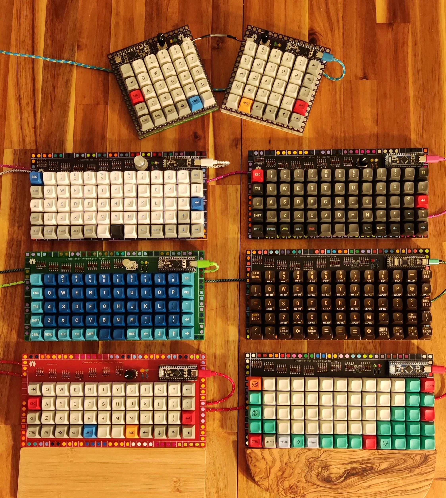
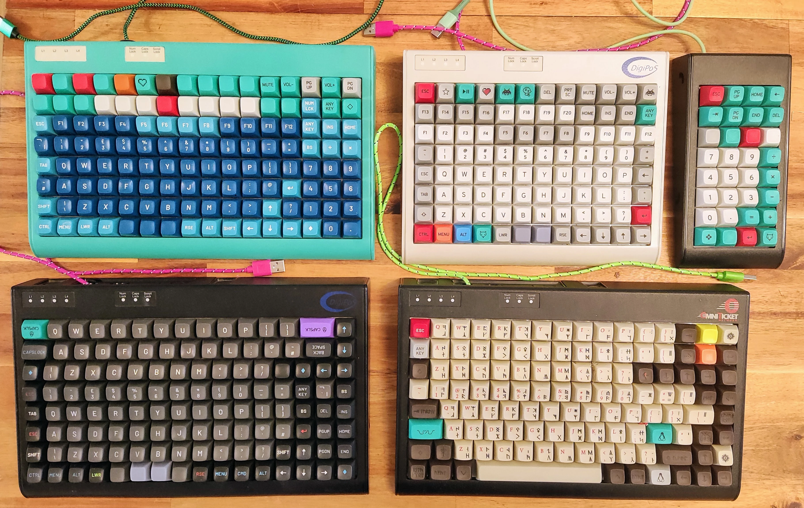
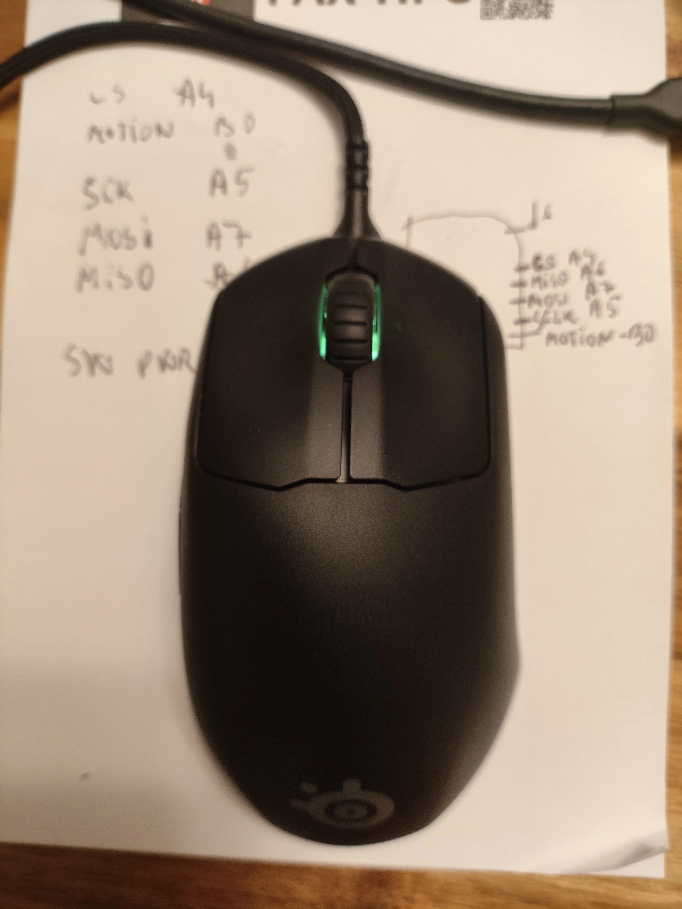

:material-keyboard-variant: Open-Source Hardware & Firmware

# mlego — Modular LEGO Ortholinear Keyboards

Custom ISO-friendly ortholinear mechanical keyboards, macropads, POS terminal conversions, and QMK/ZMK firmware experiments — all mounted in modular LEGO cases.

[Explore Keyboards :material-arrow-right:](keyboards/index.md){ .md-button .md-button--primary }
[Assembly Guide :material-wrench:](assembly.md){ .md-button }
[GitLab Repository :fontawesome-brands-gitlab:](https://gitlab.com/m-lego/m65){ .md-button }

{ loading=lazy }

-   :material-check-decagram:{ .lg .middle } **What This Project Is**

    ---

    * **Fun & experimental** — designed for learning electronics, PCB routing, and firmware
    * **Educational** — documented schematics, shift-register matrices, and QMK/ZMK configs
    * **Functional daily drivers** — full ISO keycap compatibility on compact ortho grids
    * **Budget-friendly** — cheap PCBs and LEGO plate enclosures (until switches & MT3 keycaps!)

-   :material-alert-octagon-outline:{ .lg .middle } **What This Project Is Not**

    ---

    * **Not "endgame"** — this is an evolving maker playground rather than a commercial CNC custom kit
    * Every revision explores a new microcontroller, display technology (OLED, e-ink, Sharp Memory, IPS LCD), or matrix scanning circuit

## Explore the Collection

-   { loading=lazy }

    **:material-keyboard: [Designed Keyboards](keyboards/index.md)**

    ---

    From the flagship **m66** (5×14 with RGB & multi-screen support) and **m65** (5×13 ortho) to the **m60**, **m60 Split**, **m48**, and compact macropads (**m20**, **m8**, **m4**).

    [:octicons-arrow-right-24: Browse 8 keyboard models](keyboards/index.md)

-   { loading=lazy }

    **:material-chip: [Converted POS Keyboards](converted/index.md)**

    ---

    Vintage mechanical **Tipro** point-of-sale terminals rescued from eBay, stripped, repainted, and liberated with custom STM32 daughterboards running QMK.

    [:octicons-arrow-right-24: View 5 Tipro conversions](converted/index.md)

-   { loading=lazy }

    **:material-mouse: [QMK Mice](mice/index.md)**

    ---

    Hardware bootloader unlocking and QMK firmware liberation for the **SteelSeries Prime** gaming mouse (`STM32F103` + `PMW3389` sensor).

    [:octicons-arrow-right-24: Read the Prime conversion guide](prime.md)

-   { loading=lazy }

    **:material-book-open-page-variant: [Hardware & Firmware Guides](extra/index.md)**

    ---

    Step-by-step soldering & LEGO case assembly, SPI shift-register matrix scanning (`74HC595` / `74HC165` / `74HC589`), QMK matrix remapping, and modular 5×5 handwire PCBs.

    [:octicons-arrow-right-24: Explore engineering notes](extra/index.md)

## Motivation & Background

This project started as a fun exploration into building an **ISO-friendly ortholinear keyboard**. Initially conceived as a 6×13 grid, it settled into a **5×13** (and **5×14** with a dedicated rotary encoder column) layout as the sweet spot between compactness and standard ISO keycap compatibility. Read the original story on [Alin's blog](https://alin.elena.space/blog/keeblego/).

If you are exploring similar ortholinear ecosystems, check out the [6×13 Index-Tab](https://github.com/Kyrremann/index-tab), [4×13 Nack](https://github.com/farfalleflickan/nack), [mechkey.org](https://mechkey.org/), and [mechdb.net](https://mechdb.net/).

## What Makes mlego Keyboards Special?

* **Modular LEGO Case**: PCBs are drilled to official LEGO stud pitch and thickness (1.6 mm), snapping directly onto LEGO plates and bricks for customizable height, tilt angle, and colors.
* **Accessible Reference MCUs**: Built around off-the-shelf development boards — `STM32F103` / `GD32F303` BluePill, WeAct `STM32F401`/`F411` BlackPill, `STM32G431`, Raspberry Pi Pico (`RP2040`), Pro Micro `RP2040` (Splinky/Helios), `nice!nano`, and Seeed Studio `XIAO RP2040` / `XIAO nRF52840 BLE`.
* **Shift-Register Matrix Scanning**: Later revisions pack full 65–66 key matrices + displays + encoders onto tiny 11-pin XIAO controllers using chained `74HC595`, `74HC165`, and buffered `74HC589` SPI shift registers.
* **Rich Peripherals**: Clickable EC11 rotary encoders, per-key and underglow RGB LEDs, 128×32 I²C OLEDs, WeAct SSD1680 e-ink displays, Sharp Memory displays, and ST7735 IPS LCDs.

## Keyboard Lineup at a Glance

| Model | Layout | Keys | MCU Platform | Peripherals | Firmware |
| :--- | :--- | :--- | :--- | :--- | :--- |
| [**m66**](m66.md) | 5×14 Ortho | 66 | Pro Micro RP2040 / nice!nano / XIAO | Clickable Encoder, Per-Key RGB, OLED / E-Ink / Sharp / LCD | QMK & ZMK |
| [**m65**](m65.md) | 5×13 Ortho | 65–66 | XIAO RP2040 / BLE, Pico, BlackPill | Rotary Encoder, OLED / E-Ink, RGB Strip | QMK & ZMK |
| [**m60**](m60.md) | 5×12 Ortho | 60 | BlackPill STM32F401 / RP2040 Pico | Rotary Encoder, OLED (Rev 2), RGB Strip | QMK |
| [**m60 Split**](m60_split.md) | 5×12 Split | 60 | 2× BlackPill STM32F401 / F411 | Dual Encoders, RGB Strip, TRS/JST Split | QMK |
| [**m48**](m48.md) | 4×12 Ortho | 48 | BlackPill STM32F401 / F411 | Rotary Encoder, RGB Strip | QMK |
| [**m20**](m20.md) | 5×4 Pad | 20 | RP2040 Pico / WeAct RP2040 | Rotary Encoder, OLED, MX & Choc v2 | QMK |
| [**m8**](m8.md) | 2×4 Pad | 8 | XIAO RP2040 + Shift Registers | Clickable Encoder, SPI E-Ink & I²C OLED | QMK |
| [**m4**](m4.md) | 2×2 Pad | 4 | XIAO nRF52840 BLE / XIAO RP2040 | Rotary Encoder, OLED, 2× `74HC595` | ZMK & QMK |

## Builder Tips & LEGO Tolerances

!!! warning "LEGO Dimensional Tolerances"
    PCB mounting holes are drilled to official LEGO stud dimensions. However, both PCB CNC drills and LEGO injection molds have manufacturing tolerances — and **LEGO clutch power varies slightly by plastic color**.

    * Use **1×2 and 1×4 plates** along the perimeter for the best fit. Longer plates can exert surprising force and slightly bow the PCB.
    * For the 16×32 double-sided baseplate (or two 16×16 plates), gray compatible baseplates tend to sit flattest without flexing the PCB.

!!! tip "Typing Angle vs. Low-Profile Flat Base"
    If you prefer a zero-degree flat typing profile, use a single-sided baseplate with one intermediate plate layer (total thickness ≈ 8 mm). For a ~6° typing angle, stack a full LEGO brick + plate along the rear edge.

!!! tip "Acoustic Foam Dampening"
    Lining the bottom cavity of the LEGO case with inexpensive A4 hobbycraft EVA/neoprene foam sheets makes a dramatic improvement to typing acoustics and eliminates hollow plastic resonance.
