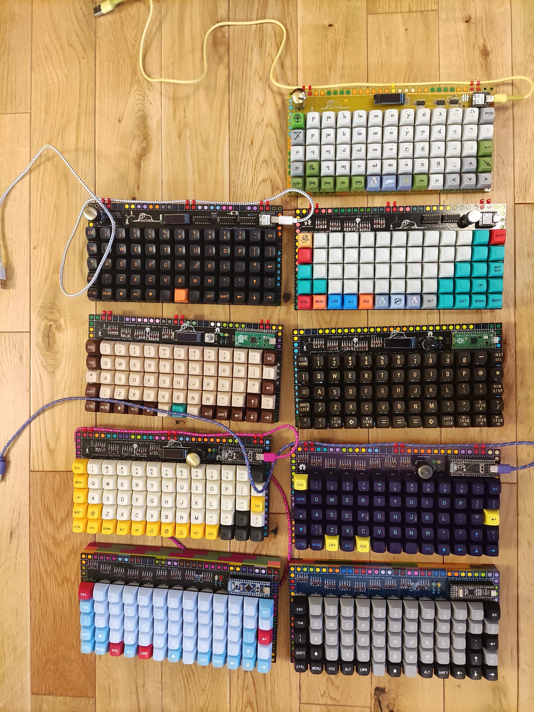
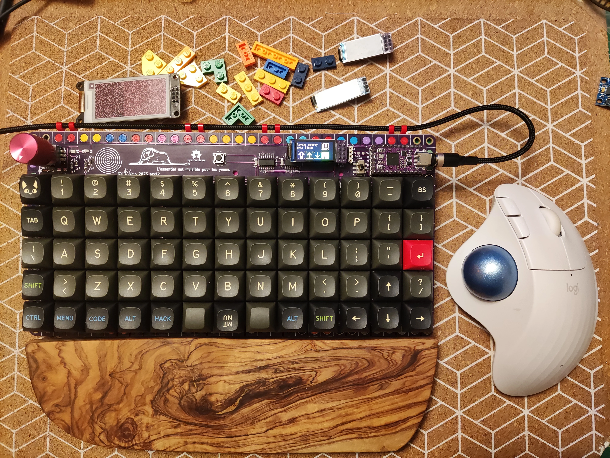
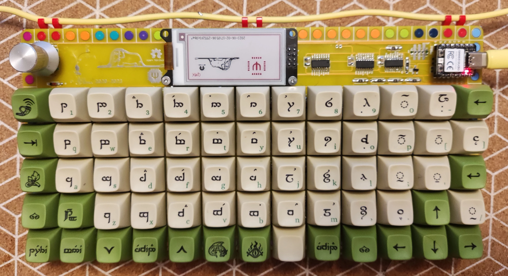
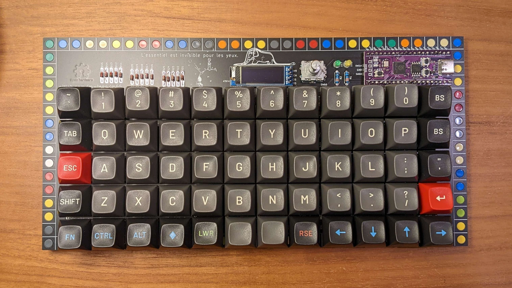
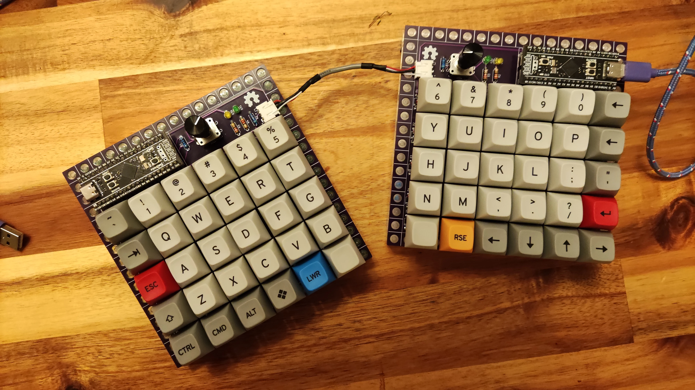
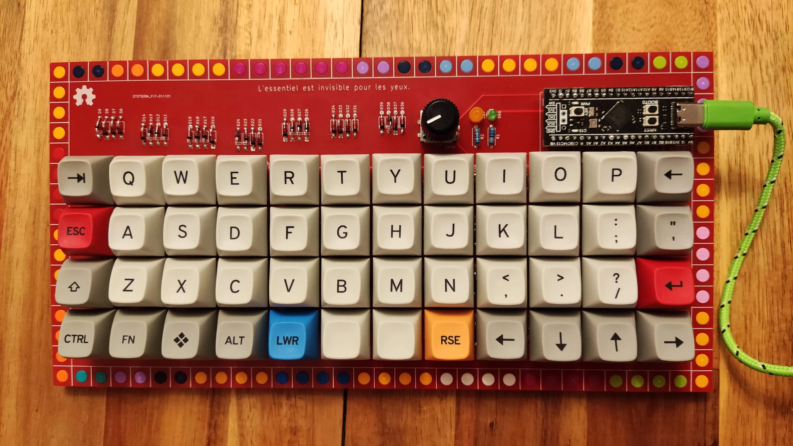
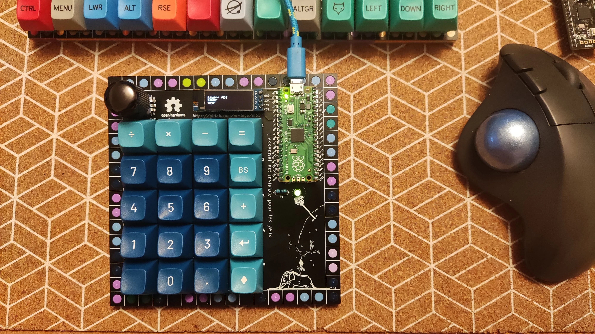
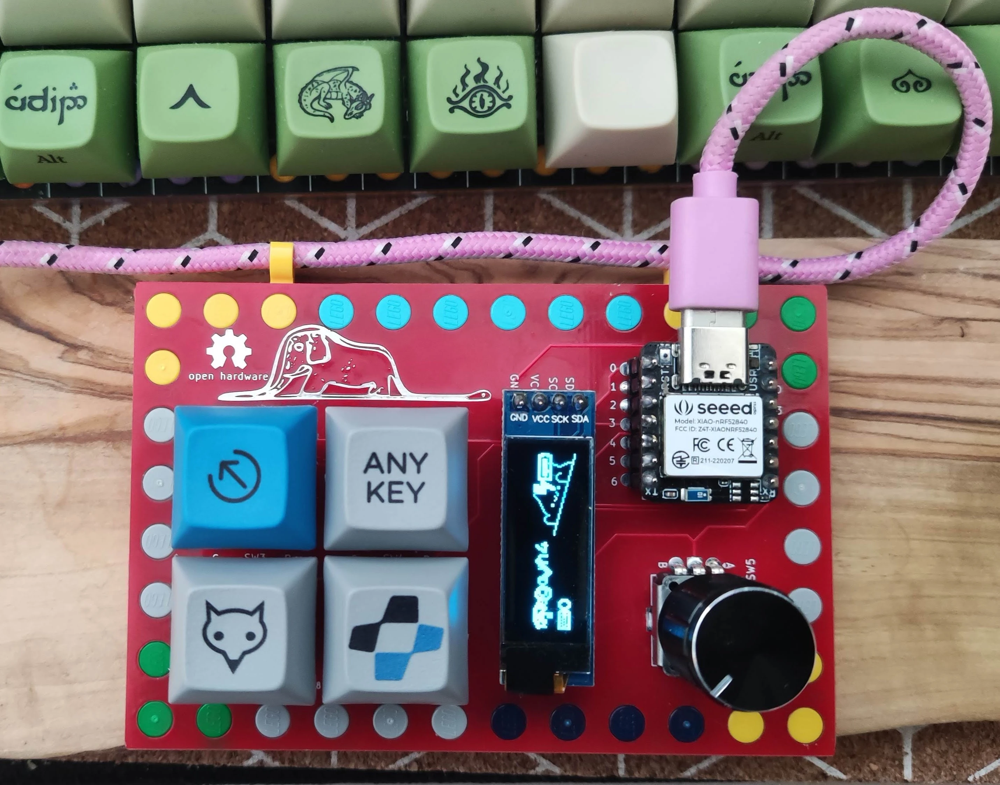

# Designed Keyboards

A family of custom ortholinear mechanical keyboards and macropads designed in KiCad, mounted in modular LEGO enclosures, and powered by QMK and ZMK firmware.

{ loading=lazy }

## Full & Compact Ortholinear Boards

-   { loading=lazy }

    ### [m66 — 5×14 Ortho]( ../m66.md )

    `5×14 Grid` · `RP2040 / nice!nano` · `Per-Key RGB`

    The latest flagship evolution of the m65 series. Features a dedicated clickable encoder column, per-key and underglow RGB, and swappable OLED, Sharp Memory, e-ink, or IPS LCD screens.

    [:octicons-arrow-right-24: m66 Documentation & Gerbers](../m66.md)

-   { loading=lazy }

    ### [m65 — 5×13 Ortho]( ../m65.md )

    `5×13 Grid` · `Rev 1–11` · `QMK & ZMK`

    The original ISO-friendly 65-key LEGO ortholinear keyboard across 11 hardware revisions — evolving from BluePill/BlackPill STM32 boards to Raspberry Pi Pico and Seeed XIAO with SPI shift registers.

    [:octicons-arrow-right-24: m65 Documentation & Revisions](../m65.md)

-   { loading=lazy }

    ### [m60 — 5×12 Ortho]( ../m60.md )

    `5×12 Grid` · `STM32F401 / RP2040` · `Preonic-Style`

    A 60-key Preonic-inspired 5×12 ortholinear board in LEGO with optional rotary encoder, RGB strip, and OLED support on Rev 2.

    [:octicons-arrow-right-24: m60 Documentation](../m60.md)

-   { loading=lazy }

    ### [m60 Split — 5×12 Split]( ../m60_split.md )

    `2× (5×6) Split` · `Dual STM32F401/411` · `Dual Encoders`

    Ergonomic split 5×12 ortholinear keyboard mounted on two 16×16 LEGO plates, featuring dual rotary encoders and RGB underglow.

    [:octicons-arrow-right-24: m60 Split Documentation](../m60_split.md)

-   { loading=lazy }

    ### [m48 — 4×12 Ortho]( ../m48.md )

    `4×12 Grid` · `STM32F401 / F411` · `Planck-Style`

    Ultra-compact 48-key Planck-style 4×12 ortholinear keyboard in a LEGO frame with optional rotary encoder and RGB strip.

    [:octicons-arrow-right-24: m48 Documentation](../m48.md)

## Macropads, Numpads & Hardware Testbeds

-   { loading=lazy }

    ### [m20 — 5×4 Pad]( ../m20.md )

    `5×4 Grid` · `RP2040 Pico` · `MX & Choc v2`

    Versatile 20-key numpad/macropad supporting both 5-pin Cherry MX and Kailh Choc v2 low-profile switches, plus rotary encoder and OLED.

    [:octicons-arrow-right-24: m20 Documentation](../m20.md)

-   { loading=lazy }

    ### [m8 — 2×4 Testbed]( ../m8.md )

    `2×4 Grid` · `74HC595 + 74HC589` · `E-Ink & OLED`

    Compact 8-key engineering testbed demonstrating full SPI shift-register matrix scanning (`74HC595` + `74HC589`) alongside SPI e-ink, I²C OLED, and a clickable encoder.

    [:octicons-arrow-right-24: m8 Documentation](../m8.md)

-   { loading=lazy }

    ### [m4 — 2×2 Pad]( ../m4.md )

    `2×2 Grid` · `XIAO BLE / RP2040` · `ZMK & QMK`

    Tiny 4-key macropad and wireless ZMK playground built to prototype shift-register scanning on Seeed Studio XIAO boards.

    [:octicons-arrow-right-24: m4 Documentation](../m4.md)

