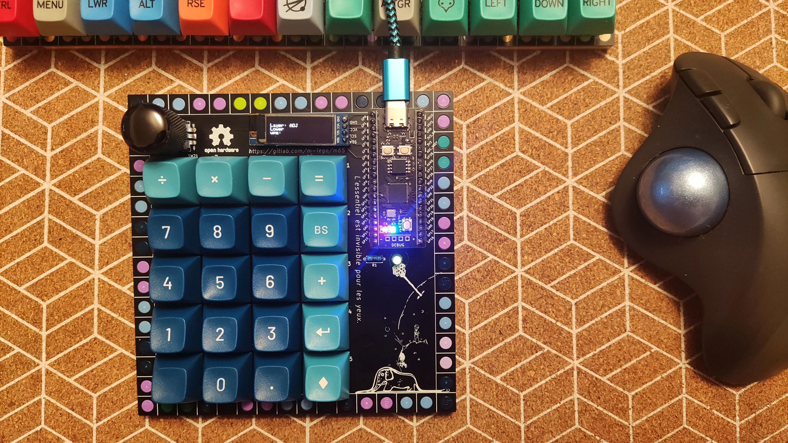
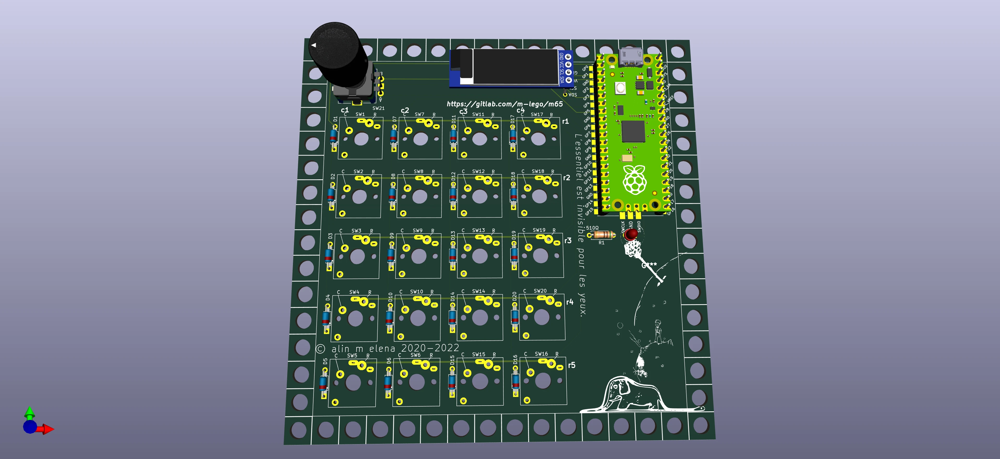
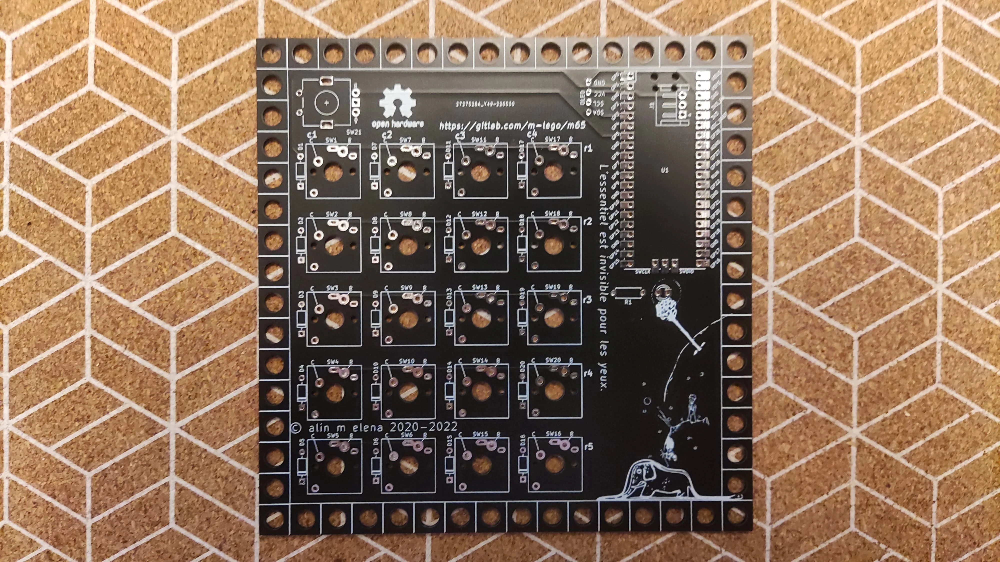
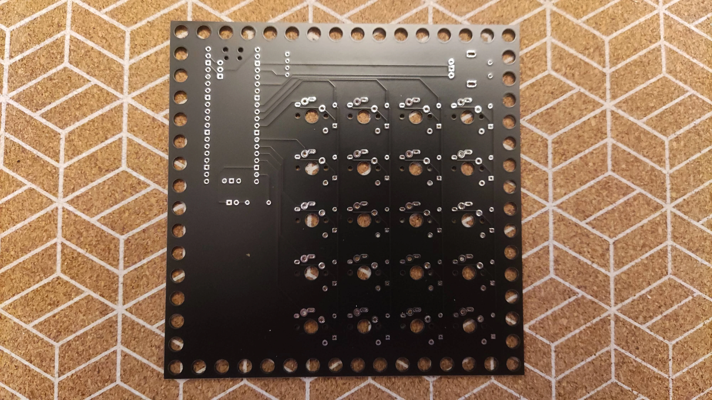
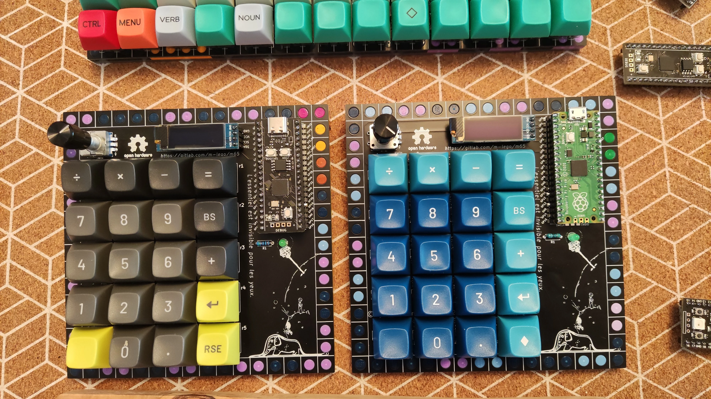
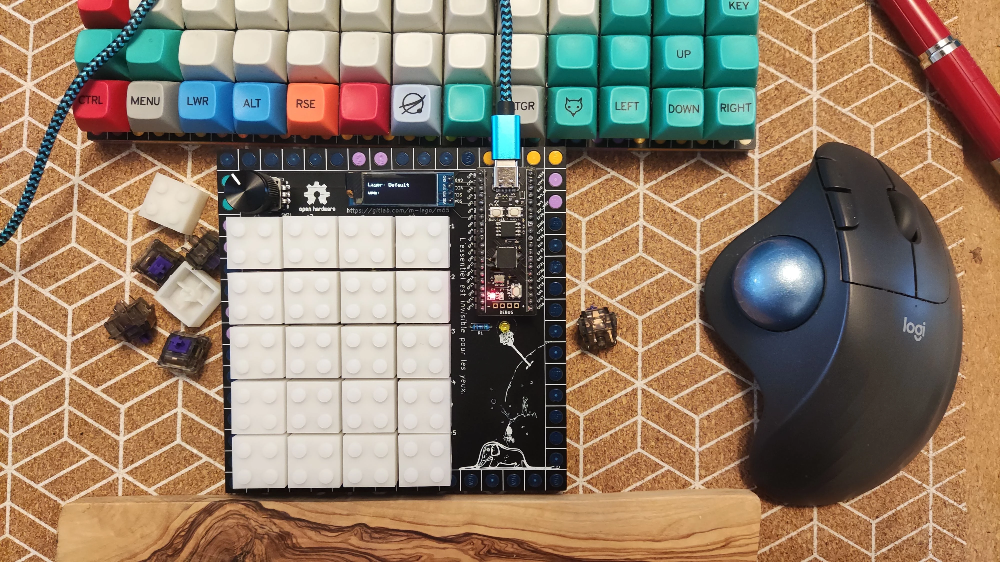
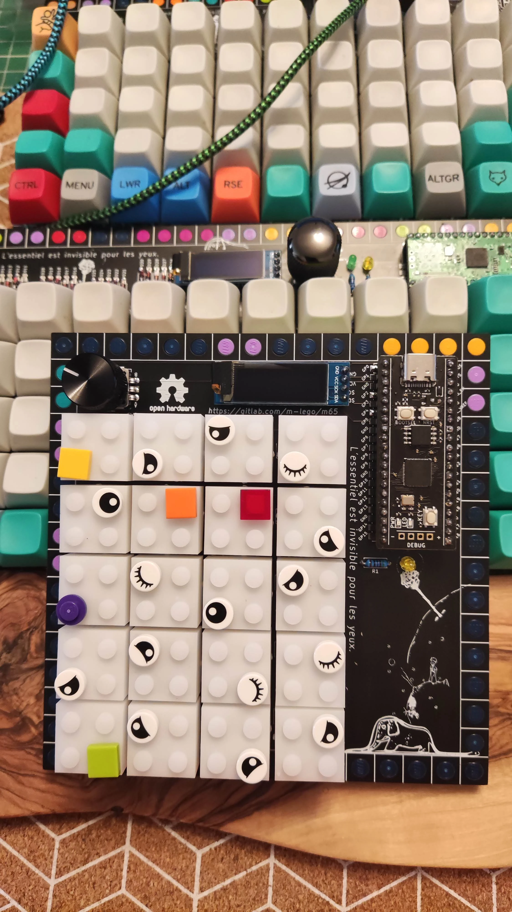

# m20 — 5×4 LEGO Macropad / Numpad

<div class="spec-badges">
  <span class="spec-badge spec-badge--status">Status: Tested &amp; Verified</span>
  <span class="spec-badge">5×4 Ortho (20 Keys)</span>
  <span class="spec-badge">RP2040 Pico / Clones</span>
  <span class="spec-badge">MX &amp; Kailh Choc v2</span>
  <span class="spec-badge">Rotary Encoder + OLED + RGB</span>
  <span class="spec-badge">QMK</span>
</div>

<div class="image-grid" markdown>
{ loading=lazy }
{ loading=lazy }
</div>

A versatile **5×4 ortholinear macropad / numpad** mounted on a $16\times 16$ LEGO baseplate, supporting both 5-pin Cherry MX and low-profile Kailh Choc v2 switches, plus an optional rotary encoder, $\text{I}^2\text{C}$ OLED screen, and RGB LED strip.

!!! success "Status: Tested All OK"

    * [x] Gerbers designed
    * [x] Firmware
    * [x] Breadboard tested
    * [x] Gerbers printed
    * [x] Board tested

## Features

* **Layout**: 5×4 ortholinear (20 keys)
* **Switches**: Dual footprint supporting 5-pin Cherry MX and Kailh Choc v2 switches
* **Controller**: Raspberry Pi Pico (`RP2040`) or compatible clones (WeAct, Teenstar)
* **Peripherals**: Optional EC11 rotary encoder, $\text{I}^2\text{C}$ OLED display, status LED, and 3-pin RGB LED strip
* **Diodes**: Supports both through-hole (DO-35) and surface-mount (SOD-123) `1N4148` diodes
* **Firmware**: QMK

## 3D Render & PCBs { #render }

=== "3D Render"

    { loading=lazy }

=== "Printed PCB (Front & Bottom)"

    <div class="image-grid" markdown>
    { loading=lazy }
    { loading=lazy }
    </div>

## BOM { #bom }

* 1× `RP2040` Raspberry Pi Pico or compatible clone (WeAct, Teenstar)
* 2× 20-pin DIL/DIP sockets and matching headers
* 20× `1N4148` signal diodes (DO-35 through-hole or SOD-123 SMD)
* 20× 5-pin Cherry MX or Kailh Choc v2 switches
* 1× EC11 rotary encoder (optional)
* 1× $510\text{ }\Omega$ resistor + 1× status indicator LED (adjust resistor value for desired LED brightness)
* 1× $\text{I}^2\text{C}$ OLED display (optional)
* 3-pin addressable LED strip (optional)
* LEGO $16\times 16$ baseplate and perimeter bricks/tiles

## Case & Assembly { #case }

* **LEGO Enclosure**: See the [m65 Case & Thickness section](m65.md#case).
* **Soldering & Build**: Follow the step-by-step [Assembly Guide](assembly.md).

## Gerbers & KiCad { #gerbers }

Full KiCad project files and Gerbers are available in the [`m-lego/m20` GitLab repository](https://gitlab.com/m-lego/m20/), using shared symbols and footprints from [`m-lego/m65`](https://gitlab.com/m-lego/m65/).

## Firmware { #firmware }

```bash
git clone --recurse-submodules -b mlego https://github.com/alinelena/qmk_firmware.git qmk-alin
cd qmk-alin
qmk compile -kb mlego/m20/rev1 -km default

# or using make:
make mlego/m20/rev1:default
```

## Pinout Reference { #pins }

* **Columns (C0–C3)**: `GP1`, `GP6`, `GP7`, `GP8`
* **Rows (R0–R4)**: `GP9`, `GP10`, `GP11`, `GP12`, `GP13`
* **Encoder**: `Pad_A = GP4`, `Pad_B = GP5`
* **OLED ($\text{I}^2\text{C}$)**: `SDA = GP2`, `SCL = GP3`

| Indicator / RGB | Pin |
| :--- | :--- |
| `NUM_LOCK` | `GP14` |
| `SCROLL_LOCK` | `GP25` |
| `RGB_DI` | `GP0` |

## Build Gallery { #other-pictures }

<div class="image-grid" markdown>
{ loading=lazy }
{ loading=lazy }
{ loading=lazy }
</div>
