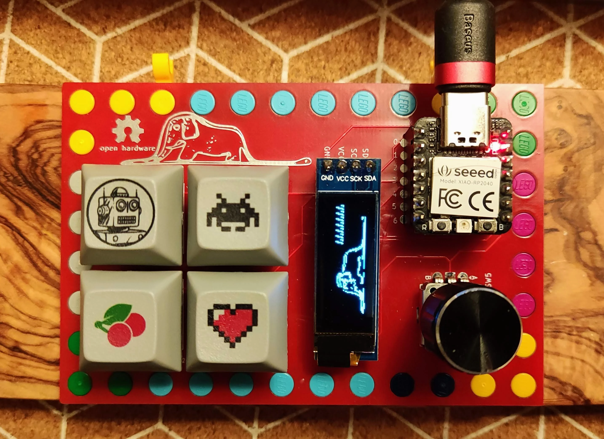
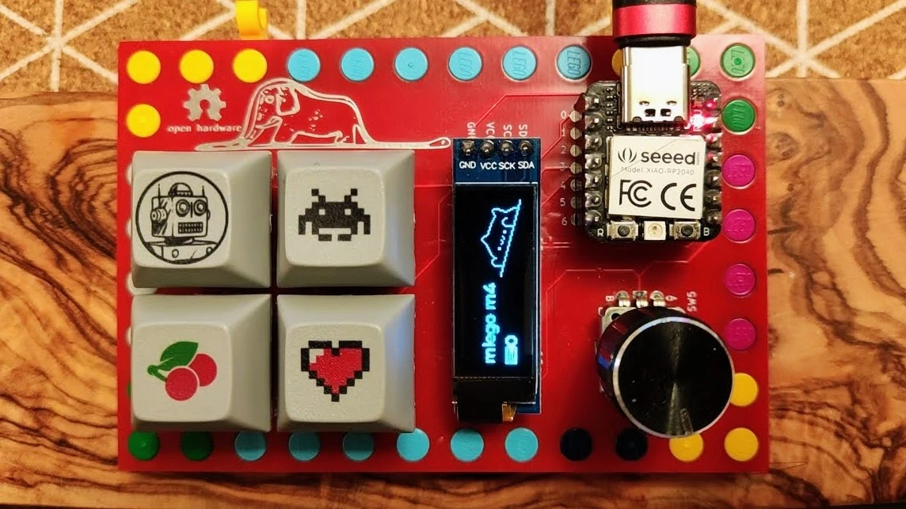
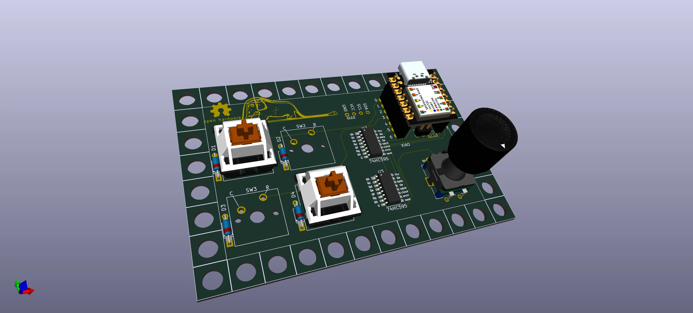
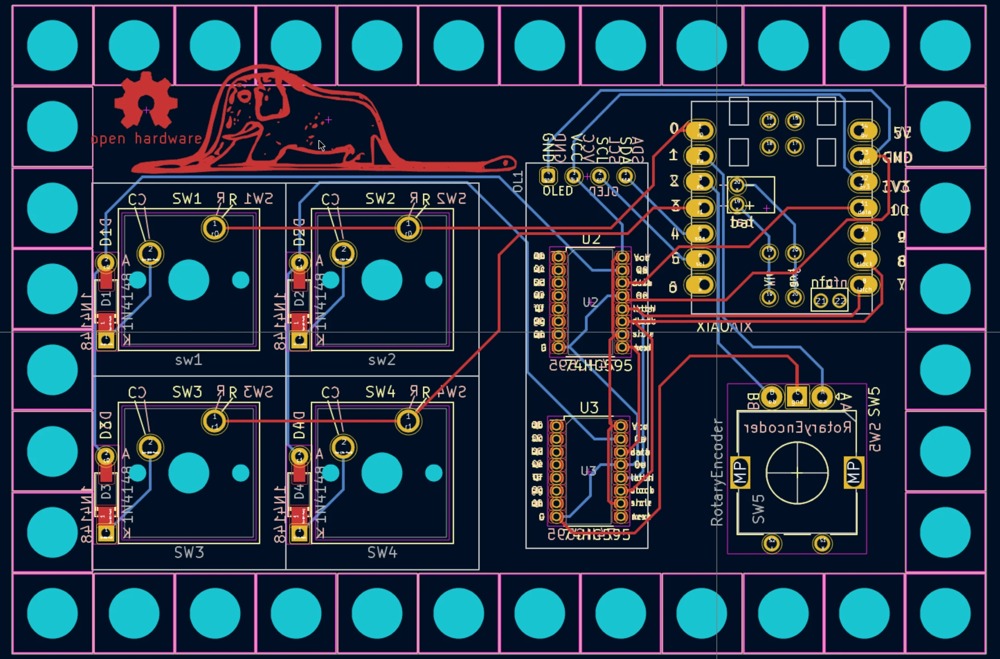
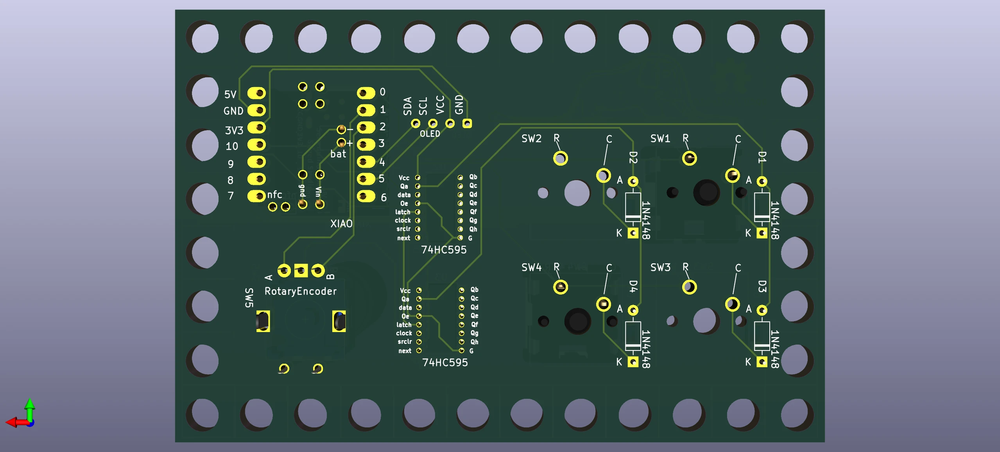
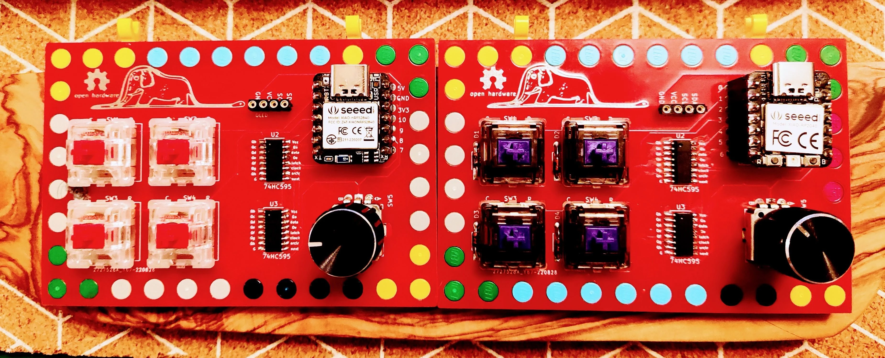
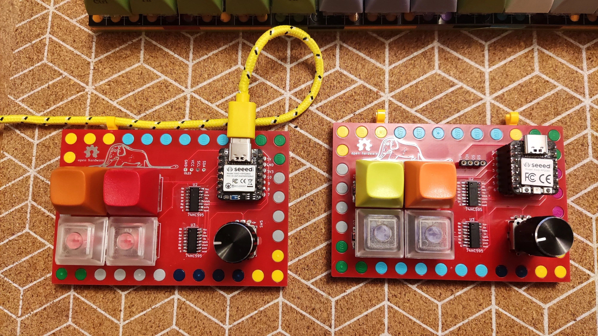
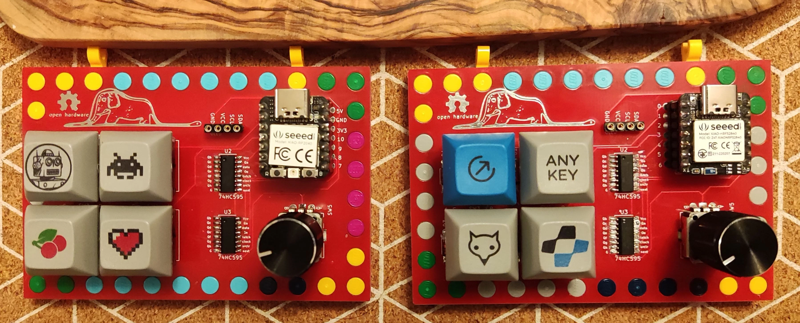

# m4 — 2×2 LEGO Macropad

<div class="spec-badges">
  <span class="spec-badge spec-badge--status">Status: Rev 1 &amp; Rev 2 Tested</span>
  <span class="spec-badge">2×2 Ortho (4 Keys)</span>
  <span class="spec-badge">Seeed XIAO nRF52840 BLE / RP2040</span>
  <span class="spec-badge">2× 74HC595 Shift Registers</span>
  <span class="spec-badge">Rotary Encoder + OLED</span>
  <span class="spec-badge">ZMK &amp; QMK</span>
</div>

<div class="image-grid" markdown>
{ loading=lazy }
{ loading=lazy }
{ loading=lazy }
</div>

A compact **2×2 ortholinear macropad** set in an $8\times 12$ LEGO frame with an optional rotary encoder and $\text{I}^2\text{C}$ OLED display.

Built around the [Seeed Studio XIAO RP2040](https://www.seeedstudio.com/XIAO-RP2040-v1-0-p-5026.html) and [Seeed Studio XIAO BLE nRF52840](https://www.seeedstudio.com/Seeed-XIAO-BLE-nRF52840-p-5201.html), the **m4** served as the hardware and firmware proving ground for chaining two `74HC595` shift registers over SPI before scaling the design up to the 65-key [m65 Rev 7](m65.md).

Other boards in the Seeed XIAO family ([SAMD21](https://www.seeedstudio.com/Seeeduino-XIAO-Arduino-Microcontroller-SAMD21-Cortex-M0+-p-4426.html), [XIAO BLE Sense](https://www.seeedstudio.com/Seeed-XIAO-BLE-Sense-nRF52840-p-5253.html), and [ESP32C3](https://www.seeedstudio.com/Seeed-XIAO-ESP32C3-p-5431.html)) share the same footprint.

!!! success "Status: All OK"

    * [x] Gerbers designed
    * [x] Firmware (ZMK & QMK)
    * [x] Breadboard tested
    * [x] Gerbers printed
    * [x] Board tested

## Features

* **Layout**: 2×2 ortholinear (4 keys, 5-pin PCB-mount MX switches)
* **Controller**: Seeed Studio XIAO nRF52840 BLE (Rev 1) or XIAO RP2040 (Rev 2)
* **Matrix Expansion**: 2× chained `74HC595` SMD shift registers
* **Peripherals**: Optional EC11 rotary encoder and $\text{I}^2\text{C}$ OLED display
* **Firmware**: ZMK (BLE & RP2040) and QMK (RP2040)

## 3D Render & PCBs { #render }

=== "3D Render"

    { loading=lazy }

=== "KiCad PCB (Front & Back)"

    <div class="image-grid" markdown>
    { loading=lazy }
    { loading=lazy }
    </div>

## BOM { #bom }

* 1× [Seeed Studio XIAO BLE nRF52840](https://www.seeedstudio.com/Seeed-XIAO-BLE-nRF52840-p-5201.html) or [Seeed Studio XIAO RP2040](https://www.seeedstudio.com/XIAO-RP2040-v1-0-p-5026.html)
* 2× 7-pin DIL/DIP female sockets + matching male headers
* 2× `74HC595` surface-mount shift registers (SOIC-16)
* 4× `1N4148` signal diodes (DO-35 through-hole or SOD-123 SMD)
* 4× 5-pin Cherry MX–compatible switches
* 1× EC11 rotary encoder (optional)
* 1× $\text{I}^2\text{C}$ OLED display (optional)
* LEGO $8\times 12$ baseplate (or 2× $4\times 12$ plates) and perimeter bricks/plates

## Case & Assembly { #case }

* **LEGO Enclosure**: Uses an $8\times 12$ plate base (or two $4\times 12$ plates). See the [m65 Case section](m65.md#case) for stacking details.
* **Soldering & Build**: Follow the step-by-step [Assembly Guide](assembly.md).

## Gerbers & KiCad { #gerbers }

* [:material-folder-zip: **Rev 1 Gerbers**](https://gitlab.com/m-lego/m4/-/blob/main/gerbers.zip)
* **Shift-Register KiCad Project**: [`m-lego/m4` on GitLab](https://gitlab.com/m-lego/m4/)
* **Direct-Pin KiCad Project (v2)**: [`m-lego/m2x2-v2` on GitLab](https://gitlab.com/m-lego/m2x2-v2)

## Firmware { #firmware }

=== "Rev 1 — XIAO nRF52840 (ZMK)"

    * **Prebuilt UF2**: [firmware/mlego2x2_rev1-seeeduino_xiao_ble-zmk.uf2](https://gitlab.com/m-lego/m4/-/blob/main/firmware/mlego2x2_rev1-seeeduino_xiao_ble-zmk.uf2)
    * **Source**: [`alinelena/mlego-zmk`](https://github.com/alinelena/mlego-zmk)

=== "Rev 2 — XIAO RP2040 (QMK & ZMK)"

    * **Prebuilt ZMK UF2**: [firmware/mlego2x2_rev2-seeeduino_xiao_rp2040-zmk.uf2](https://gitlab.com/m-lego/m4/-/blob/main/firmware/mlego2x2_rev2-seeeduino_xiao_rp2040-zmk.uf2) ([ZMK RP2040 source](https://github.com/alinelena/mlego-zmk-rp2040))
    * **Prebuilt QMK UF2**: [firmware/mlego_m4_rev2_default.uf2](https://gitlab.com/m-lego/m4/-/blob/main/firmware/mlego_m4_rev2_default.uf2) ([QMK source](https://github.com/alinelena/qmk_firmware/tree/mlego/keyboards/mlego/m4))

    Compile QMK from source:

    ```bash
    git clone --recurse-submodules -b mlego https://github.com/alinelena/qmk_firmware.git qmk-alin
    cd qmk-alin
    qmk compile -kb mlego/m4/rev2 -km default
    ```

## Pinout Reference { #pins }

* **Rows**: `1 (D0)`, `4 (D3)`
* **Columns**:
    * `C0`: Shift Register 1 — `QA`
    * `C1`: Shift Register 2 — `QA`
* **`74HC595N` Shift Registers**:
    * `Data (MOSI)`: `11 (D10)`
    * `Latch (RCLK)`: `8 (D7)`
    * `Clock (SRCLK)`: `9 (D8)`
* **Encoder**: `Pad_A = 2 (D1)`, `Pad_B = 3 (D2)`
* **OLED ($\text{I}^2\text{C}$)**: `SDA = 5 (D4)`, `SCL = 6 (D5)`

## Additional Photos { #other-pictures }

<div class="image-grid" markdown>
{ loading=lazy }
{ loading=lazy }
{ loading=lazy }
</div>
