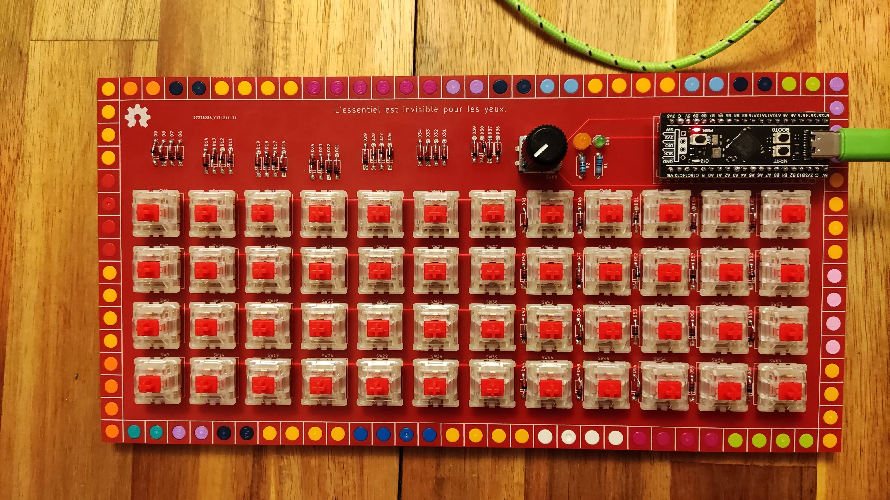
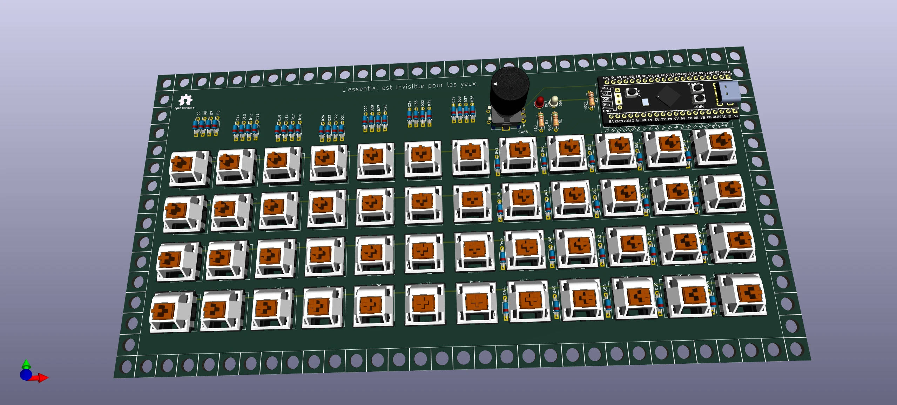
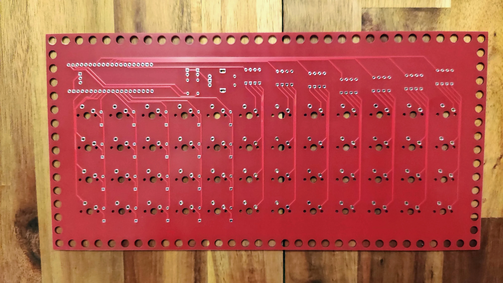
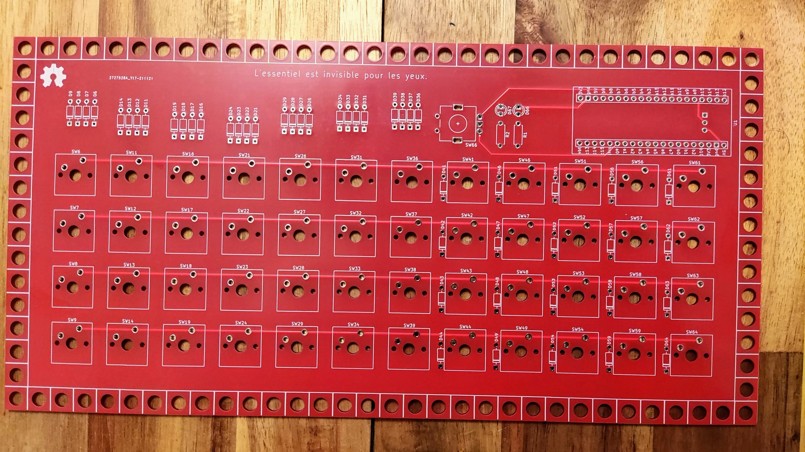
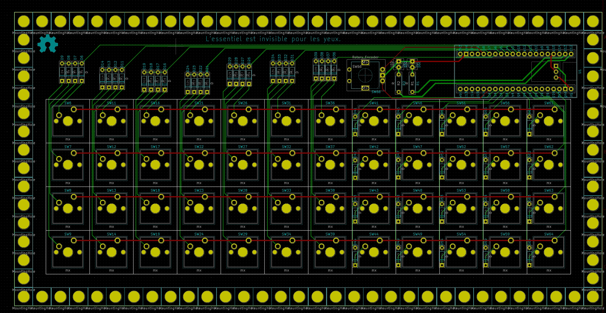

# m48 — 4×12 Planck-Style LEGO Keyboard

<div class="spec-badges">
  <span class="spec-badge spec-badge--status">Status: Tested &amp; Verified</span>
  <span class="spec-badge">4×12 Ortho (48 Keys)</span>
  <span class="spec-badge">STM32F401 / F411 BlackPill</span>
  <span class="spec-badge">Rotary Encoder + RGB Strip</span>
  <span class="spec-badge">QMK</span>
</div>

<div class="image-grid" markdown>
{ loading=lazy }
{ loading=lazy }
</div>

A compact, Planck-style **4×12 ortholinear mechanical keyboard** mounted in a modular LEGO enclosure with an optional rotary encoder and addressable LED strip.

!!! success "Status: Tested All OK!"

    * [x] Gerbers designed
    * [x] Firmware
    * [x] Breadboard tested
    * [x] Gerbers printed
    * [x] Board tested

## Features

* **Layout**: 4×12 ortholinear (48 keys, 5-pin PCB-mount MX switches)
* **Controller**: WeAct [`STM32F401` or `STM32F411` BlackPill](https://github.com/WeActTC/MiniSTM32F4x1)
* **Peripherals**: 1× EC11 rotary encoder, status LED, optional 3-pin RGB LED strip
* **Firmware**: QMK

## 3D Render & PCBs { #3d-render }

=== "3D Render"

    { loading=lazy }

=== "Printed PCB (Front & Back)"

    <div class="image-grid" markdown>
    { loading=lazy }
    { loading=lazy }
    </div>

=== "KiCad Layout"

    { loading=lazy }

## BOM { #bom }

* 1× WeAct `STM32F401` BlackPill with headers
* 1× 40-pin DIL/DIP socket
* 48× `1N4148` signal diodes (DO-35 through-hole)
* 48× 5-pin Cherry MX–compatible switches
* 1× EC11 rotary encoder
* 2× 220 Ω or 350 Ω resistors (for status LEDs and boot pull-up; see [m65 BOM notes](m65.md#bom))
* 1× status indicator LED
* Optional: 3-pin addressable LED strip
* LEGO 16×32 baseplate and perimeter plates/bricks

## Case & Assembly { #case }

* **LEGO Enclosure**: See the [m65 Case & Thickness section](m65.md#case).
* **Soldering & Build**: Follow the step-by-step [Assembly Guide](assembly.md).

## Gerbers & KiCad { #gerbers }

Production-ready Gerbers for JLCPCB:

* [:material-folder-zip: **Rev 1 Gerbers (`STM32F401`)**](https://gitlab.com/m-lego/m48/-/blob/main/gerbers-stm32f401.zip)

Full KiCad project files are available in [`m-lego/m48` on GitLab](https://gitlab.com/m-lego/m48/). Prebuilt UF2 firmware is available at [`mlego_m48_rev1_default.uf2`](https://gitlab.com/m-lego/m48/-/blob/main/firmware/mlego_m48_rev1_default.uf2).

## Firmware { #firmware }

```bash
git clone --recurse-submodules -b mlego https://github.com/alinelena/qmk_firmware.git qmk-alin
cd qmk-alin

qmk compile -kb m-lego/m48/rev1 -km default

# or using make:
make m-lego/m48/rev1:default
```

## Pinout Reference { #pins }

* **Columns (C0–C11)**: `A10`, `A15`, `B3`, `B4`, `B5`, `B7`, `B6`, `A1`, `A2`, `A3`, `A4`, `A5`
* **Rows (R0–R3)**: `A6`, `A7`, `B0`, `B10`
* **Encoder**: `Pad_A = A0`, `Pad_B = A8`

| Indicator / RGB | Pin |
| :--- | :--- |
| `NUM_LOCK` | `B12` |
| `CAPS_LOCK` | `C13` |
| `SCROLL_LOCK` | `B13` |
| `RGB_DI` | `B15` |
