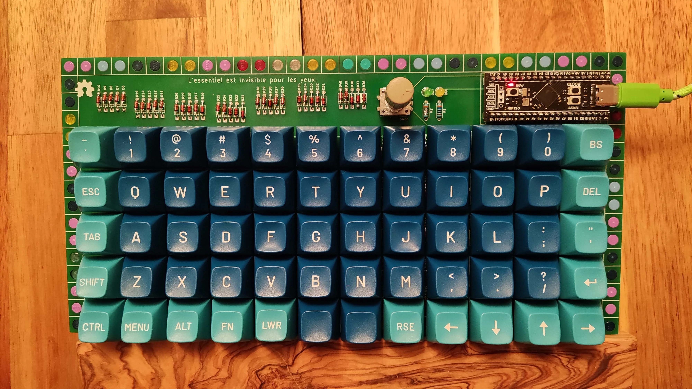
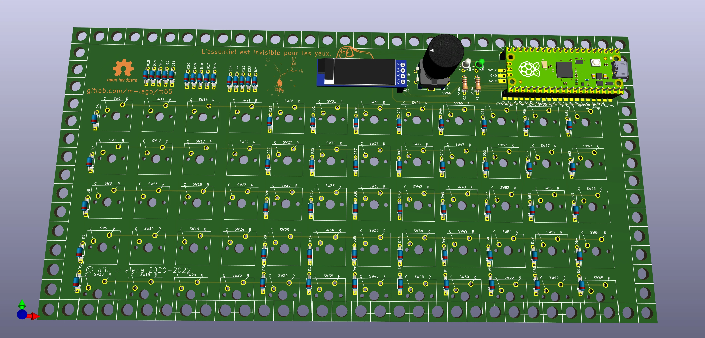
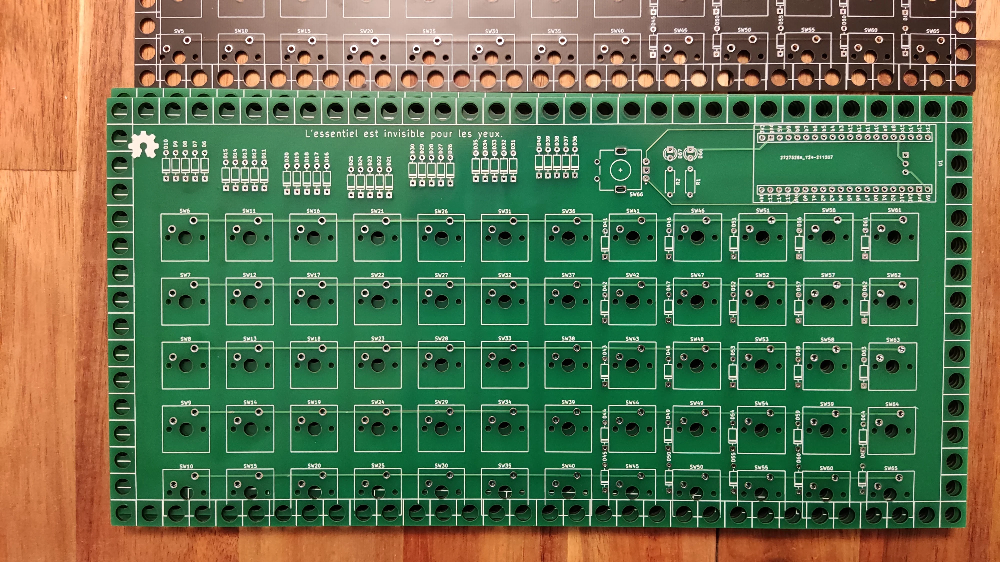
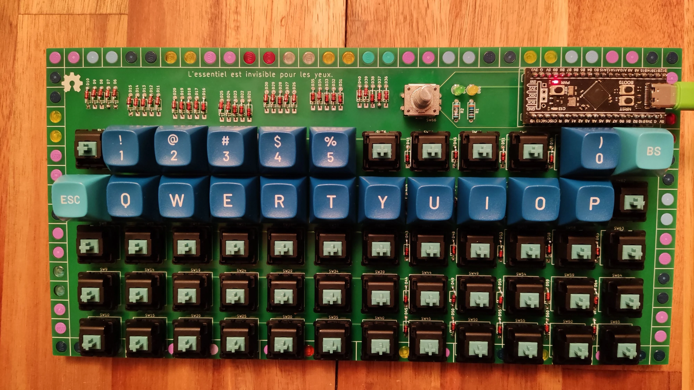

# m60 — 5×12 LEGO Ortholinear Keyboard

<div class="spec-badges">
  <span class="spec-badge spec-badge--status">Status: Rev 1 &amp; Rev 2 Tested</span>
  <span class="spec-badge">5×12 Ortho (60 Keys)</span>
  <span class="spec-badge">STM32F401 / RP2040 Pico</span>
  <span class="spec-badge">Rotary Encoder + OLED (Rev 2)</span>
  <span class="spec-badge">QMK (UF2)</span>
</div>

<div class="image-grid" markdown>
{ loading=lazy }
{ loading=lazy }
</div>

A Preonic-inspired **5×12 ortholinear mechanical keyboard** mounted in a modular LEGO case, featuring an optional rotary encoder, RGB underglow strip, and $\text{I}^2\text{C}$ OLED support (Rev 2, thanks to `@yyhazy`).

!!! success "Status: Rev 1 & Rev 2 Tested"

    * [x] Gerbers designed
    * [x] Firmware
    * [x] Breadboard tested
    * [x] Gerbers printed
    * [x] Board tested

## Features

* **Layout**: 5×12 ortholinear (60 keys, 5-pin PCB-mount MX switches)
* **Controller**:
    * **Rev 1**: WeAct [`STM32F401`/`F411` BlackPill](https://github.com/WeActTC/MiniSTM32F4x1)
    * **Rev 2**: Raspberry Pi Pico (`RP2040`) or compatible pinout
* **Peripherals**: Optional EC11 rotary encoder, 3-pin addressable LED strip, and $\text{I}^2\text{C}$ OLED display (Rev 2)
* **Firmware**: QMK with UF2 drag-and-drop flashing by default

## 3D Render & PCBs { #render }

=== "Rev 2 3D Render"

    { loading=lazy }

=== "Rev 1 PCB"

    { loading=lazy }

## BOM { #bom }

=== "Rev 2 (RP2040 Pico)"

    * 1× Raspberry Pi Pico (`RP2040`) or compatible pinout module
    * 60× `1N4148` signal diodes (DO-35 through-hole)
    * 60× 5-pin Cherry MX–compatible switches
    * 1× EC11 rotary encoder (optional)
    * 1× $\text{I}^2\text{C}$ OLED module (optional)
    * 2× $220\text{ }\Omega$ or $350\text{ }\Omega$ LED resistors (select value for your LED color and brightness)
    * 2× status indicator LEDs
    * 1× 40-pin DIL/DIP socket (or two 20-pin female headers)
    * 3-pin RGB LED strip (optional)
    * LEGO $16\times 32$ baseplate and perimeter plates/bricks

=== "Rev 1 (STM32F401)"

    * 1× WeAct `STM32F401` BlackPill
    * 60× `1N4148` signal diodes (DO-35 through-hole)
    * 60× 5-pin Cherry MX–compatible switches
    * 1× EC11 rotary encoder (optional)
    * 2× $220\text{ }\Omega$ or $350\text{ }\Omega$ LED resistors
    * 2× status indicator LEDs
    * 1× 40-pin DIL/DIP socket
    * 3-pin RGB LED strip (optional)
    * LEGO $16\times 32$ baseplate and perimeter plates/bricks

## Case & Assembly { #case }

* **LEGO Enclosure**: See the [m65 Case & Thickness section](m65.md#case) for plate dimensions and stacking options.
* **Soldering & Build**: Follow the step-by-step [Assembly Guide](assembly.md).

## Gerbers & KiCad { #gerbers }

Production-ready Gerbers for JLCPCB:

* [:material-folder-zip: **Rev 1 Gerbers (`STM32F401`)**](https://gitlab.com/m-lego/m60/-/blob/main/gerbers-stm32f401.zip)
* [:material-folder-zip: **Rev 2 Gerbers (`RP2040`)**](https://gitlab.com/m-lego/m60/-/blob/main/gerbers-rp2040.zip)

Full KiCad project files are available in the [`m-lego/m60` GitLab repository](https://gitlab.com/m-lego/m60/), using shared symbols and footprints from [`m-lego/m65`](https://gitlab.com/m-lego/m65/).

## Firmware { #firmware }

=== "Rev 2 (`RP2040`)"

    Download prebuilt UF2: [mlego_m60_rev1_default.uf2](https://gitlab.com/m-lego/m60/-/blob/main/firmware/mlego_m60_rev1_default.uf2) or compile from source:

    ```bash
    git clone --recurse-submodules -b mlego https://github.com/alinelena/qmk_firmware.git qmk-alin
    cd qmk-alin
    qmk compile -kb mlego/m60/rev2 -km default

    # or using make:
    make mlego/m60/rev2:default
    ```

=== "Rev 1 (`STM32F401`)"

    Download prebuilt UF2: [mlego_m60_rev1_default.uf2](https://gitlab.com/m-lego/m60/-/blob/main/firmware/mlego_m60_rev1_default.uf2) (requires [TinyUF2 bootloader](https://github.com/adafruit/tinyuf2) installed on the STM32F401):

    ```bash
    git clone --recurse-submodules -b mlego https://github.com/alinelena/qmk_firmware.git qmk-alin
    cd qmk-alin
    qmk compile -kb mlego/m60/rev1 -km default

    # or using make:
    make mlego/m60/rev1:default
    ```

## Pinout Reference { #pins }

=== "Rev 2 (`RP2040`)"

    * **Columns (C0–C11)**: `GP1`, `GP6`, `GP7`, `GP8`, `GP9`, `GP15`, `GP14`, `GP13`, `GP12`, `GP11`, `GP10`, `GP21`
    * **Rows (R0–R4)**: `GP19`, `GP16`, `GP17`, `GP18`, `GP20`
    * **Encoder**: `Pad_A = GP4`, `Pad_B = GP5`
    * **OLED ($\text{I}^2\text{C}$)**: `SDA = GP2`, `SCL = GP3`

    | Indicator / RGB | Pin |
    | :--- | :--- |
    | `NUM_LOCK` | `GP22` |
    | `CAPS_LOCK` | `GP25` |
    | `SCROLL_LOCK` | `GP27` |
    | `RGB_DI` | `GP0` |

=== "Rev 1 (`STM32F401`)"

    * **Columns (C0–C11)**: `A10`, `A15`, `B3`, `B4`, `B5`, `B7`, `B6`, `A1`, `A2`, `A3`, `A4`, `A5`
    * **Rows (R0–R4)**: `A6`, `A7`, `B0`, `B1`, `B10`
    * **Encoder**: `Pad_A = A0`, `Pad_B = A8`

    | Indicator / RGB | Pin |
    | :--- | :--- |
    | `NUM_LOCK` | `B12` |
    | `CAPS_LOCK` | `C13` |
    | `SCROLL_LOCK` | `B13` |
    | `RGB_DI` | `B15` |

## Additional Photos

{ loading=lazy }
