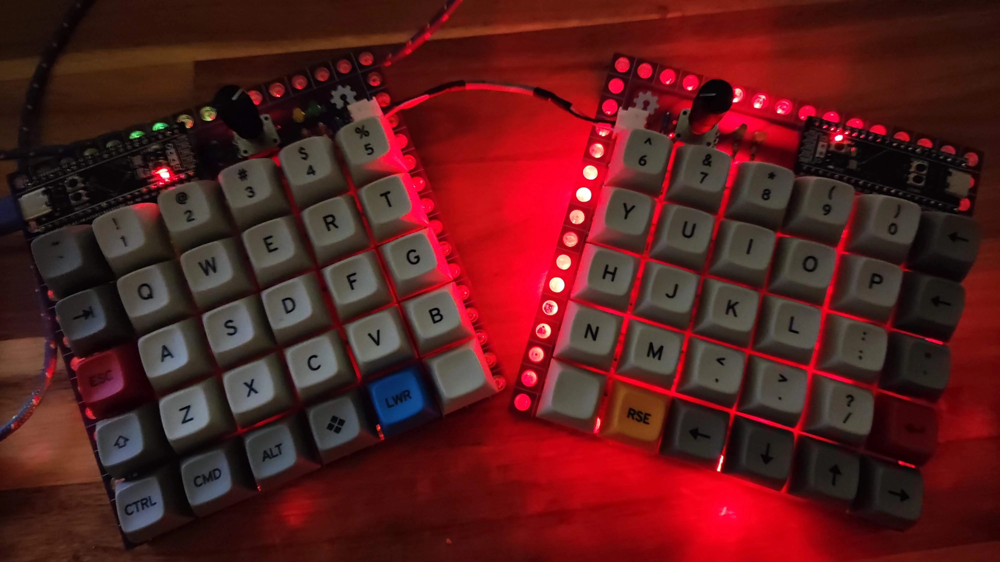
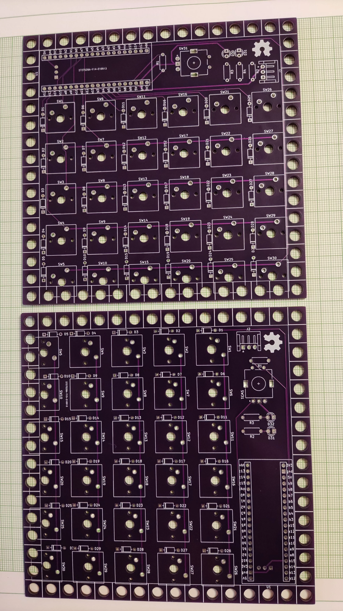
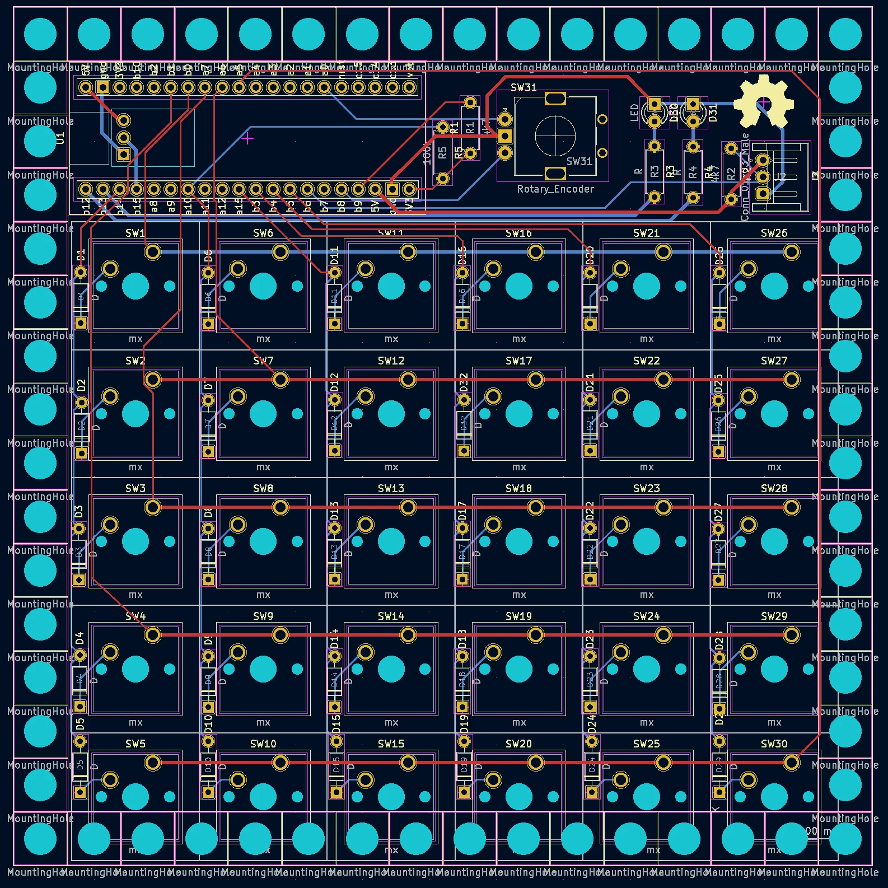
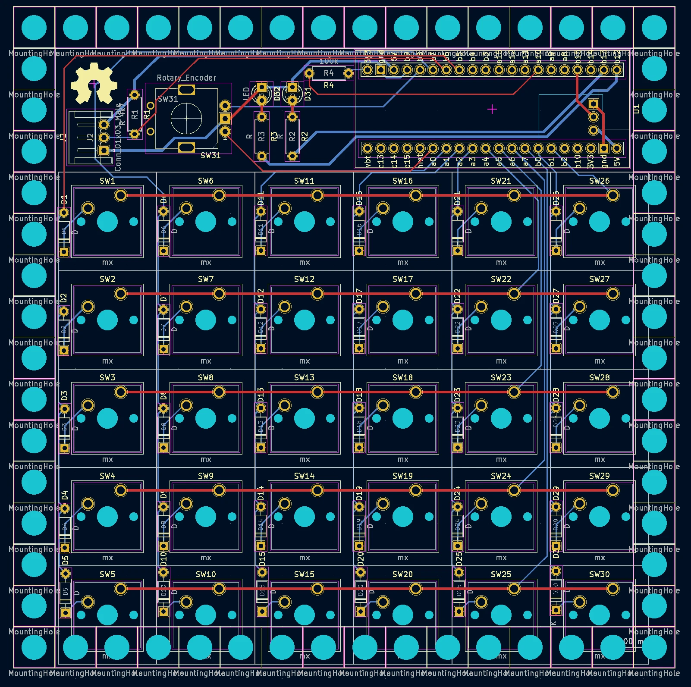
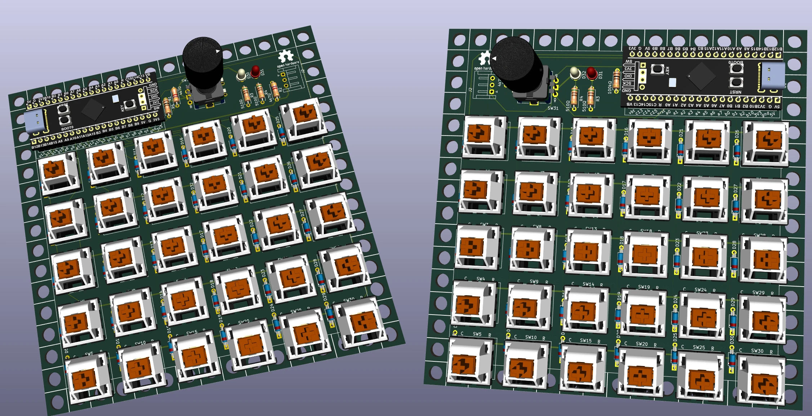
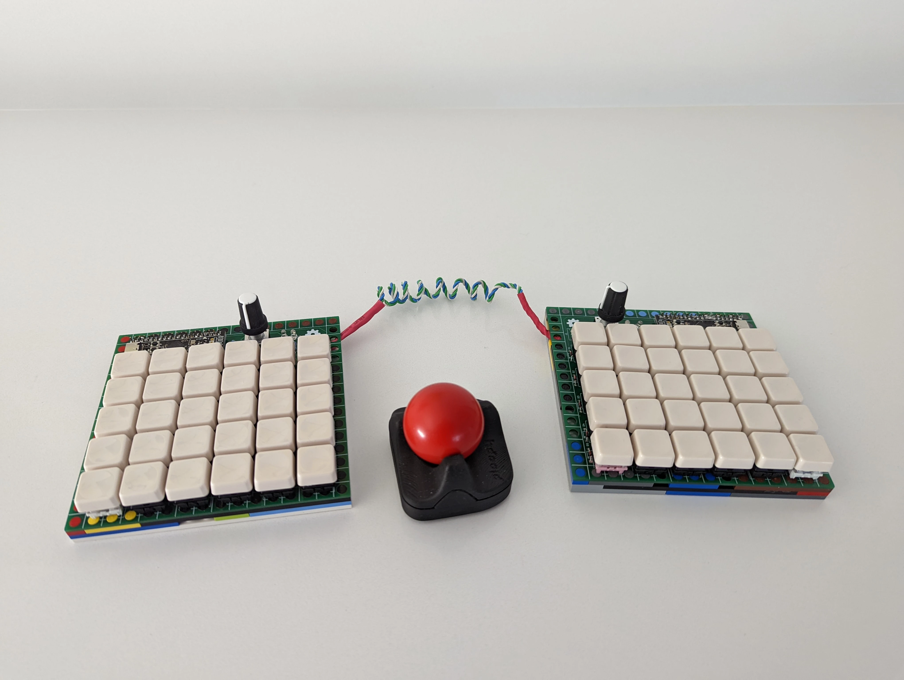
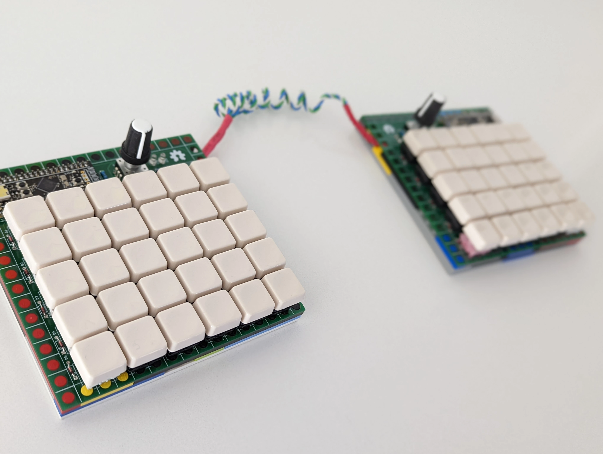
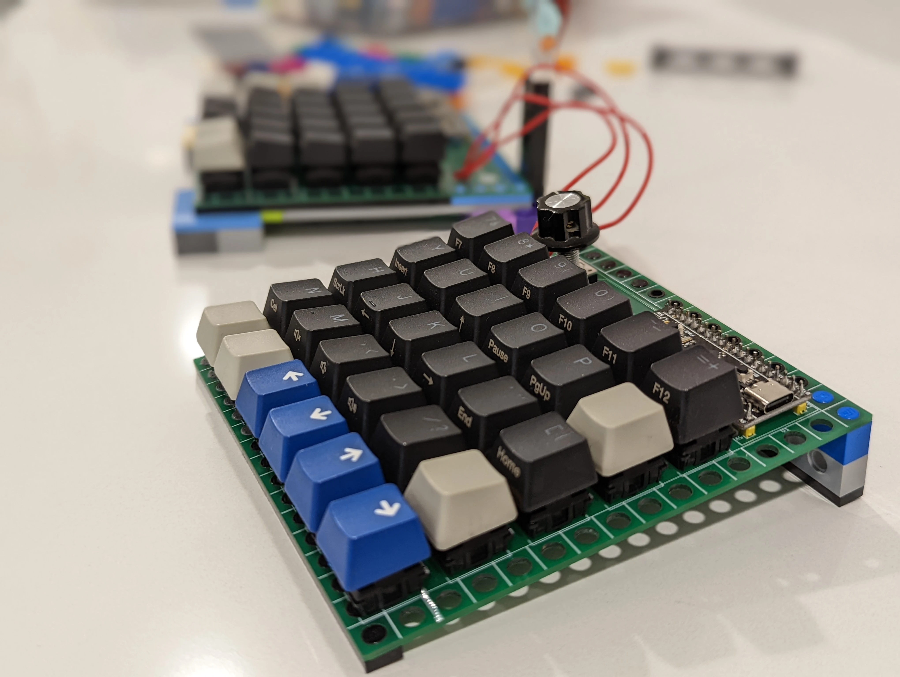
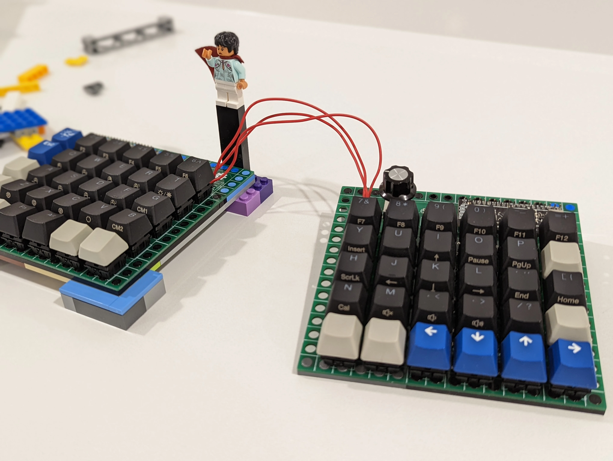

# m60 Split — 5×12 Split LEGO Keyboard

<div class="spec-badges">
  <span class="spec-badge spec-badge--status">Status: Tested &amp; Verified</span>
  <span class="spec-badge">5×12 Split (2× 5×6)</span>
  <span class="spec-badge">2× STM32F401 / F411 BlackPill</span>
  <span class="spec-badge">Dual Encoders + RGB Underglow</span>
  <span class="spec-badge">QMK</span>
</div>

<div class="image-grid" markdown>
{ loading=lazy }
{ loading=lazy }
</div>

An ergonomic **5×12 split ortholinear keyboard** mounted on two 16×16 LEGO baseplates, featuring dual rotary encoders (one per half) and addressable RGB underglow.

!!! success "Status: Tested All OK"

    * [x] Gerbers designed
    * [x] Firmware
    * [x] Breadboard tested
    * [x] Gerbers printed
    * [x] Board tested

## Features

* **Layout**: 5×12 split (two 5×6 halves, 60 keys total)
* **Controllers**: 2× WeAct [`STM32F401` (Rev 1) or `STM32F411` (Rev 2) BlackPill](https://github.com/WeActTC/MiniSTM32F4x1)
* **Peripherals**: 1× rotary encoder per half, RGB underglow strip, 4× status LEDs
* **Interconnect**: Direct 3-wire serial cable via angled 3-pin JST XH 2.54 mm connectors
* **Firmware**: QMK with TinyUF2 bootloader support

## Renders & PCBs { #renders }

=== "Left & Right Printed PCBs"

    { loading=lazy }

=== "KiCad Left & Right Layout"

    <div class="image-grid" markdown>
    { loading=lazy }
    { loading=lazy }
    </div>

=== "3D Render (Left Half)"

    { loading=lazy }

## BOM { #bom }

* 2× WeAct `STM32F401` (or `STM32F411`) BlackPill boards with headers
* 2× 40-pin DIL/DIP sockets
* 60× `1N4148` signal diodes (DO-35 through-hole)
* 60× 5-pin Cherry MX–compatible switches
* 2× EC11 rotary encoders
* **Resistors**:
    * 3× 4.7 kΩ (`R1` and `R2` on left half; `R1` on right half)
    * 2× 100 kΩ (`R5` on left half; `R4` on right half)
    * 4× 220 Ω LED resistors (`R3`, `R4` on left half; `R2`, `R3` on right half — adjust to match LED color/brightness)
* 4× status indicator LEDs
* 2× angled 3-pin JST XH 2.54 mm connectors (plus matching direct, non-crossed interconnect cable)
* Optional: 2× additional 3-pin JST connectors and 3-pin addressable LED strips
* 2× LEGO 16×16 baseplates and perimeter plates/bricks

## Case & Assembly { #case }

* **LEGO Enclosure**: See the [m65 Case & Thickness section](m65.md#case) for LEGO plate stacking details.
* **Soldering & Build**: Follow the step-by-step [Assembly Guide](assembly.md).

## Gerbers & KiCad { #gerbers }

Production-ready Gerbers for JLCPCB:

* [:material-folder-zip: **Rev 1 Left Half Gerbers**](https://gitlab.com/m-lego/m60_split/-/blob/main/m60-split-left/gerbers-left.zip)
* [:material-folder-zip: **Rev 1 Right Half Gerbers**](https://gitlab.com/m-lego/m60_split/-/blob/main/m60-split-right/gerbers-right.zip)

Full KiCad project files are available in [`m-lego/m60_split` on GitLab](https://gitlab.com/m-lego/m60_split/) (shared footprints in [`m-lego/m65`](https://gitlab.com/m-lego/m65/)).

## Firmware { #firmware }

Ensure both BlackPill boards are flashed with the [TinyUF2 bootloader](https://github.com/adafruit/tinyuf2).

=== "Rev 1 (`STM32F401`)"

    Download prebuilt UF2: [mlego_m60_split_rev1_default.uf2](https://gitlab.com/m-lego/m60_split/-/blob/main/firmware/mlego_m60_split_rev1_default.uf2)

    ```bash
    git clone --recurse-submodules -b mlego https://github.com/qmk/qmk_firmware.git qmk-alin
    cd qmk-alin
    qmk compile -kb mlego/m60_split/rev1 -km default
    ```

=== "Rev 2 (`STM32F411`)"

    Download prebuilt UF2: [mlego_m60_split_rev2_default.uf2](https://gitlab.com/m-lego/m60_split/-/blob/main/firmware/mlego_m60_split_rev2_default.uf2)

    ```bash
    git clone --recurse-submodules -b mlego https://github.com/qmk/qmk_firmware.git qmk-alin
    cd qmk-alin
    qmk compile -kb mlego/m60_split/rev2 -km default
    ```

## Pinout Reference { #pins }

* **Left Half**:
    * **Columns**: `B14`, `A10`, `A15`, `B3`, `B4`, `B5`
    * **Rows**: `B0`, `A6`, `A7`, `B1`, `A5`
* **Right Half**:
    * **Columns**: `B0`, `A3`, `A2`, `A1`, `B7`, `B5`
    * **Rows**: `B1`, `A4`, `A5`, `A6`, `A7`
* **Encoders**: `Pad_A = A0`, `Pad_B = A8`
* **Split Communication**: `SPLIT_HAND_PIN = B9`, `SERIAL_USART_TX_PIN = B6`

| Indicator / RGB | Pin |
| :--- | :--- |
| `NUM_LOCK` | `B12` |
| `CAPS_LOCK` | `C13` |
| `SCROLL_LOCK` | `B13` |
| `RGB_DI` | `B15` |

## Community Builds { #other-builds }

Builds by **Seth** (`u/modularsynth123456`):

<div class="image-grid" markdown>
{ loading=lazy }
{ loading=lazy }
{ loading=lazy }
{ loading=lazy }
</div>
