# m66 — 5×14 LEGO Ortholinear Keyboard

<div class="spec-badges">
  <span class="spec-badge spec-badge--status">Status: Rev 4 Tested</span>
  <span class="spec-badge">5×14 Ortho (66 Keys)</span>
  <span class="spec-badge">RP2040 Pro Micro / nice!nano / XIAO</span>
  <span class="spec-badge">Per-Key RGB + Underglow</span>
  <span class="spec-badge">OLED / Sharp / E-Ink / LCD</span>
  <span class="spec-badge">QMK &amp; ZMK</span>
</div>

<div class="image-grid" markdown>
{ loading=lazy }
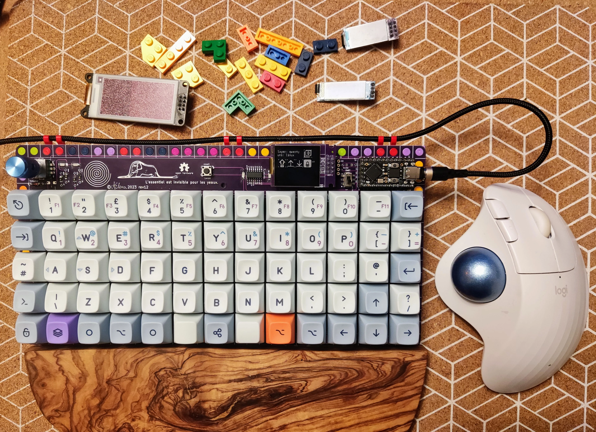{ loading=lazy }
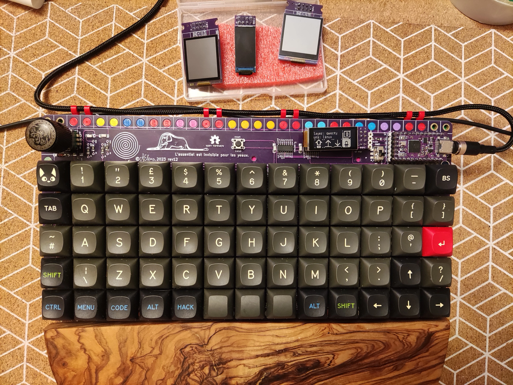{ loading=lazy }
</div>

The **m66** is a 5-row, 13-column ortholinear keyboard plus a dedicated clickable rotary encoder column (technically a 5×14 matrix), designed to accommodate all standard keycaps from an ISO layout.

The current iteration (**Rev 4**) uses an **RP2040 Pro Micro–compatible footprint** (tested with Splinky, Helios, and `nice!nano` BLE boards), chained per-key RGB LEDs and underglow backlight, a clickable rotary encoder, and multi-display support for $\text{I}^2\text{C}$ OLED, Sharp Memory display, WeAct SSD1680 e-ink, and ST7735 IPS LCD screens.

!!! success "Status: **Rev 4** Done and Tested"

    * [x] Gerbers designed
    * [x] Firmware (QMK & ZMK)
    * [ ] Breadboard tested
    * [x] Gerbers printed
    * [x] Board tested

!!! info "Revision History"

    * **m66 Rev 4** *(formerly m65 Rev 12)*: RP2040 Pro Micro pinout with 2× `74HC595` shift registers, OLED / LCD (`ST7735` tested) / Sharp Memory / e-ink (`SSD1680` WeAct), clickable encoder, per-key RGB, and RGB backlight
    * **m66 Rev 3** *(formerly m65 Rev 11)*: XIAO RP2040 with 3 shift registers (2× `74HC595` + 1× `74HC589`), OLED / e-ink (`SSD1680` WeAct), and push rotary encoder with QMK (ZMK support in progress for RP2040 and nRF52840)
    * **m66 Rev 2** *(formerly m65 Rev 10)*: XIAO RP2040 with 3 shift registers (2× `74HC595` + 1× `74HC589`), OLED, and push rotary encoder with QMK
    * **m66 Rev 1** *(formerly m65 Rev 9)*: XIAO RP2040 with 3 shift registers (2× `74HC595` + 1× `74HC165`), OLED, and push rotary encoder with QMK
    * **m65 Rev 7/8**: XIAO RP2040 and nRF52840 with 2× `74HC595` shift registers, rotary encoder, no OLED (both QMK and ZMK firmware on RP2040)
    * **m65 Rev 5/6**: RP2040 support (Raspberry Pi Pico, WeAct, and compatible clones), non-push encoder, OLED
    * **m65 Rev 4**: `STM32F401`/`F411`, non-push encoder, OLED
    * **m65 Rev 3**: `STM32F401`/`F411`, non-push encoder
    * **m65 Rev 2**: `GD32F303` (BluePill Plus, USB-C F103 equivalent — <https://github.com/WeActStudio/BluePill-Plus>)
    * **m65 Rev 1**: `STM32F103` / `APM32F103` or `STM32F303`

## BOM { #bom }

!!! warning "Microcontroller Notes (MCUs)"

    I have used several reference MCU boards over time. Reference boards simplify DIY keyboard design since all high-frequency crystal and power circuitry is already on the module. While I have done handwire projects with AVR (`ATmega32U4`), I strongly advise against using them for new builds.

    * **m65 Rev 1**: `STM32F103` [BluePill](https://stm32-base.org/boards/STM32F103C8T6-Blue-Pill.html) or [RobotDyn `STM32F303CCT6` BlackPill](https://stm32-base.org/boards/STM32F303CCT6-RobotDyn-Black-Pill.html) *(do not confuse with the WeAct F401/F411 BlackPill)*. Micro-USB; requires flashing an `stm32duino` bootloader.
    * **m65 Rev 2**: `GD32F303` [BluePill Plus](https://github.com/WeActStudio/BluePill-Plus) with USB Type-C.
    * **m65 Rev 3/4**: WeAct [`STM32F401`/`F411` MiniF4x BlackPill](https://github.com/WeActStudio/WeActStudio.MiniSTM32F4x) with USB Type-C.
    * **m65 Rev 5/6**: `RP2040` ([Raspberry Pi Pico](https://www.raspberrypi.com/documentation/microcontrollers/raspberry-pi-pico.html), [Waveshare RP2040-Plus](https://www.waveshare.com/wiki/RP2040-Plus), or USB-C compatible clones with matching pinouts).
    * **m65 Rev 7 / m66 Rev 1–3**: [Seeed Studio XIAO RP2040](https://wiki.seeedstudio.com/XIAO-RP2040/) and [XIAO BLE nRF52840](https://wiki.seeedstudio.com/XIAO_BLE/). Compact 14-pin footprint paired with SPI shift registers.
    * **m66 Rev 4**: `RP2040` in Pro Micro footprint (tested with **Splinky** and **Helios** pinouts) as well as **`nice!nano`** BLE controllers and clones.
    * **More pins**: If you need more direct GPIO pins in a compact package, check the [WeAct `STM32G431` CoreBoard](https://github.com/WeActStudio/WeActStudio.STM32G431CoreBoard) (supported in QMK).

### Rev 4

!!! info "Revision 4 BOM"

    * **MCU**: `RP2040` Pro Micro–compatible pinout (tested with Splinky and Helios-like MCUs) or `nice!nano` BLE MCUs
    * **Shift Registers**: 2× `74HC595` (SOIC-16 surface mount)
    * **Diodes**: 66× `1N4148` signal diodes (DO-35 through-hole or SOD-123 SMD)
    * **Display (optional)**: $\text{I}^2\text{C}$ OLED ($128\times 32$), Sharp Memory Display, ST7735 IPS LCD, or WeAct SSD1680 e-ink module
    * **Encoder**: Clickable EC11 rotary encoder (e.g., Bourns 24-pulse incremental mechanical encoder with 6 mm flat shaft)
    * **RGB (optional)**: Per-key SK6812 MINI-E LEDs and/or underglow RGB chain
    * **LEGO Enclosure**: $16\times 32$ double-sided baseplate (or 2× $16\times 16$ plates) + ~46× $1\times 2$ or $1\times 4$ LEGO plates/bricks

### Rev 3

??? info "Revision 3 BOM (formerly m65 Rev 11)"

    * **LEGO**: ~46× $1\times 2$ or $1\times 4$ plates (or bricks if housing a LiPo battery), 1× $16\times 32$ double-sided baseplate (or 2× $16\times 16$ plates; gray plates minimize PCB bow), optional 4× $1\times 1$ tiles/eyes and 4× $2\times 2$ corner plates
    * **Diodes**: 66× `1N4148` signal diodes (DO-35 or SOD-123)
    * **Resistors**: 5× $10\text{ k}\Omega$ (THT or SMD 1206) and 1× $5.1\text{ k}\Omega$ (THT or SMD 1206)
    * **MCU**: Seeed Studio XIAO RP2040 (or XIAO nRF52840) with recommended female header sockets
    * **Shift Registers**: 2× `74HC595` (SOIC-16 SMD) and 1× `74HC589` (SOIC-16 SMD)
    * **Transistor**: 1× `2N7002` N-channel MOSFET (SOT-23 SMD)
    * **Capacitors (optional)**: 3× $100\text{ nF}$ decoupling capacitors
    * **Power / Battery (optional)**: Pogo pins, LiPo battery, 2-pin PH 2.0 battery connector, and 1P2T 4 mm micro slide switch
    * **Encoder**: Clickable EC11 rotary encoder (Bourns 24-pulse, 6 mm flat shaft)
    * **Display (optional)**: $128\times 32$ $\text{I}^2\text{C}$ OLED (1×4 socket) or WeAct SSD1680 e-ink display (2×4 header/socket)

### Rev 2

??? warning "Revision 2 BOM — Superseded by Rev 3 (formerly m65 Rev 10)"

    * Same component list as **Rev 3**, supporting $\text{I}^2\text{C}$ OLED ($128\times 32$) with 1×4 DIL socket (prior to the dedicated e-ink header addition in Rev 3).

### Rev 1

??? info "Revision 1 BOM (formerly m65 Rev 9)"

    * **LEGO**: $16\times 32$ double-sided plate (or 2× $16\times 16$) + ~46× $1\times 2$ or $1\times 4$ plates
    * **Diodes**: 66× `1N4148` signal diodes (DO-35 or SOD-123)
    * **Resistors**: 5× $10\text{ k}\Omega$ THT resistors
    * **MCU**: Seeed Studio XIAO RP2040 (or XIAO nRF52840)
    * **Shift Registers**: 2× `74HC595` (DIP-16 THT + sockets) and 1× `74HC165` (DIP-16 THT + socket)
    * **Capacitors (optional)**: 3× $100\text{ nF}$ decoupling capacitors (or integrated capacitor DIP sockets)
    * **Encoder & Battery**: EC11 clickable rotary encoder, optional LiPo battery + PH 2.0 socket + 1P2T switch

## Case & Enclosure { #case }

<div class="image-grid" markdown>
{ loading=lazy }
{ loading=lazy }
{ loading=lazy }
{ loading=lazy }
{ loading=lazy }
</div>

## Assembly { #assembly }

See the step-by-step [Assembly Guide](assembly.md) for soldering diodes, socketing the MCU and display, and mounting the PCB onto the LEGO baseplate.

## Thickness Profiles { #thickness }

Depending on your LEGO plate stack, the enclosure can be built ultra-low-profile or tall enough to house underglow strips and batteries:

<div class="grid cards" markdown>

-   { loading=lazy }

    **8.0 mm — Ultra-Thin Profile**

    1× double-sided baseplate + 1× intermediate plate ($3.2\text{ mm}$) + PCB ($1.6\text{ mm}$). Leaves room for a thin sheet of acoustic dampening foam.

-   { loading=lazy }

    **11.2 mm — Mid Profile**

    1× double-sided baseplate + 2× intermediate plates + PCB. Fits thicker foam or a direct-wired LED strip without a JST connector.

-   { loading=lazy }

    **14.4 mm — Full Brick Profile**

    1× double-sided baseplate + 1× full LEGO brick + PCB. Accommodates a 3-pin JST header or LiPo battery.

</div>

## 3D Renders { #3d-render }

=== "Rev 4"

    <div class="image-grid" markdown>
    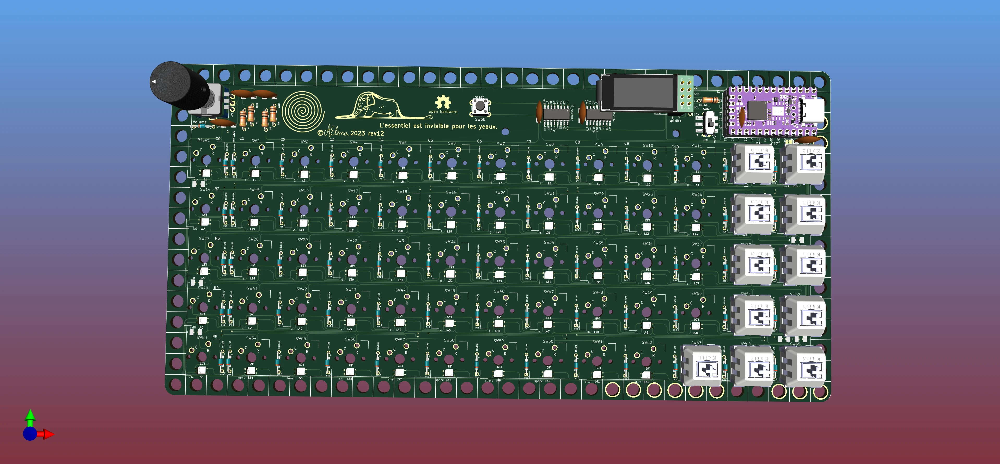{ loading=lazy }
    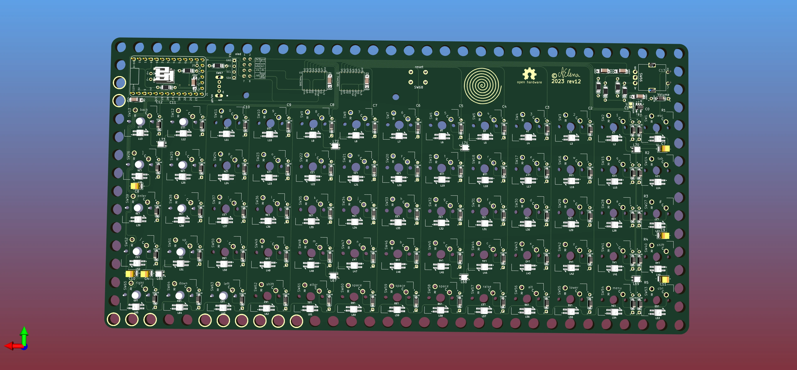{ loading=lazy }
    </div>

=== "Rev 3"

    <div class="image-grid" markdown>
    { loading=lazy }
    { loading=lazy }
    </div>

=== "Rev 2"

    <div class="image-grid" markdown>
    { loading=lazy }
    { loading=lazy }
    </div>

=== "Rev 1"

    <div class="image-grid" markdown>
    { loading=lazy }
    { loading=lazy }
    </div>

## Schematics { #schematic }

=== "Rev 4"

    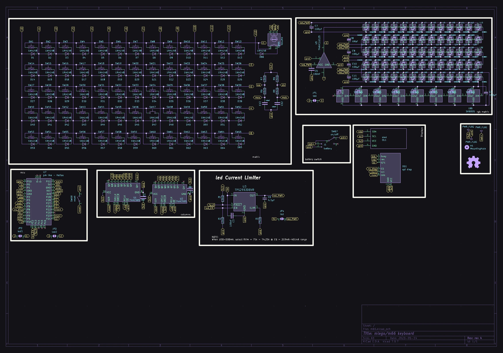{ loading=lazy }

=== "Rev 3"

    { loading=lazy }

=== "Rev 2"

    { loading=lazy }

=== "Rev 1"

    { loading=lazy }

## PCBs { #pcb }

=== "Rev 4"

    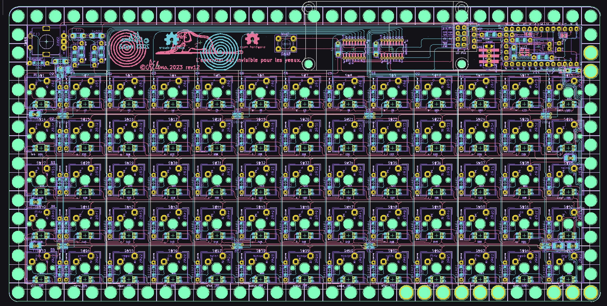{ loading=lazy }

=== "Rev 3"

    <div class="image-grid" markdown>
    { loading=lazy }
    { loading=lazy }
    { loading=lazy }
    </div>

=== "Rev 2"

    <div class="image-grid" markdown>
    { loading=lazy }
    { loading=lazy }
    { loading=lazy }
    </div>

=== "Rev 1"

    <div class="image-grid" markdown>
    { loading=lazy }
    { loading=lazy }
    { loading=lazy }
    </div>

## Gerbers & KiCad Source { #gerbers }

Production-ready Gerbers for JLCPCB:

* [:material-folder-zip: **m66 Rev 4 Gerbers**](https://gitlab.com/m-lego/m65/-/blob/devel/gerbers/GERBER-m66-rev4.zip)
* [:material-folder-zip: **m66 Rev 3 Gerbers**](https://gitlab.com/m-lego/m65/-/blob/devel/gerbers/gerbers-rev11.zip)
* [:material-folder-zip: **m66 Rev 2 Gerbers**](https://gitlab.com/m-lego/m65/-/blob/devel/gerbers/gerbers-rev10.zip)
* [:material-folder-zip: **m66 Rev 1 Gerbers**](https://gitlab.com/m-lego/m65/-/blob/devel/gerbers/gerbers-rev9.zip)

Full KiCad project files are hosted on [GitLab (`m-lego/m65`)](https://gitlab.com/m-lego/m65/). Note that the default branch `HEAD` is always work-in-progress; check out the specific revision tag/branch below:

### KiCad Checkout { #kicad }

=== "Rev 4"

    ```bash
    git clone https://gitlab.com/m-lego/m65.git
    cd m65
    git checkout m66-rev4
    ```

=== "Rev 3"

    ```bash
    git clone https://gitlab.com/m-lego/m65.git
    cd m65
    git checkout revision11
    ```

=== "Rev 2"

    ```bash
    git clone https://gitlab.com/m-lego/m65.git
    cd m65
    git checkout revision10
    ```

=== "Rev 1"

    ```bash
    git clone https://gitlab.com/m-lego/m65.git
    cd m65
    git checkout revision9
    ```

## Firmware { #firmware }

Both **QMK** and **ZMK** are supported. You can download prebuilt `.uf2` binaries below or compile from source.

### ZMK { #zmk }

Latest ZMK builds are available from the [mlego-zmk GitHub Actions workflow](https://github.com/alinelena/mlego-zmk/actions/workflows/build.yml) (select the latest successful **Build mlego** run):

* [Prebuilt ZMK firmware for Rev 4](https://github.com/alinelena/mlego-zmk/tree/main/firmware)

### QMK Prebuilt UF2 { #qmk }

* [mlego_m66_rev4_default_rgb_screen.uf2](https://gitlab.com/m-lego/m65/-/blob/devel/firmware/mlego_m66_rev4_default_rgb_screen.uf2)
* [mlego_m66_rev4_uk_rgb_screen.uf2](https://gitlab.com/m-lego/m65/-/blob/devel/firmware/mlego_m66_rev4_uk_rgb_screen.uf2)
* [mlego_m66_rev3_default.uf2](https://gitlab.com/m-lego/m65/-/blob/devel/firmware/mlego_m66_rev3_default.uf2)
* [mlego_m66_rev3_uk.uf2](https://gitlab.com/m-lego/m65/-/blob/devel/firmware/mlego_m66_rev3_uk.uf2)
* [mlego_m66_rev2_default.uf2](https://gitlab.com/m-lego/m65/-/blob/devel/firmware/mlego_m66_rev2_default.uf2)
* [mlego_m66_rev2_uk.uf2](https://gitlab.com/m-lego/m65/-/blob/devel/firmware/mlego_m66_rev2_uk.uf2)
* [mlego_m66_rev1_default.uf2](https://gitlab.com/m-lego/m65/-/blob/devel/firmware/mlego_m66_rev1_default.uf2)
* [mlego_m66_rev1_uk.uf2](https://gitlab.com/m-lego/m65/-/blob/devel/firmware/mlego_m66_rev1_uk.uf2)

Latest automated QMK builds can also be downloaded from [GitHub Actions](https://github.com/alinelena/qmk_firmware/actions/workflows/build.yml).

### QMK Source Build { #qmk-source }

=== "Rev 4"

    ```bash
    git clone --recurse-submodules -b mlego_dev https://github.com/alinelena/qmk_firmware.git qmk-alin
    cd qmk-alin
    qmk compile -kb mlego/m66/rev4 -km uk
    qmk compile -kb mlego/m66/rev4 -km default
    ```

=== "Rev 3"

    ```bash
    # OLED version
    git clone --recurse-submodules -b mlego_dev https://github.com/alinelena/qmk_firmware.git qmk-alin
    cd qmk-alin
    qmk compile -kb mlego/m66/rev3 -km uk
    qmk compile -kb mlego/m66/rev3 -km default

    # E-Ink version
    git clone --recurse-submodules -b mlego_eink https://github.com/alinelena/qmk_firmware.git qmk-alin
    cd qmk-alin
    qmk compile -kb mlego/m66/rev3 -km uk
    qmk compile -kb mlego/m66/rev3 -km default
    ```

=== "Rev 2"

    ```bash
    git clone --recurse-submodules -b mlego_dev https://github.com/alinelena/qmk_firmware.git qmk-alin
    cd qmk-alin
    qmk compile -kb mlego/m66/rev2 -km uk
    qmk compile -kb mlego/m66/rev2 -km default
    ```

=== "Rev 1"

    ```bash
    git clone --recurse-submodules -b mlego_dev https://github.com/alinelena/qmk_firmware.git qmk-alin
    cd qmk-alin
    qmk compile -kb mlego/m66/rev1 -km uk
    qmk compile -kb mlego/m66/rev1 -km default
    ```

## Build Gallery { #pictures }

=== "Rev 4"

    <div class="image-grid" markdown>
    { loading=lazy }
    { loading=lazy }
    { loading=lazy }
    </div>

=== "Rev 3"

    <div class="image-grid" markdown>
    { loading=lazy }
    { loading=lazy }
    </div>

=== "Rev 2"

    <div class="image-grid" markdown>
    { loading=lazy }
    { loading=lazy }
    { loading=lazy }
    { loading=lazy }
    </div>

=== "Rev 1"

    { loading=lazy }

## Keymaps & Layout { #keymaps-layout }

All m66 revisions share the same 5×14 physical layout and keymaps (shown below for Rev 4).

### Physical Layout { #layout }

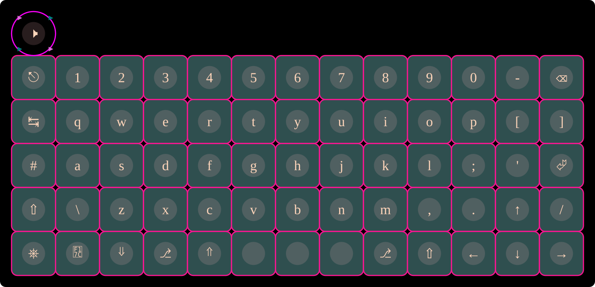{ loading=lazy }

### Combined UK Keymap Summary { #summary-keymap }

Except for mouse keys, QMK and ZMK keymaps are identical:

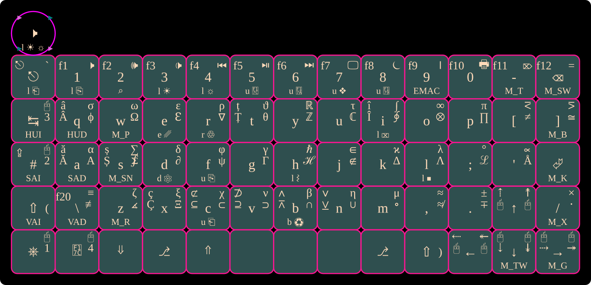{ loading=lazy }

* **Center legend**: Layer 0 (Base) · **Left legend**: Layer 1 (Lower) · **Right legend**: Layer 2 (Raise) · **Bottom legend**: Layer 3 (Adjust)
* **Legend codes**: `l` Lighting · `u` Unicode · `d` Debug · `b` Bootloader · `e` Erase EEPROM · `r` Reset MCU

### Default Keymap Layers { #keymap-default }

=== "Layer 0 — QWERTY"

    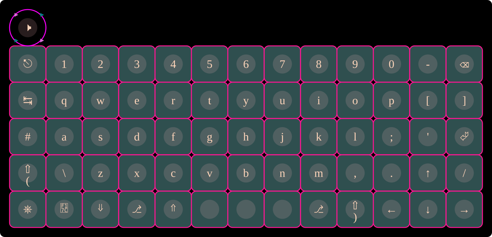{ loading=lazy }

=== "Layer 1 — Lower"

    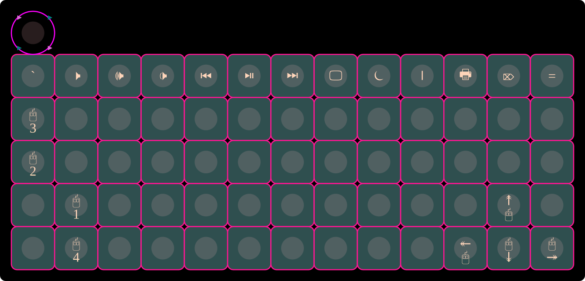{ loading=lazy }

=== "Layer 2 — Raise"

    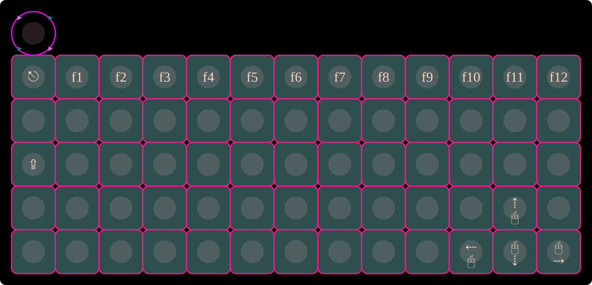{ loading=lazy }

=== "Layer 3 — Adjust"

    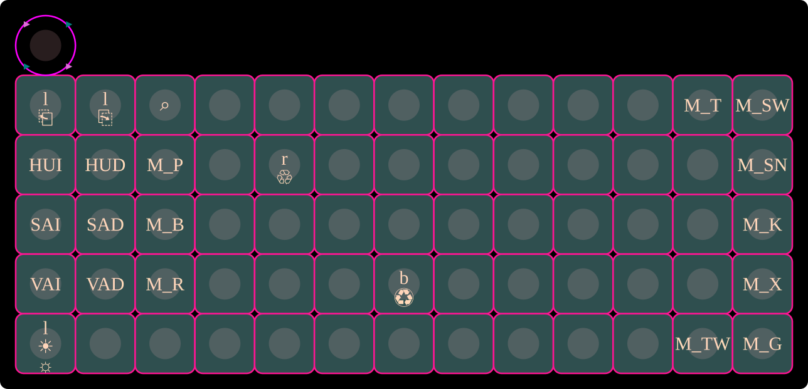{ loading=lazy }

### UK ISO Keymap Layers (with RGB Indicators) { #keymap-uk }

=== "Layer 0 — QWERTY"

    { loading=lazy }
    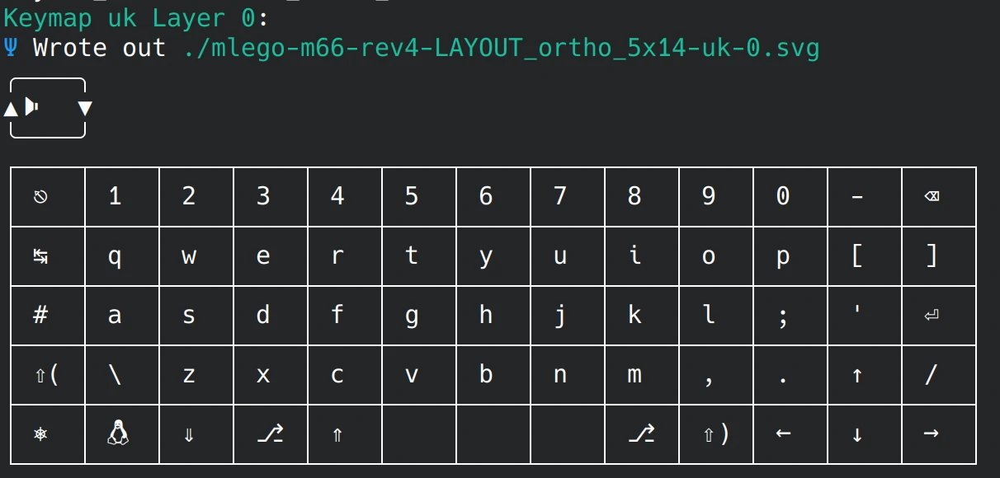{ loading=lazy }

=== "Layer 1 — Lower"

    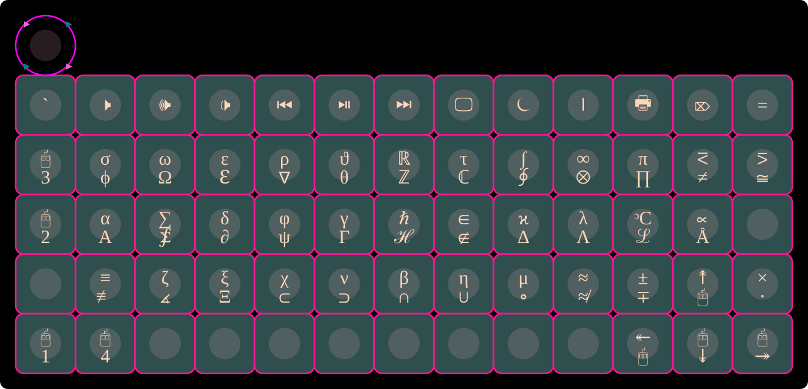{ loading=lazy }
    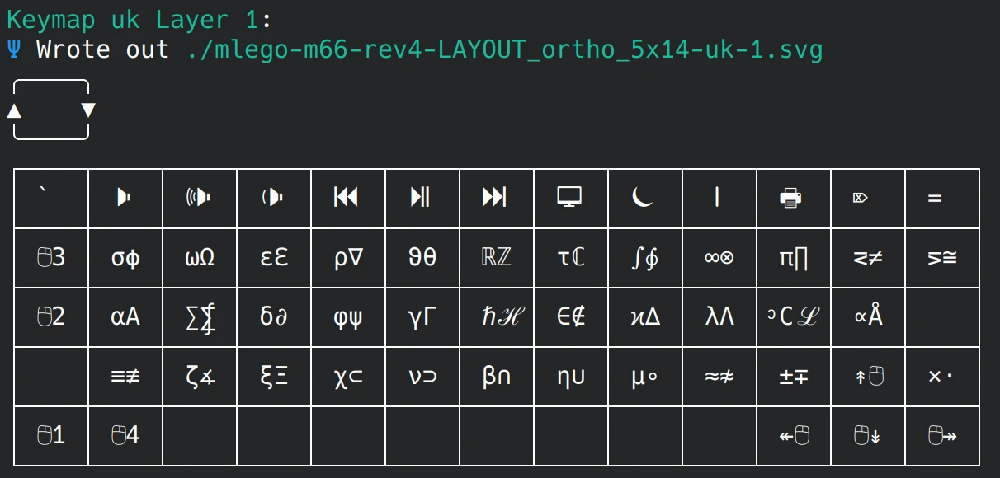{ loading=lazy }

=== "Layer 2 — Raise"

    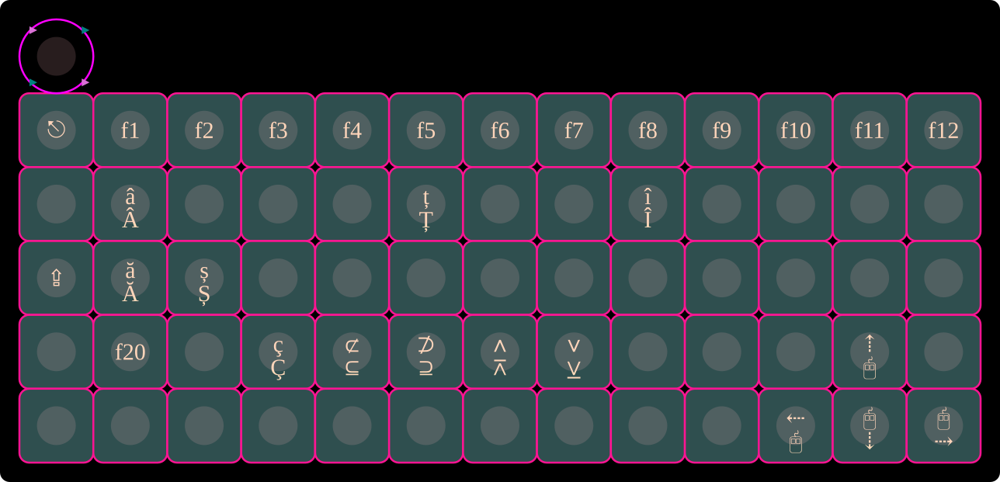{ loading=lazy }
    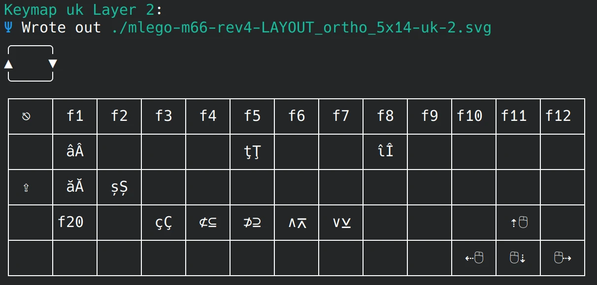{ loading=lazy }

=== "Layer 3 — Adjust"

    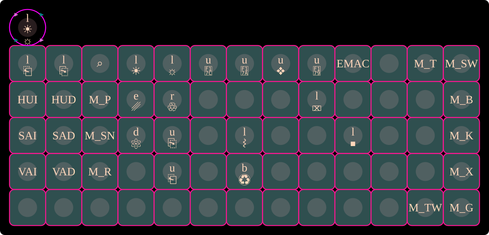{ loading=lazy }
    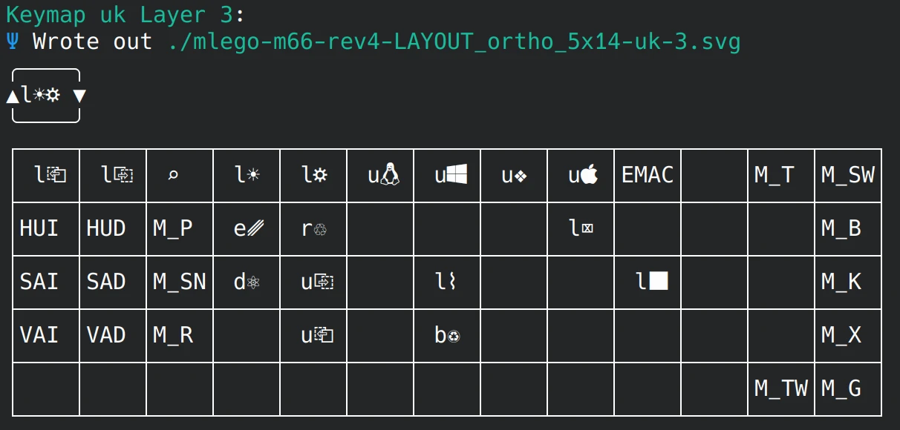{ loading=lazy }

## Matrix & Pinout Reference { #matrix-pins }

=== "Rev 4 (RP2040 Pro Micro)"

    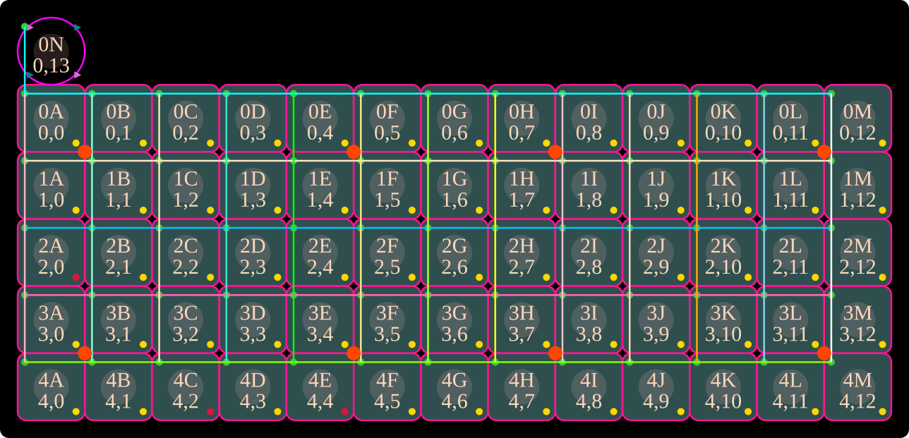{ loading=lazy }

=== "Rev 3 (XIAO RP2040)"

    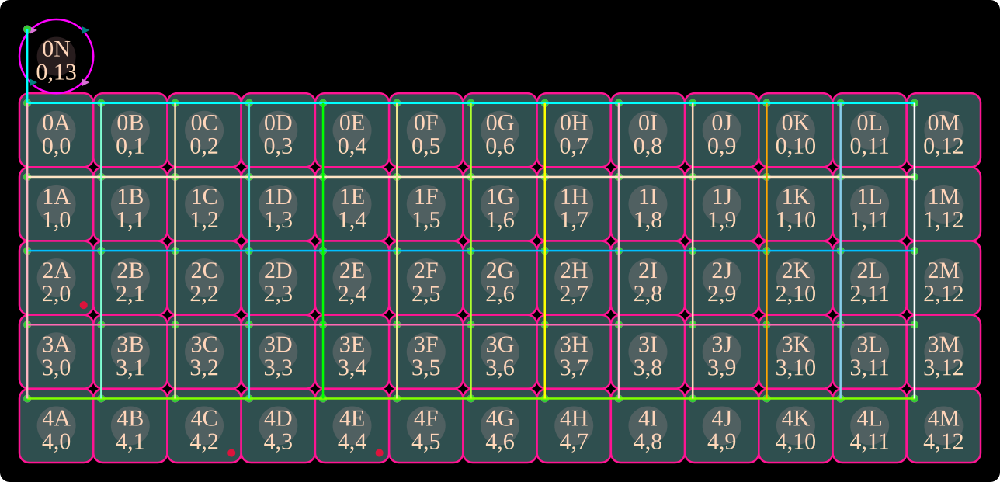{ loading=lazy }

=== "Rev 2 (XIAO RP2040)"

    { loading=lazy }

=== "Rev 1 (XIAO RP2040)"

    { loading=lazy }

    ```text
    ShiftRegister SN74HC595N (#1 & #2)        ShiftRegister 74HC165N (#3)
    QB |1    16| VCC                          nPL |1    16| VCC
    QC |2    15| QA                            CP |2    15| nCE
    QD |3    14| SER data                      D4 |3    14| D3
    QE |4    13| OE                            D5 |4    13| D2
    QF |5    12| RCLK latch                    D6 |5    12| D1
    QG |6    11| SRCLK clock                   D7 |6    11| D0
    QH |7    10| SRCLR                        nQ7 |7    10| DS
     G |8     9| QH*                            G |8     9| Q7
    ```

    | Rows | C0 | C1 | C2 | C3 | C4 | C5 | C6 | C7 | C8 | C9 | C10 | C11 | C12 | C13 | Row Pin |
    | :---: | :---: | :---: | :---: | :---: | :---: | :---: | :---: | :---: | :---: | :---: | :---: | :---: | :---: | :---: | :---: |
    | **R0** | Esc | 1 | 2 | 3 | 4 | 5 | 6 | 7 | 8 | 9 | 0 | - | Bksp | MUTE | `3D0` |
    | **R1** | Tab | q | w | e | r | t | y | u | i | o | p | [ | ] | X* | `3D1` |
    | **R2** | # | a | s | d | f | g | h | j | k | l | ; | ' | Enter | X* | `3D2` |
    | **R3** | Shift | \ | z | x | c | v | b | n | m | , | . | Up | / | X* | `3D3` |
    | **R4** | Ctrl | Menu | Lower | Alt | Raise | Space | Space | Space | AltGr | Shift | Left | Down | Right | X* | `3D4` |
    | **Col Pin** | `2QB` | `2QC` | `2QD` | `2QE` | `2QF` | `2QG` | `2QH` | `2QA` | `1QH` | `1QG` | `1QF` | `1QE` | `1QA` | `1QD` | *(X* NC)* |

    * **Encoders**: `Pad_A = GP27`, `Pad_B = GP26`
    * **OLED ($\text{I}^2\text{C}$)**: `SCL = GP7`, `SDA = GP6`
    * **`74HC595N` (Columns)**: `MOSI = GP3` (pin 11), `Latch = GP1` (pin 8), `Clock = GP2` (pin 9)
    * **`74HC165N` (Rows)**: `Latch = GP1` (pin 8), `Clock = GP2` (pin 9), `MISO = GP4` (pin 10)
    * **LEDs (RP2040)**: `CAPS_LOCK = GP25`, `Lower = GP16`, `Raise = GP17`, `RGB DI = GP12`, `RGB On = GP11`
