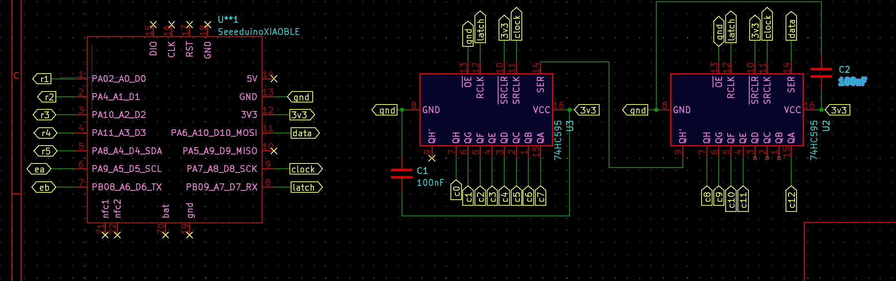
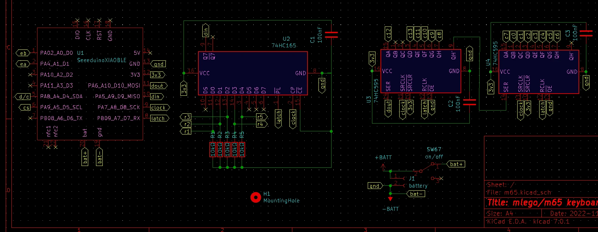
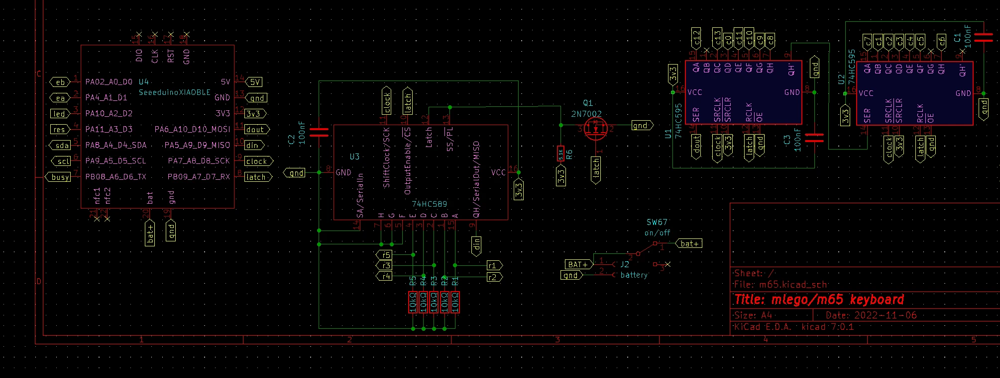
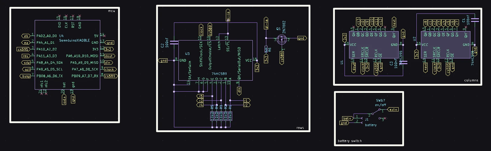

# Not Enough Pins for Your Keyboard Matrix?

<div class="spec-badges">
  <span class="spec-badge">SPI Shift Registers</span>
  <span class="spec-badge">74HC595 · 74HC165 · 74HC589</span>
  <span class="spec-badge">Matrix Remapping (5×13 → 8×9)</span>
  <span class="spec-badge">QMK &amp; ZMK</span>
</div>

So you decided to wire a custom mechanical keyboard, but your favorite compact microcontroller doesn't expose enough GPIO pins for the full switch matrix. This is the exact challenge I hit when moving the 65-key [**m65**](m65.md) onto the tiny 11-pin **Seeed Studio XIAO RP2040**.

## Common Pin-Reduction Approaches

Before settling on SPI shift registers, I surveyed the existing approaches used in the community:

* **Duplex Matrix**: Folds long rows/columns by wiring two switches per row/column intersection with opposing diodes. Effective, but makes schematic reading and routing more mentally taxing.
* **Direct-Pin Shift Registers**: Used in boards like [tzarc's Ghoul](https://github.com/tzarc/ghoul) with chained `74HC589` shift registers (one bit per switch, no matrix). Great scan speed, but requires many ICs for 65+ keys.
* **$\text{I}^2\text{C}$ IO Expanders & Demuxers**: Popular on split boards (e.g., [Ferris IO Expander guide](https://github.com/pierrechevalier83/ferris/wiki/Understanding-the-QMK-firmware-for-the-IO-Expander)) or `74HC138` 3-to-8 decoders in QMK.
* **SPI Shift-Register Matrix Scanning**: Using inexpensive `74HC595` (serial-in, parallel-out) and `74HC165` / `74HC589` (parallel-in, serial-out) shift registers to drive columns and/or read rows over hardware SPI.
    * Background tutorials on shift registers: [Last Minute Engineers — `74HC595`](https://lastminuteengineers.com/74hc595-shift-register-arduino-tutorial/) and [DroneBot Workshop — `74HC595` & `74HC165`](https://dronebotworkshop.com/shift-registers/).
    * Initial keyboard inspiration: [mehmedbasic.dk — `74HC595` Keyboard](https://mehmedbasic.dk/post/74hc595-keyboard/).

!!! info "Official QMK Support & Acknowledgments"
    When I started experimenting with these circuits, QMK had very few public examples. Since QMK `0.20.0`, boards like Keychron and `hazel/bad_wings` use `74HC595`, and `handwired/dqz11n1g` uses `74HC165`. Huge thanks to **sigprof** and **tzarc** for their guidance on SPI timing and tri-state buffering.

!!! warning "Disclaimer"
    While the schematics and firmware below work reliably together to scan a 13×5 / 14×5 matrix at 4,000–6,000+ Hz, remember I am a hardware enthusiast rather than an electrical engineer — use and adapt them at your own risk!

---

## Method 1: Scan Columns via `74HC595` + Direct GPIO Rows { #1-scan-only-columns-with-shift-registers }

Uses **2× [`74HC595`](https://www.ti.com/product/SN74HC595)** output shift registers chained over SPI (`MOSI`, `SCK`, `RCLK`) to drive up to 16 columns using only **3 MCU pins**, while the 5 rows are read directly on 5 MCU GPIO pins (total: **8 pins** for a 5×16 matrix).

{ loading=lazy }

* **QMK Implementation**: [`mlego/m65/rev7/matrix.c`](https://github.com/alinelena/qmk_firmware/tree/mlego_dev/keyboards/mlego/m65/rev7/matrix.c)
* **ZMK Implementation**: [`mlego5x13_rev8.overlay` (`zmk,kscan-gpio-matrix` + `74hc595`)](https://github.com/alinelena/mlego-zmk/blob/main/config/boards/shields/mlego5x13_rev8/mlego5x13_rev8.overlay)

---

## Method 2a: Scan Columns (`74HC595`) & Rows (`74HC165`) — Unbuffered { #2a-scan-both-columns-and-rows-with-shift-registers }

Uses **2× `74HC595`** (columns) and **1× [`74HC165`](https://www.ti.com/product/SN74HC165)** (rows). Both ICs are inexpensive and widely available in through-hole (DIP-16) and SMD (SOIC-16) packages. Reads the entire 5×14 matrix using only **4 MCU pins** (`MOSI`, `MISO`, `SCK`, shared `Latch`).

!!! warning "Limitation: Unbuffered `MISO`"
    Because the `74HC165` serial output (`Q7`) does not have a true high-impedance (3-state) output when deselected, **you cannot easily share the `MISO` pin with other SPI peripherals** without adding external tri-state buffer circuitry.

{ loading=lazy }

* **QMK Implementation**: [`mlego/m66/rev1/matrix.c`](https://github.com/alinelena/qmk_firmware/blob/mlego_dev/keyboards/mlego/m66/rev1/matrix.c)

---

## Method 2b: Scan Columns (`74HC595`) & Rows (`74HC589`) — Buffered 3-State SPI { #2b-scan-both-columns-and-rows-with-shift-registers }

Replaces the `74HC165` with a **1× [`74HC589`](https://www.onsemi.com/pdf/datasheet/mc74hc589a-d.pdf)** (mostly SMD today). The `74HC589` includes an internal **3-state output buffer**, allowing the `MISO` line to be cleanly shared with other SPI devices (such as SPI e-ink or Sharp Memory displays).

### Variant 1 (Single Shared Latch — Deprecated) { #variant-1 }

!!! danger "Do Not Use Variant 1 for New Designs"
    While this single-latch circuit (`m65 Rev 10` / `m66 Rev 2`) works with carefully tuned firmware timing, it relies on edge-case latch/output-enable behavior. Use **Variant 2** below instead.

{ loading=lazy }

* **QMK Reference**: [`mlego/m66/rev2/matrix.c`](https://github.com/alinelena/qmk_firmware/blob/mlego_dev/keyboards/mlego/m66/rev2/matrix.c)

### Variant 2 (Separate Chip Selects — Recommended) { #variant-2 }

Uses separate latch / chip-select lines for the `2× 74HC595` column driver and the `1× 74HC589` row reader (costing 1 extra pin compared to Variant 1, for **5 SPI pins total**), making SPI bus sharing and matrix scanning clean and deterministic.

{ loading=lazy }

* **QMK Implementation**: [`mlego/m66/rev3/matrix.c`](https://github.com/alinelena/qmk_firmware/blob/mlego_dev/keyboards/m66/rev3/matrix.c)

!!! tip "Hybrid Scanning"
    All three shift-register methods above can be combined with direct GPIO pins in custom `matrix.c` routines if you want to mix shift-register columns with extra direct keys.

---

## Method 3: Mathematical Matrix Restructuring (Zero Extra Hardware) { #restructure-the-matrix }

If you are only short by **1 or 2 GPIO pins**, you don't need any shift registers at all — simply **decouple the electrical matrix dimensions from the physical key layout** so the row and column counts are closer to a square ($\text{Rows} \approx \text{Cols}$ maximizes $\text{Rows} \times \text{Cols}$ for a fixed pin budget $\text{Rows} + \text{Cols}$).

* **Example 1**: A physical **6×17** board (68 keys) normally requires $6 + 17 = 23\text{ pins}$. Electrically wiring it as a **10×7** or **9×8** matrix reduces the pin count to $17\text{ pins}$ — saving **6 pins**!
* **Example 2 (`m65` 5×13 Ortho)**:
    * **Standard 5×13 Matrix**: Uses $5 + 13 = \mathbf{18\text{ pins}}$ (`65` positions).
    * **Restructured 8×9 Matrix**: Uses $8 + 9 = \mathbf{17\text{ pins}}$ (`72` positions, saving 1 pin with 7 spare switch slots!).

Both QMK (via data-driven `info.json` `"matrix": [row, col]` coordinates) and ZMK (via `zmk,matrix-transform`) make this remapping trivial:

=== "Standard 5×13 Matrix (18 Pins)"

    **1. `info.json` Pin Definition (`5 + 13 = 18` pins)**:

    ```json
    "matrix_pins": {
        "cols": ["GP1", "GP6", "GP7", "GP8", "GP9", "GP15", "GP14", "GP13", "GP12", "GP11", "GP10", "GP17", "GP21"],
        "rows": ["GP22", "GP16", "GP18", "GP19", "GP20"]
    }
    ```

    **2. Physical-to-Electrical Mapping (1:1 Grid)**:

    ```text
    ┌──┐┌──┐┌──┐┌──┐┌──┐┌──┐┌──┐┌──┐┌──┐┌──┐┌──┐┌──┐┌──┐
    │0A││0B││0C││0D││0E││0F││0G││0H││0I││0J││0K││0L││0M│
    └──┘└──┘└──┘└──┘└──┘└──┘└──┘└──┘└──┘└──┘└──┘└──┘└──┘
    ┌──┐┌──┐┌──┐┌──┐┌──┐┌──┐┌──┐┌──┐┌──┐┌──┐┌──┐┌──┐┌──┐
    │1A││1B││1C││1D││1E││1F││1G││1H││1I││1J││1K││1L││1M│
    └──┘└──┘└──┘└──┘└──┘└──┘└──┘└──┘└──┘└──┘└──┘└──┘└──┘
    ┌──┐┌──┐┌──┐┌──┐┌──┐┌──┐┌──┐┌──┐┌──┐┌──┐┌──┐┌──┐┌──┐
    │2A││2B││2C││2D││2E││2F││2G││2H││2I││2J││2K││2L││2M│
    └──┘└──┘└──┘└──┘└──┘└──┘└──┘└──┘└──┘└──┘└──┘└──┘└──┘
    ┌──┐┌──┐┌──┐┌──┐┌──┐┌──┐┌──┐┌──┐┌──┐┌──┐┌──┐┌──┐┌──┐
    │3A││3B││3C││3D││3E││3F││3G││3H││3I││3J││3K││3L││3M│
    └──┘└──┘└──┘└──┘└──┘└──┘└──┘└──┘└──┘└──┘└──┘└──┘└──┘
    ┌──┐┌──┐┌──┐┌──┐┌──┐┌──┐┌──┐┌──┐┌──┐┌──┐┌──┐┌──┐┌──┐
    │4A││4B││4C││4D││4E││4F││4G││4H││4I││4J││4K││4L││4M│
    └──┘└──┘└──┘└──┘└──┘└──┘└──┘└──┘└──┘└──┘└──┘└──┘└──┘
    ```

    **3. Full `LAYOUT_ortho_5x13` Definition**:

    ??? code "Expand 5×13 `info.json` Layout Definition"

        ```json
        "LAYOUT_ortho_5x13": {
            "layout": [
                { "label": "⎋" , "matrix": [0, 0] , "w": 1, "x": 0 , "y": 0 },
                { "label": "1" , "matrix": [0, 1] , "w": 1, "x": 1 , "y": 0 },
                { "label": "2" , "matrix": [0, 2] , "w": 1, "x": 2 , "y": 0 },
                { "label": "3" , "matrix": [0, 3] , "w": 1, "x": 3 , "y": 0 },
                { "label": "4" , "matrix": [0, 4] , "w": 1, "x": 4 , "y": 0 },
                { "label": "5" , "matrix": [0, 5] , "w": 1, "x": 5 , "y": 0 },
                { "label": "6" , "matrix": [0, 6] , "w": 1, "x": 6 , "y": 0 },
                { "label": "7" , "matrix": [0, 7] , "w": 1, "x": 7 , "y": 0 },
                { "label": "8" , "matrix": [0, 8] , "w": 1, "x": 8 , "y": 0 },
                { "label": "9" , "matrix": [0, 9] , "w": 1, "x": 9 , "y": 0 },
                { "label": "0" , "matrix": [0, 10], "w": 1, "x": 10, "y": 0 },
                { "label": "-" , "matrix": [0, 11], "w": 1, "x": 11, "y": 0 },
                { "label": "⌫" , "matrix": [0, 12], "w": 1, "x": 12, "y": 0 },
                { "label": "↹", "matrix": [1, 0] , "w": 1, "x": 0 , "y": 1 },
                { "label": "q" , "matrix": [1, 1] , "w": 1, "x": 1 , "y": 1 },
                { "label": "w" , "matrix": [1, 2] , "w": 1, "x": 2 , "y": 1 },
                { "label": "e" , "matrix": [1, 3] , "w": 1, "x": 3 , "y": 1 },
                { "label": "r" , "matrix": [1, 4] , "w": 1, "x": 4 , "y": 1 },
                { "label": "t" , "matrix": [1, 5] , "w": 1, "x": 5 , "y": 1 },
                { "label": "y" , "matrix": [1, 6] , "w": 1, "x": 6 , "y": 1 },
                { "label": "u" , "matrix": [1, 7] , "w": 1, "x": 7 , "y": 1 },
                { "label": "i" , "matrix": [1, 8] , "w": 1, "x": 8 , "y": 1 },
                { "label": "o" , "matrix": [1, 9] , "w": 1, "x": 9 , "y": 1 },
                { "label": "p" , "matrix": [1, 10], "w": 1, "x": 10, "y": 1 },
                { "label": "[" , "matrix": [1, 11], "w": 1, "x": 11, "y": 1 },
                { "label": "]" , "matrix": [1, 12], "w": 1, "x": 12, "y": 1 },
                { "label": "#" , "matrix": [2, 0] , "w": 1, "x": 0 , "y": 2 },
                { "label": "a" , "matrix": [2, 1] , "w": 1, "x": 1 , "y": 2 },
                { "label": "s" , "matrix": [2, 2] , "w": 1, "x": 2 , "y": 2 },
                { "label": "d" , "matrix": [2, 3] , "w": 1, "x": 3 , "y": 2 },
                { "label": "f" , "matrix": [2, 4] , "w": 1, "x": 4 , "y": 2 },
                { "label": "g" , "matrix": [2, 5] , "w": 1, "x": 5 , "y": 2 },
                { "label": "h" , "matrix": [2, 6] , "w": 1, "x": 6 , "y": 2 },
                { "label": "j" , "matrix": [2, 7] , "w": 1, "x": 7 , "y": 2 },
                { "label": "k" , "matrix": [2, 8] , "w": 1, "x": 8 , "y": 2 },
                { "label": "l" , "matrix": [2, 9] , "w": 1, "x": 9 , "y": 2 },
                { "label": ";" , "matrix": [2, 10], "w": 1, "x": 10, "y": 2 },
                { "label": "'" , "matrix": [2, 11], "w": 1, "x": 11, "y": 2 },
                { "label": "⏎" , "matrix": [2, 12], "w": 1, "x": 12, "y": 2 },
                { "label": "⇧" , "matrix": [3, 0] , "w": 1, "x": 0 , "y": 3 },
                { "label": "\\", "matrix": [3, 1] , "w": 1, "x": 1 , "y": 3 },
                { "label": "z" , "matrix": [3, 2] , "w": 1, "x": 2 , "y": 3 },
                { "label": "x" , "matrix": [3, 3] , "w": 1, "x": 3 , "y": 3 },
                { "label": "c" , "matrix": [3, 4] , "w": 1, "x": 4 , "y": 3 },
                { "label": "v" , "matrix": [3, 5] , "w": 1, "x": 5 , "y": 3 },
                { "label": "b" , "matrix": [3, 6] , "w": 1, "x": 6 , "y": 3 },
                { "label": "n" , "matrix": [3, 7] , "w": 1, "x": 7 , "y": 3 },
                { "label": "m" , "matrix": [3, 8] , "w": 1, "x": 8 , "y": 3 },
                { "label": "," , "matrix": [3, 9] , "w": 1, "x": 9 , "y": 3 },
                { "label": "." , "matrix": [3, 10], "w": 1, "x": 10, "y": 3 },
                { "label": "↑" , "matrix": [3, 11], "w": 1, "x": 11, "y": 3 },
                { "label": "/" , "matrix": [3, 12], "w": 1, "x": 12, "y": 3 },
                { "label": "⎈" , "matrix": [4, 0] , "w": 1, "x": 0 , "y": 4 },
                { "label": "" , "matrix": [4, 1] , "w": 1, "x": 1 , "y": 4 },
                { "label": "⇓" , "matrix": [4, 2] , "w": 1, "x": 2 , "y": 4 },
                { "label": "⎇" , "matrix": [4, 3] , "w": 1, "x": 3 , "y": 4 },
                { "label": "⇑" , "matrix": [4, 4] , "w": 1, "x": 4 , "y": 4 },
                { "label": " " , "matrix": [4, 5] , "w": 1, "x": 5 , "y": 4 },
                { "label": " " , "matrix": [4, 6] , "w": 1, "x": 6 , "y": 4 },
                { "label": " " , "matrix": [4, 7] , "w": 1, "x": 7 , "y": 4 },
                { "label": "⎇" , "matrix": [4, 8] , "w": 1, "x": 8 , "y": 4 },
                { "label": "⇧" , "matrix": [4, 9] , "w": 1, "x": 9 , "y": 4 },
                { "label": "←", "matrix": [4, 10], "w": 1, "x": 10, "y": 4 },
                { "label": "↓" , "matrix": [4, 11], "w": 1, "x": 11, "y": 4 },
                { "label": "→" , "matrix": [4, 12], "w": 1, "x": 12, "y": 4 }
            ]
        }
        ```

=== "Restructured 8×9 Matrix (17 Pins — Saves 1 Pin)"

    **1. `info.json` Pin Definition (`8 + 9 = 17` pins)**:

    ```json
    "matrix_pins": {
        "cols": ["GP1", "GP6", "GP7", "GP8", "GP9", "GP15", "GP14", "GP13", "GP12"],
        "rows": ["GP11", "GP10", "GP17", "GP21", "GP16", "GP18", "GP19", "GP20"]
    }
    ```

    **2. Physical-to-Electrical Mapping (8 Rows `0–7` × 9 Cols `A–I`)**:

    Wire all keys sharing the same digit (`0–7`) to the corresponding row pin, and all keys sharing the same letter (`A–I`) to the corresponding column pin:

    ```text
    ┌──┐┌──┐┌──┐┌──┐┌──┐┌──┐┌──┐┌──┐┌──┐┌──┐┌──┐┌──┐┌──┐
    │0A││0B││0C││0D││0E││0F││0G││0H││0I││1A││1B││1C││1D│
    └──┘└──┘└──┘└──┘└──┘└──┘└──┘└──┘└──┘└──┘└──┘└──┘└──┘
    ┌──┐┌──┐┌──┐┌──┐┌──┐┌──┐┌──┐┌──┐┌──┐┌──┐┌──┐┌──┐┌──┐
    │1E││1F││1G││1H││1I││2A││2B││2C││2D││2E││2F││2G││2H│
    └──┘└──┘└──┘└──┘└──┘└──┘└──┘└──┘└──┘└──┘└──┘└──┘└──┘
    ┌──┐┌──┐┌──┐┌──┐┌──┐┌──┐┌──┐┌──┐┌──┐┌──┐┌──┐┌──┐┌──┐
    │2I││3A││3B││3C││3D││3E││3F││3G││3H││3I││4A││4B││4C│
    └──┘└──┘└──┘└──┘└──┘└──┘└──┘└──┘└──┘└──┘└──┘└──┘└──┘
    ┌──┐┌──┐┌──┐┌──┐┌──┐┌──┐┌──┐┌──┐┌──┐┌──┐┌──┐┌──┐┌──┐
    │4D││4E││4F││4G││4H││4I││5A││5B││5C││5D││5E││5F││5G│
    └──┘└──┘└──┘└──┘└──┘└──┘└──┘└──┘└──┘└──┘└──┘└──┘└──┘
    ┌──┐┌──┐┌──┐┌──┐┌──┐┌──┐┌──┐┌──┐┌──┐┌──┐┌──┐┌──┐┌──┐
    │5H││5I││6A││6B││6C││6D││6E││6F││6G││6H││6I││7A││7B│
    └──┘└──┘└──┘└──┘└──┘└──┘└──┘└──┘└──┘└──┘└──┘└──┘└──┘
    ```

    **3. Full Remapped `LAYOUT_ortho_5x13` Definition**:

    ??? code "Expand Remapped 8×9 `info.json` Layout Definition"

        ```json
        "LAYOUT_ortho_5x13": {
            "layout": [
                { "label": "⎋" , "matrix": [0, 0] , "w": 1, "x": 0 , "y": 0 },
                { "label": "1" , "matrix": [0, 1] , "w": 1, "x": 1 , "y": 0 },
                { "label": "2" , "matrix": [0, 2] , "w": 1, "x": 2 , "y": 0 },
                { "label": "3" , "matrix": [0, 3] , "w": 1, "x": 3 , "y": 0 },
                { "label": "4" , "matrix": [0, 4] , "w": 1, "x": 4 , "y": 0 },
                { "label": "5" , "matrix": [0, 5] , "w": 1, "x": 5 , "y": 0 },
                { "label": "6" , "matrix": [0, 6] , "w": 1, "x": 6 , "y": 0 },
                { "label": "7" , "matrix": [0, 7] , "w": 1, "x": 7 , "y": 0 },
                { "label": "8" , "matrix": [0, 8] , "w": 1, "x": 8 , "y": 0 },
                { "label": "9" , "matrix": [1, 0] , "w": 1, "x": 9 , "y": 0 },
                { "label": "0" , "matrix": [1, 1], "w": 1, "x": 10, "y": 0 },
                { "label": "-" , "matrix": [1, 2], "w": 1, "x": 11, "y": 0 },
                { "label": "⌫" , "matrix": [1, 3], "w": 1, "x": 12, "y": 0 },
                { "label": "↹", "matrix": [1, 4] , "w": 1, "x": 0 , "y": 1 },
                { "label": "q" , "matrix": [1, 5] , "w": 1, "x": 1 , "y": 1 },
                { "label": "w" , "matrix": [1, 6] , "w": 1, "x": 2 , "y": 1 },
                { "label": "e" , "matrix": [1, 7] , "w": 1, "x": 3 , "y": 1 },
                { "label": "r" , "matrix": [1, 8] , "w": 1, "x": 4 , "y": 1 },
                { "label": "t" , "matrix": [2, 0] , "w": 1, "x": 5 , "y": 1 },
                { "label": "y" , "matrix": [2, 1] , "w": 1, "x": 6 , "y": 1 },
                { "label": "u" , "matrix": [2, 2] , "w": 1, "x": 7 , "y": 1 },
                { "label": "i" , "matrix": [2, 3] , "w": 1, "x": 8 , "y": 1 },
                { "label": "o" , "matrix": [2, 4] , "w": 1, "x": 9 , "y": 1 },
                { "label": "p" , "matrix": [2, 5], "w": 1, "x": 10, "y": 1 },
                { "label": "[" , "matrix": [2, 6], "w": 1, "x": 11, "y": 1 },
                { "label": "]" , "matrix": [2, 7], "w": 1, "x": 12, "y": 1 },
                { "label": "#" , "matrix": [2, 8] , "w": 1, "x": 0 , "y": 2 },
                { "label": "a" , "matrix": [3, 0] , "w": 1, "x": 1 , "y": 2 },
                { "label": "s" , "matrix": [3, 1] , "w": 1, "x": 2 , "y": 2 },
                { "label": "d" , "matrix": [3, 2] , "w": 1, "x": 3 , "y": 2 },
                { "label": "f" , "matrix": [3, 3] , "w": 1, "x": 4 , "y": 2 },
                { "label": "g" , "matrix": [3, 4] , "w": 1, "x": 5 , "y": 2 },
                { "label": "h" , "matrix": [3, 5] , "w": 1, "x": 6 , "y": 2 },
                { "label": "j" , "matrix": [3, 6] , "w": 1, "x": 7 , "y": 2 },
                { "label": "k" , "matrix": [3, 7] , "w": 1, "x": 8 , "y": 2 },
                { "label": "l" , "matrix": [3, 8] , "w": 1, "x": 9 , "y": 2 },
                { "label": ";" , "matrix": [4, 0], "w": 1, "x": 10, "y": 2 },
                { "label": "'" , "matrix": [4, 1], "w": 1, "x": 11, "y": 2 },
                { "label": "⏎" , "matrix": [4, 2], "w": 1, "x": 12, "y": 2 },
                { "label": "⇧" , "matrix": [4, 3] , "w": 1, "x": 0 , "y": 3 },
                { "label": "\\", "matrix": [4, 4] , "w": 1, "x": 1 , "y": 3 },
                { "label": "z" , "matrix": [4, 5] , "w": 1, "x": 2 , "y": 3 },
                { "label": "x" , "matrix": [4, 6] , "w": 1, "x": 3 , "y": 3 },
                { "label": "c" , "matrix": [4, 7] , "w": 1, "x": 4 , "y": 3 },
                { "label": "v" , "matrix": [4, 8] , "w": 1, "x": 5 , "y": 3 },
                { "label": "b" , "matrix": [5, 0] , "w": 1, "x": 6 , "y": 3 },
                { "label": "n" , "matrix": [5, 1] , "w": 1, "x": 7 , "y": 3 },
                { "label": "m" , "matrix": [5, 2] , "w": 1, "x": 8 , "y": 3 },
                { "label": "," , "matrix": [5, 3] , "w": 1, "x": 9 , "y": 3 },
                { "label": "." , "matrix": [5, 4], "w": 1, "x": 10, "y": 3 },
                { "label": "↑" , "matrix": [5, 5], "w": 1, "x": 11, "y": 3 },
                { "label": "/" , "matrix": [5, 6], "w": 1, "x": 12, "y": 3 },
                { "label": "⎈" , "matrix": [5, 7] , "w": 1, "x": 0 , "y": 4 },
                { "label": "" , "matrix": [5, 8] , "w": 1, "x": 1 , "y": 4 },
                { "label": "⇓" , "matrix": [6, 0] , "w": 1, "x": 2 , "y": 4 },
                { "label": "⎇" , "matrix": [6, 1] , "w": 1, "x": 3 , "y": 4 },
                { "label": "⇑" , "matrix": [6, 2] , "w": 1, "x": 4 , "y": 4 },
                { "label": " " , "matrix": [6, 3] , "w": 1, "x": 5 , "y": 4 },
                { "label": " " , "matrix": [6, 4] , "w": 1, "x": 6 , "y": 4 },
                { "label": " " , "matrix": [6, 5] , "w": 1, "x": 7 , "y": 4 },
                { "label": "⎇" , "matrix": [6, 6] , "w": 1, "x": 8 , "y": 4 },
                { "label": "⇧" , "matrix": [6, 7] , "w": 1, "x": 9 , "y": 4 },
                { "label": "←", "matrix": [6, 8], "w": 1, "x": 10, "y": 4 },
                { "label": "↓" , "matrix": [7, 0], "w": 1, "x": 11, "y": 4 },
                { "label": "→" , "matrix": [7, 1], "w": 1, "x": 12, "y": 4 }
            ]
        }
        ```
