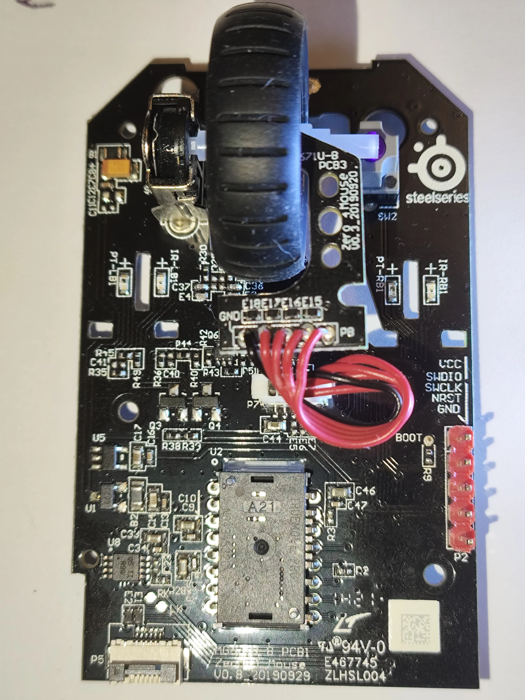
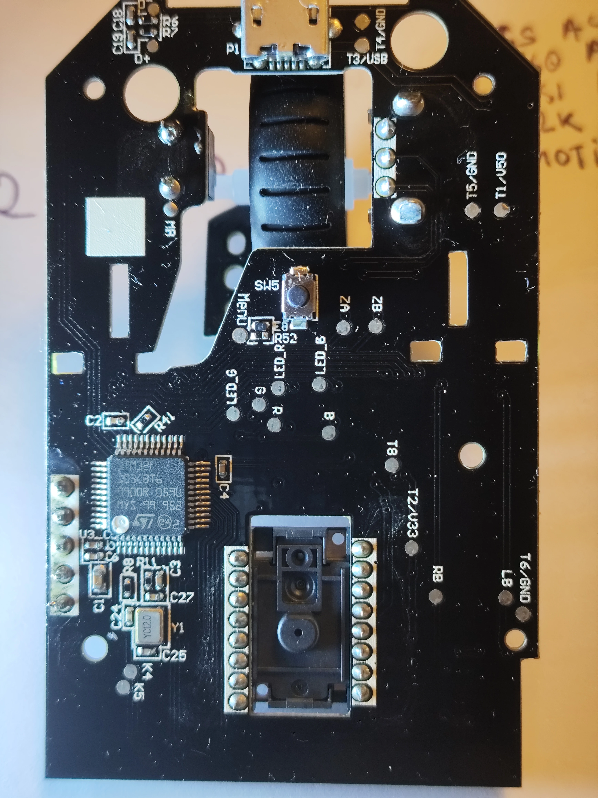

# SteelSeries Prime — QMK Mouse Liberation

<div class="spec-badges">
  <span class="spec-badge spec-badge--status">Difficulty: Medium (Soldering + SWD)</span>
  <span class="spec-badge">STM32F103C8T6</span>
  <span class="spec-badge">PixArt PMW3389 (TrueMove Pro)</span>
  <span class="spec-badge">6 Buttons + RGB Wheel</span>
  <span class="spec-badge">UF2 Bootloader + QMK</span>
</div>

{ loading=lazy }

The wired [SteelSeries Prime](https://steelseries.com/gaming-mice/prime) is an affordable, lightweight gaming mouse (picked up from a local discounter, B&M, for £15) built around an **`STM32F103C8T6`** microcontroller, a **TrueMove Pro** optical sensor (compatible with QMK's PixArt `PMW3389` driver), 6 buttons, and an RGB scroll wheel LED.

Because the fancier **Prime+** shares the same MCU and optical sensor and was already ported to QMK by **Dasky**, adapting the standard Prime was straightforward. Converting it requires opening the shell, soldering a 5-pin SWD header, unlocking flash protection via `openocd`, and flashing a UF2 bootloader.

## Internal PCBs { #pcbs }

<div class="image-grid" markdown>
{ loading=lazy }
{ loading=lazy }
</div>

## Required Tools { #tools }

* **Screwdrivers**: `PH0` (for internal PCB screws) and `TX6` Torx (for external case screws beneath the skates)
* **SWD Programmer**: `ST-Link v2` (an inexpensive clone from RobotDyn/AliExpress works fine)
* **Soldering Gear**: Soldering iron, 5-pin $2.54\text{ mm}$ pitch header strip, and 3–4 female-to-female DuPont jumper wires

## Teardown & Preparation { #prep }

1. **Remove PTFE Skates**: Carefully peel back the glued PTFE feet covering the bottom screws so they can be reused after reassembly (or keep replacement skates on hand).
2. **Open the Shell**: Unscrew the 4 external case screws using the `TX6` driver.
3. **Disconnect Ribbon Cable**: Gently separate the top shell and release the internal ribbon cable using its zero-insertion-force latch lever.
4. **Remove Internal PCB**: Unscrew the 2 main PCB screws plus the 2 additional screws next to the scroll wheel (`PH0`). Lift the PCB out of the lower housing (don't worry if the small plastic alignment prong on the side of the PCB snaps).
5. **Solder SWD Header**: Clear any factory solder from the 5 through-holes on the SWD header footprint and solder the $2.54\text{ mm}$ pin header in place.

## Flashing the UF2 Bootloader { #bootloader }

1. **Wire ST-Link to the Mouse PCB**:
    * If powering the mouse via its USB cable, connect 3 DuPont wires: `GND`, `SWCLK`, and `SWDIO`.
    * If powering directly from the ST-Link, connect a 4th wire for `VCC` ($3.3\text{ V}$).
2. **Download or Build the Bootloader**:
    * **Prebuilt Binary**: [:material-download: `firmware/uf2boot_prime.bin`](https://gitlab.com/m-lego/m65/-/blob/devel/firmware/uf2boot_prime.bin)
    * **Build from Source**: Clone [`daskygit/uf2-prime-plus`](https://github.com/daskygit/uf2-prime-plus), apply the patch below to rename the USB volume/product labels for the standard Prime, and build target `PRIME_PLUS`:

    ```diff
    diff --git a/libopencm3/Makefile b/libopencm3/Makefile
    index d93efeac..d5c2e4d6 100644
    --- a/libopencm3/Makefile
    +++ b/libopencm3/Makefile
    @@ -59,7 +59,7 @@ build: lib
      LIB_DIRS:=$(wildcard $(addprefix lib/,$(TARGETS)))
      $(LIB_DIRS): $(IRQ_DEFN_FILES:=.genhdr)
             @printf "  BUILD   $@\n";
    -       $(Q)$(MAKE) --directory=$@ SRCLIBDIR="$(SRCLIBDIR)"
    +       $(Q)$(MAKE) --directory=$@ SRCLIBDIR=$(SRCLIBDIR)

      lib: $(LIB_DIRS)
             $(Q)true
    diff --git a/src/stm32f103/prime_plus/config.h b/src/stm32f103/prime_plus/config.h
    index d7c2b50..6fe0eb7 100644
    --- a/src/stm32f103/prime_plus/config.h
    +++ b/src/stm32f103/prime_plus/config.h
    @@ -49,11 +49,11 @@
      #define UF2_FAMILY 0x5ee21072

      #undef VOLUME_LABEL
    -#define VOLUME_LABEL "PRIMEPLUS"
    +#define VOLUME_LABEL "PRIME"
      #undef PRODUCT_NAME
    -#define PRODUCT_NAME "SteelSeries Prime+"
    +#define PRODUCT_NAME "SteelSeries Prime"
      #undef BOARD_ID
    -#define BOARD_ID "steelseries-prime-plus"
    +#define BOARD_ID "steelseries-prime"
    ```

3. **Remove `STM32F103` Write Protection**:
    Using `openocd` (or STM32CubeProgrammer):

    ```sh
    openocd -f interface/stlink.cfg -f target/stm32f1x.cfg \
      -c "init; reset halt; stm32f1x unlock 0; flash protect 0 0 last off; reset halt; exit"
    ```

4. **Flash the UF2 Bootloader**:

    ```sh
    openocd -f interface/stlink.cfg -f target/stm32f1x.cfg \
      -c "program uf2boot.bin verify reset exit 0x8000000"
    ```

5. **Reassemble**: Disconnect power and remove the ST-Link jumper wires, then reassemble the PCB, ribbon cable, shell, and skates.

## QMK Firmware { #firmware }

1. **Enter UF2 Bootloader Mode**: Hold down the **underside CPI button** while plugging in the USB cable. A removable USB mass-storage drive (`PRIME`) will mount on your computer.
2. **Flash QMK**:
    * **Prebuilt UF2**: Download [:material-download: `firmware/steelseries_prime_default.uf2`](https://gitlab.com/m-lego/m65/-/blob/devel/firmware/steelseries_prime_default.uf2) and copy it onto the mounted drive.
    * **Compile from Source**:

    ```bash
    git clone --recurse-submodules -b mlego_dev https://github.com/alinelena/qmk_firmware.git qmk-alin
    cd qmk-alin
    qmk compile -kb steelseries/prime -km default
    qmk flash -kb steelseries/prime -km default
    ```
