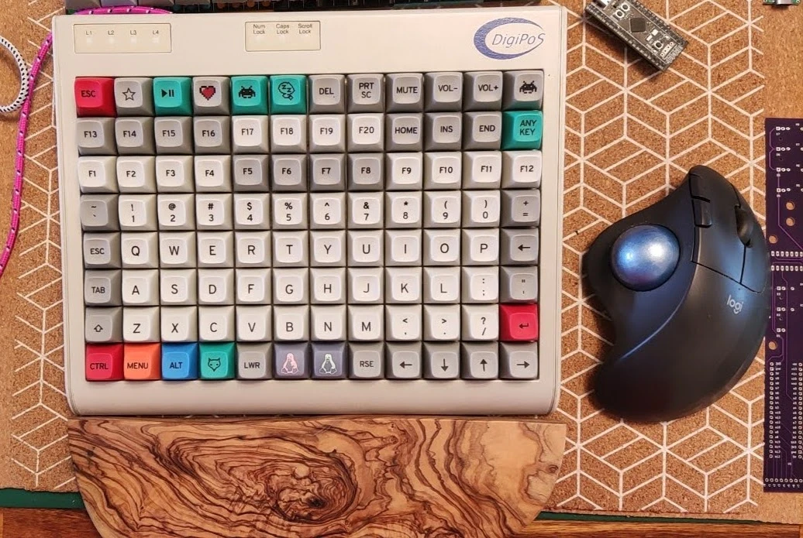
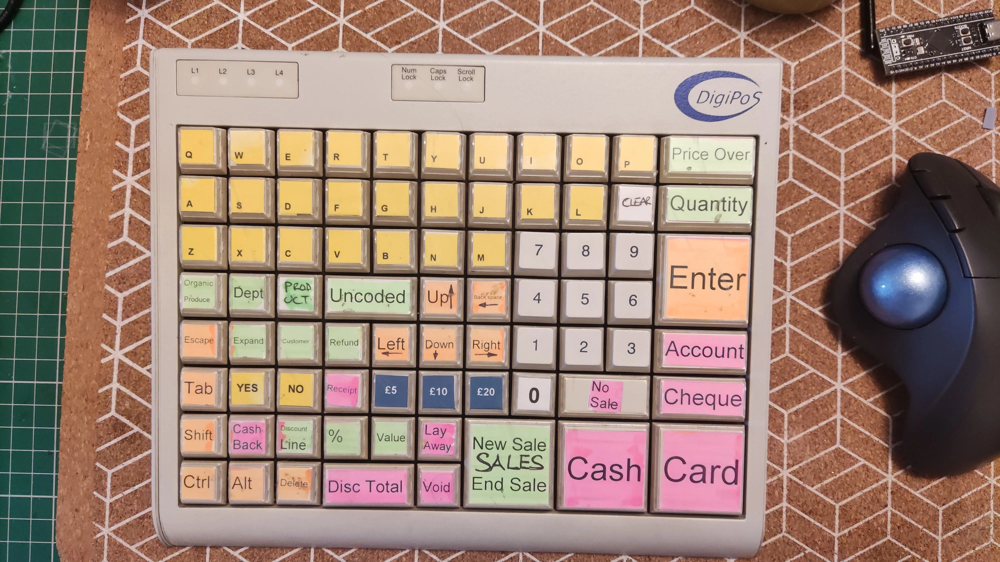
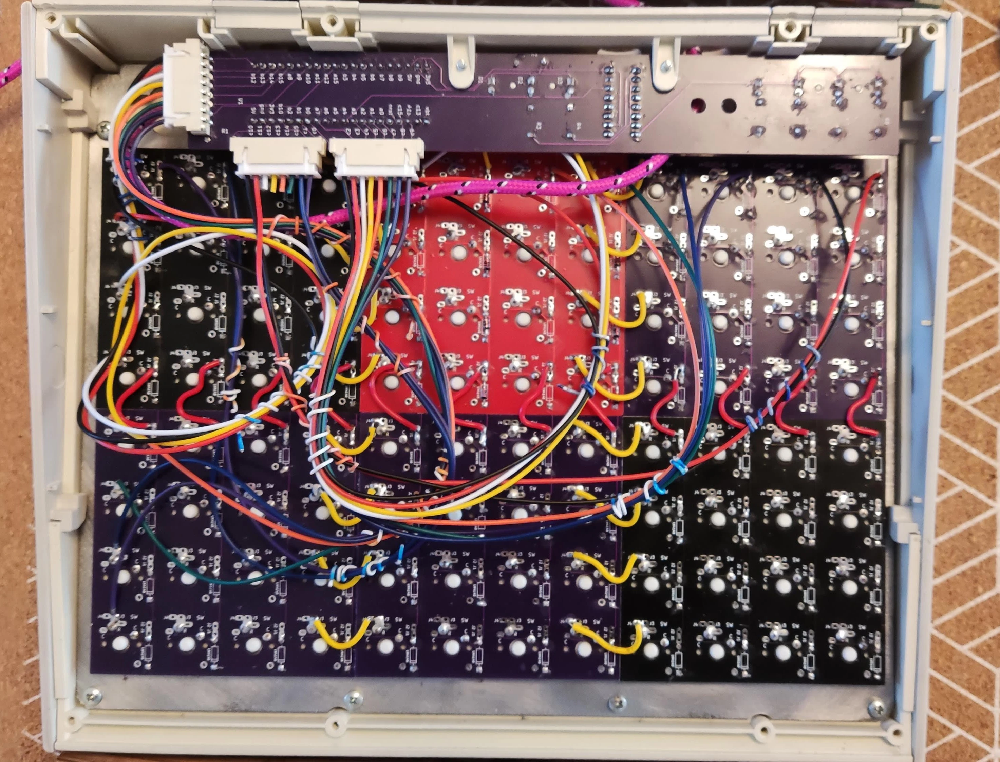

# Tipro 8×12 — 96-Key POS Terminal Conversion

<div class="spec-badges">
  <span class="spec-badge spec-badge--status">Status: Completed</span>
  <span class="spec-badge">8×12 Ortho (96 Keys)</span>
  <span class="spec-badge">WeAct STM32F401 Daughterboard</span>
  <span class="spec-badge">74HC595 Status LEDs</span>
  <span class="spec-badge">QMK</span>
</div>

{ loading=lazy }

## Introduction { #introduction }

A compact **96-key (8×12)** Tipro mechanical point-of-sale terminal converted to run **QMK Firmware**.

## Daughterboard PCB { #pcb }

Uses the same custom `STM32F401` + `74HC595` daughterboard PCB designed for the [Tipro 8×16 conversion](tipro8x16.md#pcb).

## Firmware { #firmware }

* **Prebuilt UF2**: [:material-download: `tipro_rev2_default_96.uf2`](https://gitlab.com/m-lego/hand8x16/-/blob/develop/firmware/tipro_rev2_default_96.uf2)

Compile from source:

```bash
git clone --recurse-submodules -b mlego https://github.com/alinelena/qmk_firmware.git qmk-alin
cd qmk-alin
qmk compile -kb tipro/rev2 -km default_96
```

Copy the resulting `.uf2` file onto the MCU in bootloader mode.

## Pinout Reference { #pins }

* **Columns**: `B9`, `B8`, `B7`, `B6`, `B5`, `B4`, `C14`, `C15`, `A0`, `A1`, `A2`, `A3`, `A7`, `B0`, `B10`, `B1`
* **Rows**: `B12`, `B13`, `B14`, `B15`, `A8`, `A10`, `A15`, `B3`
* **Status LEDs**: Shift Register `QA`–`QG`
* **`74HC595N` Shift Register**:
    * `Data`: `A4`
    * `Latch`: `A6`
    * `Clock`: `A5`

## Before & Inside Gallery { #pictures }

<div class="image-grid" markdown>
{ loading=lazy }
{ loading=lazy }
</div>
