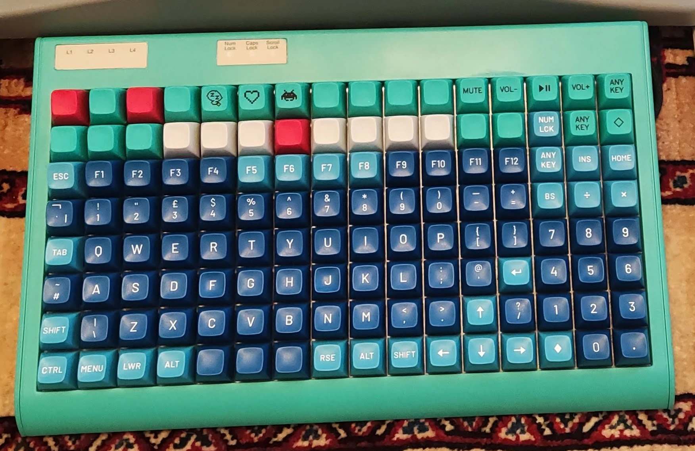
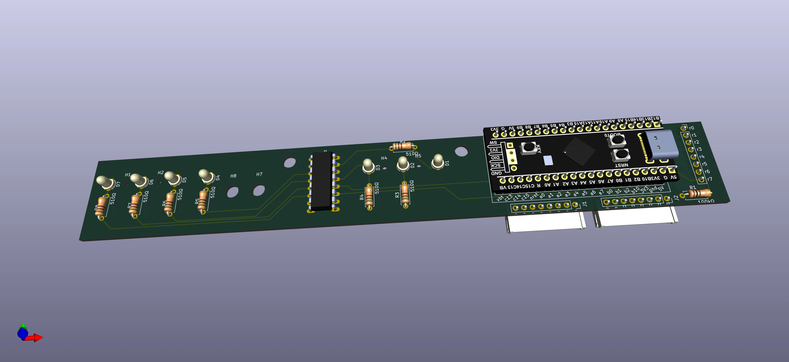
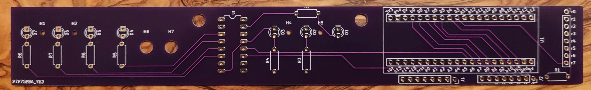
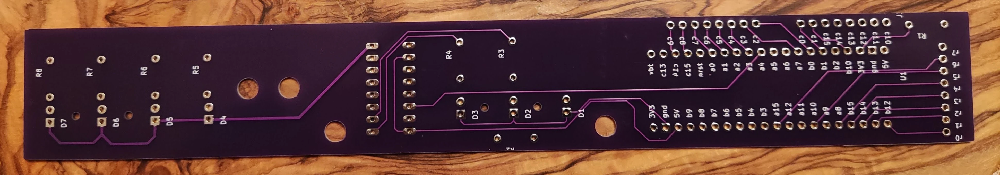
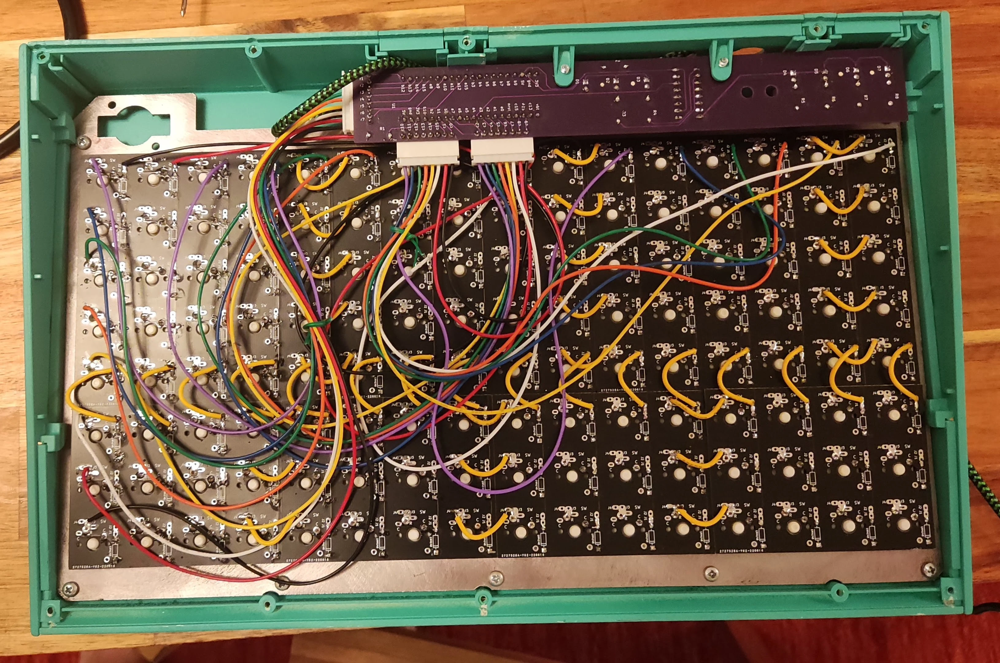
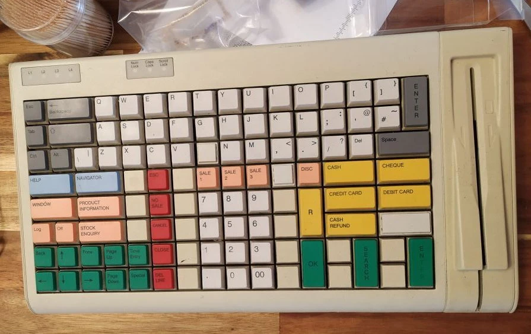
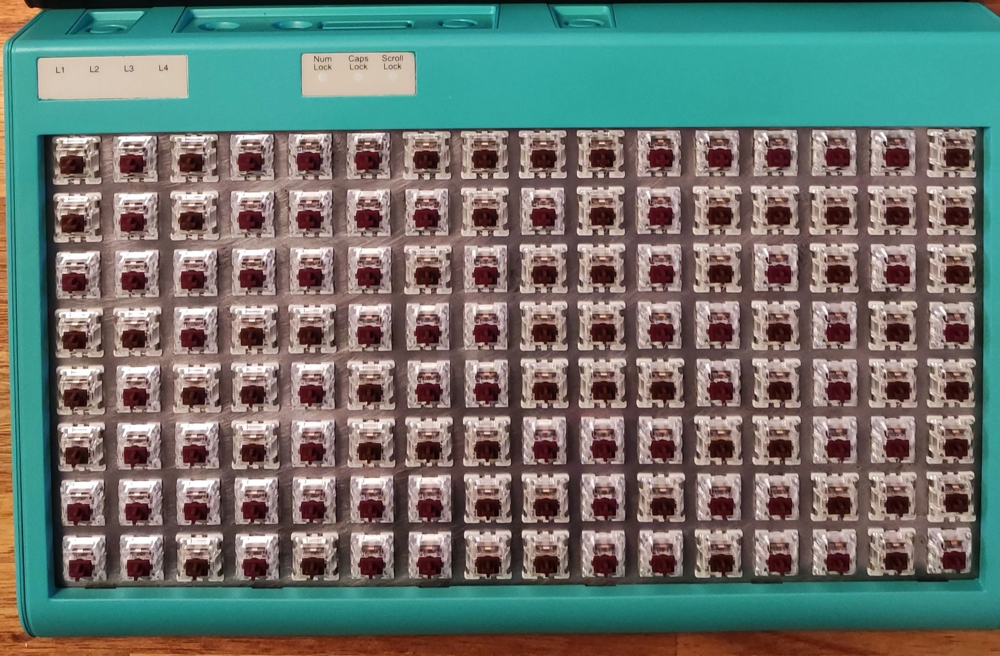

# Tipro 8×16 — 128-Key POS Terminal Conversion

<div class="spec-badges">
  <span class="spec-badge spec-badge--status">Status: Completed (~£10 Conversion)</span>
  <span class="spec-badge">8×16 Ortho (128 Keys)</span>
  <span class="spec-badge">WeAct STM32F401 Daughterboard</span>
  <span class="spec-badge">74HC595 Status LEDs</span>
  <span class="spec-badge">QMK</span>
</div>

{ loading=lazy }

## Introduction { #introduction }

A vintage **Tipro 8×16 (128-key)** mechanical point-of-sale terminal converted to run **QMK Firmware** using a custom daughterboard PCB (`hand8x16`).

Sourced from eBay (some new-old-stock after ~15 years, others heavily worn), the painted steel switch plate was stripped and polished to remove aged paint, and the yellowed plastic shell was repainted. The original 3-pin Cherry MX Black switches were desoldered and replaced, topped with a combination of **MT3 Dasher** and **MT3 `/dev/tty`** keycaps.

The custom controller PCB hosts a WeAct **`STM32F401` BlackPill** and uses a **`74HC595` shift register** to drive the 7 status LEDs once the 24 matrix pins (`8 rows + 16 columns`) are allocated. Total conversion cost (excluding switches/keycaps) is around **£10**.

## Daughterboard PCB { #pcb }

=== "3D Render"

    { loading=lazy }

=== "Printed PCBs"

    <div class="image-grid" markdown>
    { loading=lazy }
    { loading=lazy }
    </div>

## Wiring & KiCad { #wiring }

{ loading=lazy }

* **KiCad Daughterboard Project**: [`m-lego/hand8x16` on GitLab](https://gitlab.com/m-lego/hand8x16/)

## Firmware { #firmware }

* **Prebuilt UF2**: [:material-download: `tipro_rev1_default.uf2`](https://gitlab.com/m-lego/hand8x16/-/blob/develop/firmware/tipro_rev1_default.uf2)

Compile from source:

```bash
git clone --recurse-submodules -b mlego https://github.com/alinelena/qmk_firmware.git qmk-alin
cd qmk-alin
qmk compile -kb tipro/rev1 -km default
```

Copy the resulting `.uf2` file onto the MCU in bootloader mode.

## Pinout Reference { #pins }

* **Columns (16)**: `B9`, `B8`, `B7`, `B6`, `B5`, `B4`, `C14`, `C15`, `A0`, `A1`, `A2`, `A3`, `A7`, `B0`, `B10`, `B1`
* **Rows (8)**: `B12`, `B13`, `B14`, `B15`, `A8`, `A10`, `A15`, `B3`
* **Status LEDs**: Shift Register `QA`–`QG`
* **`74HC595N` Shift Register**:
    * `Data`: `A4`
    * `Latch`: `A6`
    * `Clock`: `A5`

## Before & After Gallery { #pictures }

<div class="image-grid" markdown>
{ loading=lazy }
{ loading=lazy }
</div>
