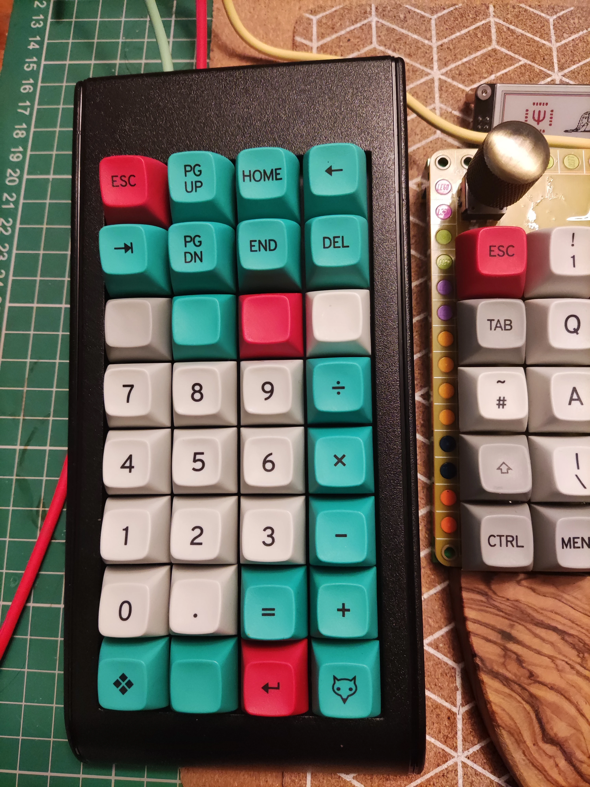
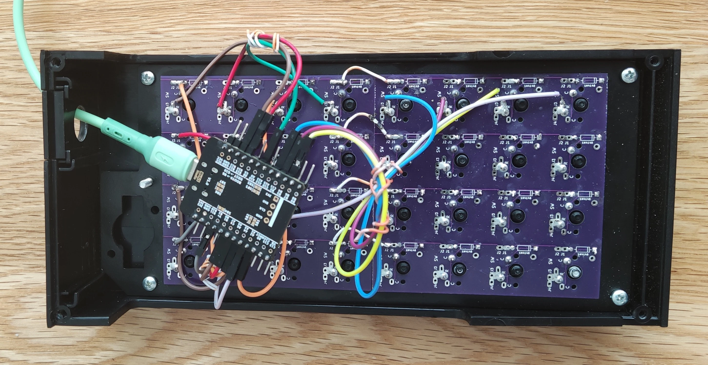
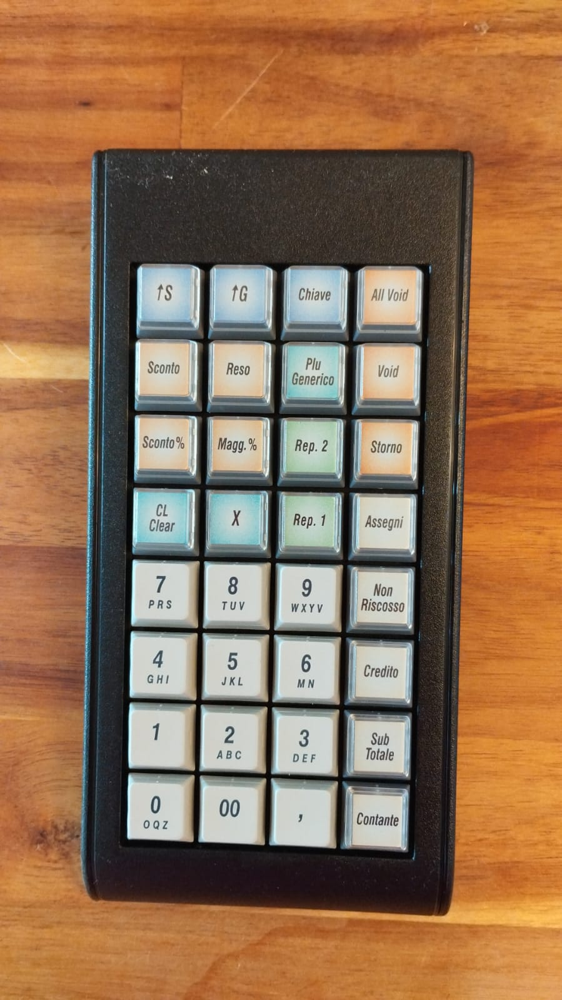

# Tipro 8×4 — 32-Key POS Keypad Conversion

  Status: Completed
  8×4 Ortho (32 Keys)
  WeAct STM32G431 CoreBoard
  QMK

{ loading=lazy }

## Introduction { #introduction }

A 32-key **Tipro 8×4** mechanical keypad module converted to QMK using a direct-wired **WeAct `STM32G431`** controller board.

## Internal Wiring & MCU { #wiring }

{ loading=lazy }

* **Microcontroller**: [WeAct `STM32G431` CoreBoard](https://github.com/WeActStudio/WeActStudio.STM32G431CoreBoard) ([AliExpress reference](https://www.aliexpress.com/item/1005005303669884.html))

## Firmware { #firmware }

Prebuilt firmware can be downloaded from [GitHub Actions (`qmk_firmware`)](https://github.com/alinelena/qmk_firmware/actions/workflows/build.yml) — navigate to the **build firmware for mlego** workflow, select the latest successful run, and download **`tipro32_default`** from the artifacts list.

## Original Condition { #pictures }

{ loading=lazy }
