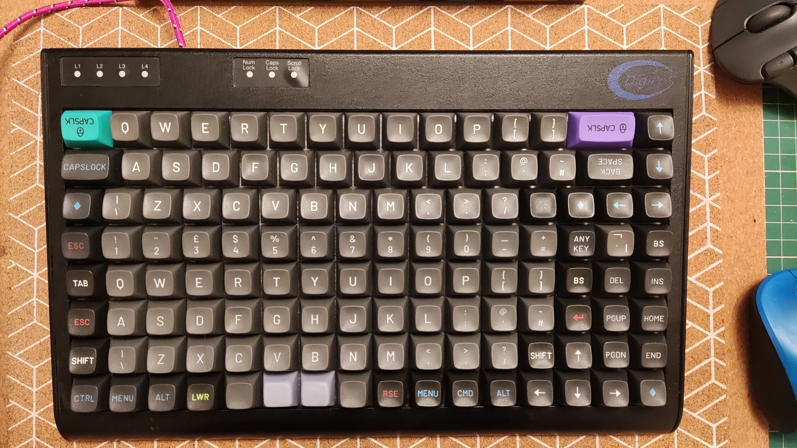
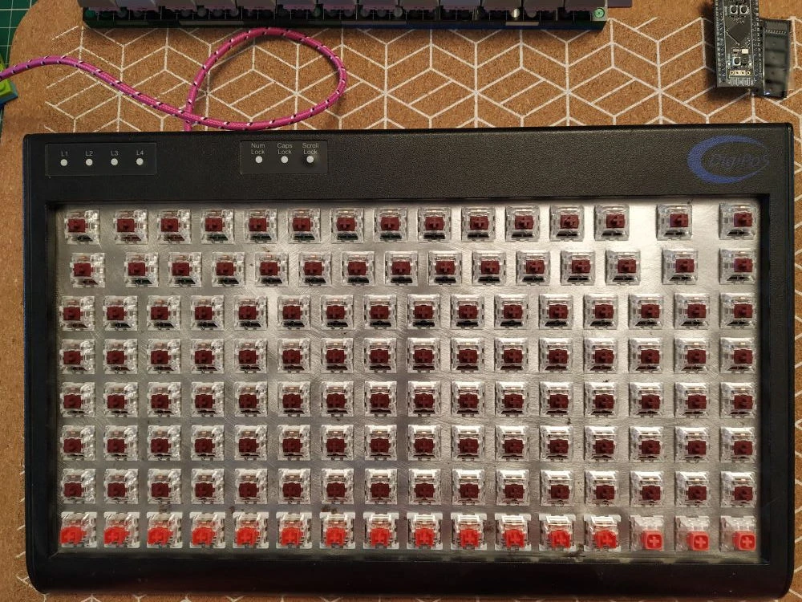
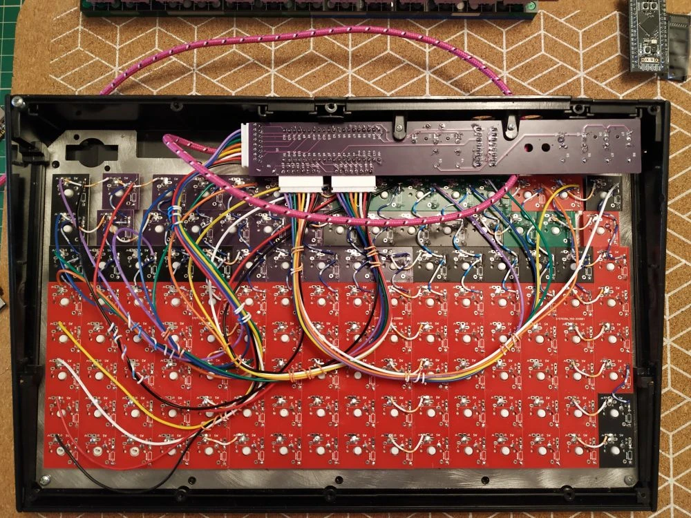
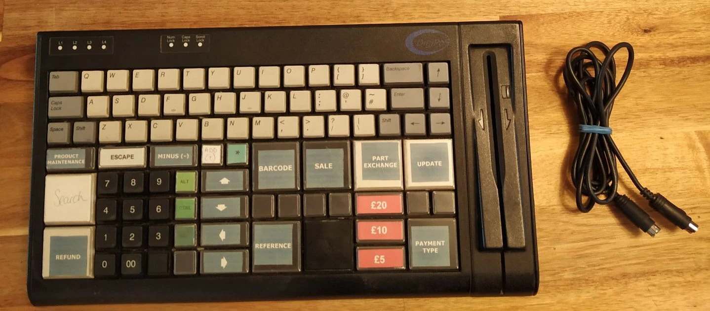

# Tipro ANSI-Ortho — Hybrid POS Conversion

<div class="spec-badges">
  <span class="spec-badge spec-badge--status">Status: Completed</span>
  <span class="spec-badge">Hybrid ANSI + Ortholinear</span>
  <span class="spec-badge">WeAct STM32F401 Daughterboard</span>
  <span class="spec-badge">QMK</span>
</div>

<div class="image-grid" markdown>
{ loading=lazy }
{ loading=lazy }
</div>

## Introduction { #introduction }

A hybrid **ANSI staggered + ortholinear** Tipro terminal converted to run **QMK Firmware** using the same `STM32F401` + `74HC595` daughterboard technique described in the [Tipro 8×16 guide](tipro8x16.md).

## Internal Wiring & KiCad { #wiring }

{ loading=lazy }

* **KiCad Daughterboard Project**: [`m-lego/hand8x16` on GitLab](https://gitlab.com/m-lego/hand8x16/)

## Firmware { #firmware }

* **Prebuilt UF2**: [:material-download: `tipro_rev1_default_ansiortho.uf2`](https://gitlab.com/m-lego/hand8x16/-/blob/develop/firmware/tipro_rev1_default_ansiortho.uf2)

Compile from source:

```bash
git clone --recurse-submodules -b mlego https://github.com/alinelena/qmk_firmware.git qmk-alin
cd qmk-alin
qmk compile -kb tipro/rev1 -km default_ansiortho
```

## Pinout Reference { #pins }

Identical to the [Tipro 8×16 pinout](tipro8x16.md#pins).

## Original Condition { #photos }

{ loading=lazy }
