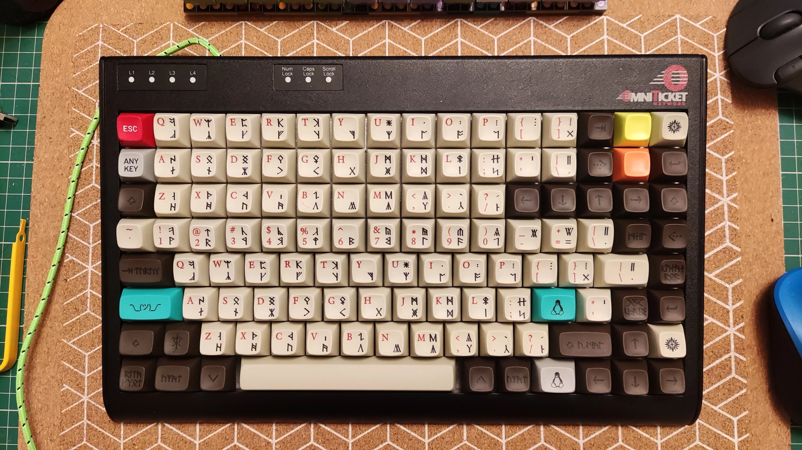
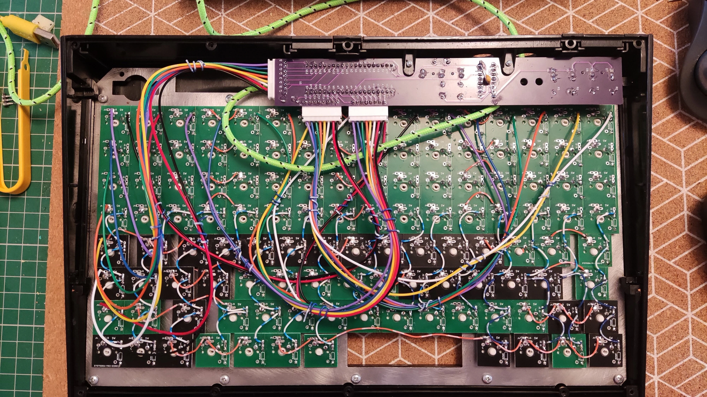
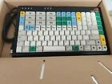
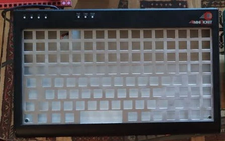
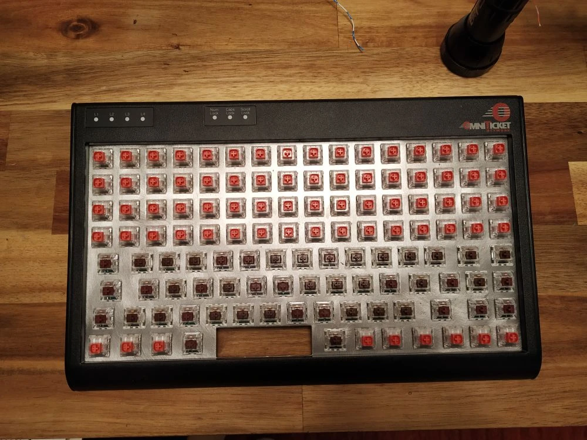

# Tipro Ortho-ANSI — Hybrid POS Conversion

  Hybrid Ortholinear + ANSI
  WeAct STM32F401 Daughterboard
  QMK

{ loading=lazy }

## Introduction { #introduction }

A hybrid **ortholinear + ANSI staggered** Tipro point-of-sale keyboard converted to **QMK Firmware** using the shared `hand8x16` daughterboard PCB from the [Tipro 8×16 conversion](tipro8x16.md).

## Internal Wiring { #wiring }

{ loading=lazy }

## Restoration Progress Gallery { #other-pictures }

=== "1. Original Terminal"

    { loading=lazy }

=== "2. Stripped & Cleaned"

    { loading=lazy }

=== "3. New Switches Mounted"

    { loading=lazy }
